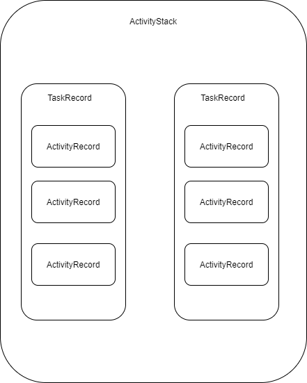

## 1 AMS 家族

在 Android 系统启动、应用程序进程启动过程以及四大组件工作过程都设计到一个非常重要的概念 AMS。AMS是Android中最核心的服务之一，AMS 并不是单打独斗，而是以家族形式，相互配合完成工作。

在 Activity 的启动过程中会调用 Instrumentation 的 execStartActivity 方法。

```java
public Activity execStartActivity(...){
    try {
        ..
            
            
        //调用 ActivityManager#getService() 
        int result = ActivityManager.getService().startActivity(...)    
    }
}
```

接下来看看 ActivityManager#getService()。

```java
public static IActivityManager getService() {
    return IActivityManagerSingleton.get()    
}


 private static final Singleton<IActivityManager> IActivityManagerSingleton =
            new Singleton<IActivityManager>() {
                @Override
                protected IActivityManager create() {
                    //得到名为 activity 的 service 引用 -> IBinder 类型的 AMS 引用。
                    final IBinder b = ServiceManager.getService(Context.ACTIVITY_SERVICE);
                    //转换为 IActivityManager   这几段代码其实就是典型的 AIDL 应用
                    final IActivityManager am = IActivityManager.Stub.asInterface(b);
                    return am;
                }
            };

```

## 2 AMS 启动

### 2.1 SystemServer#main ()

AMS 启动在 SystemServer 的 main 方法中。

```java
public static void main(String[] args) {
     //调用 run 方法
     new SystemServer().run();
}

private void run() {
     try {
         //创建消息 Looper
        Looper.prepareMainLooper();

        //加载 libandroid.so
        System.loadLibrary("android_servers");
        ...
        //创建 SystemServiceManager 对系统服务进行管理   
        mSystemServiceManager = new SystemServiceManager(mSystemContext);
        mSystemServiceManager.setRuntimeRestarted(mRuntimeRestart);
        LocalServices.addService(SystemServiceManager.class, mSystemServiceManager);
            
        SystemServerInitThreadPool.get();
        } finally {
           ...
        }
        try {
          //启动引导服务  AMS、PMS等
          startBootstrapServices();
          //启动核心服务  
          startCoreServices();
          //启动其他服务  
          startOtherServices();
          SystemServerInitThreadPool.shutdown();
        }
     }
}
```

### 2.2 SystemServer#startBootstrapServices()

接下来我们看看 startBootstrapServices()

```java
private void startBootstrapServices() {
    ...
    //调用 SystemServiceManager#startService() 参数是 ActivityManagerService.Lifecycle.class   
    mActivityManagerService = mSystemServiceManager.startService(
                ActivityManagerService.Lifecycle.class).getService();
    ....
    
}
```

### 2.3 SystemServiceManager#startService()

```java
public void startService(@NonNull final SystemService service) {
       //添加到 ArrayList 中
       mServices.add(service);
       //启动
       long time = System.currentTimeMillis();
       try {
            service.onStart();
        } catch (RuntimeException ex) {
           ...
       }
       ...
}
```

 ActivityManagerService.Lifecycle 是 ActivityManagerService 内部类，代码如下：

```java
public static final class Lifecycle extends SystemService {
        private final ActivityManagerService mService;
        public Lifecycle(Context context) {
            super(context);
            //创建 AMS
            mService = new ActivityManagerService(context);
        }

        @Override
        public void onStart() {
            mService.start();
        }

        public ActivityManagerService getService() {
            return mService;
        }
}
```

## 3 Activity 栈

* ActivityRecord：即 Activity 在 Activity 栈中的存储形式，包含了一个 **Activity 所有的信息**，存放于 TaskRecord 中的 ArrayList
* TaskRecord：任务栈、Task栈，存放于 ActivityStack 中的 ArrayList，内部存储任务栈的所有信息，例如 任务ID、所在的 ActivityStack 等。
* ActivityStack：管理类，用来管理**系统中的所有 Activity**，内部维护 Activity 所有状态、特殊状态的 Activity 以及和 Activity 相关的列表等数据，由 ActivityStackSupervisor 管理的。

总结：

* AMS 初始化时创建一个 ActivityStackSupervisor 对象（ 创建和管理 Android 系统中所有应用的 ActivityStack）
* 一个 ActivityStack 对应和包含一个应用所启动的所有 Activity。
* 一个 ActivityStack 包含一或多个TaskRecord；
* 一个TaskRecord 包含一到多个 ActivityRecord（包含Activity所有信息）。

> 2025 更新：上面是 Android 9/10 时代的 ActivityStack/TaskRecord 模型。Android 10 起，Activity/Task 管理已拆到 `ActivityTaskManagerService`（ATMS），`ActivityStack`、`TaskRecord`、`ActivityStackSupervisor` 被 `Task`、`TaskFragment`、`ActivityTaskSupervisor` 等取代；阅读老源码时不要把类名直接套到新版本上。



## 4 Launch Mode

* standard：标准模式（默认模式），每启动 Activity 都会创建一个新的 Activity 实例，加入到栈中。
* singleTop：如果在任务的栈顶正好存在该Activity的实例，就重用该实例，会调用 onNewIntent() ，否则就会创建新的实例并放入栈顶。适合接收通知启动的内容显示页面。
* singleTask：如果在栈中已经有该 Activity 的实例，就重用该实例，调用 onNewIntent() 。并且上面的实例将会被移出栈。如果栈中不存在该实例，将会创建新的实例放入栈中。适合作为程序入口点，例如浏览器的主界面
* singleInstance：和 singleTask 类型，但是启动时会创建一个新栈，新栈中只有当前的 Activity。适合需要与程序分离开的页面。例如闹铃提醒，将闹铃提醒与闹铃设置分离。

## 5 Intent 的 Flag

FLAG_ACTIVITY_NEW_TASK :对应singleTask启动模式，其效果和在XML中指定该启动模式相同；

> 2025 更新：`FLAG_ACTIVITY_NEW_TASK` 并不等同于 `singleTask`。它表示“在目标任务/新任务中启动”，是否复用已有实例还取决于 `launchMode`、`taskAffinity`、`FLAG_ACTIVITY_CLEAR_TOP` 等；把两者画等号是常见面试误区。

FLAG_ACTIVITY_SINGLE_TOP :对应singleTop启动模式，其效果和在XML中指定该启动模式相同；

FLAG_ACTIVITY_CLEAR_TOP :启动时，在同一个任务栈中所有位于它上面的 Activity 都要出栈。一般会和 singleTask模式一起出现。

FLAG_ACTIVITY_EXCLUDE_FROM_RECENTS : Activity 不会出现在历史 Activity 列表中；

## 6 taskAffinity

在 配置文件中设置 android:taskAffinity ,指定 Activity 的栈，默认情况下，同一个应用 Activity 有相同的 taskAffinity，要使 taskAffinity 产生效果，需要如下情况：

* 与 FLAG_ACTIVITY_NEW_TASK 或 singleTask 配合使用
* 与 allowTaskReparenting 配合，android:allowTaskReparenting="true"，说明 Activity 有转移能力。
## 7 Android 12—16 的变化与面试追问

> 2025 更新：前文源码框架来自 Android 9/10 时代。Android 10 起 AMS 已把 Activity/Task 管理拆到 ATMS，本节按 Android 12—16（API 31—36）梳理行为变化；具体类名和默认值以对应 AOSP 分支、官方 Behavior changes 文档为准。

### 7.1 先厘清 ATMS 与 AMS 的分工

Android 10 起，SystemServer 先启动 `ActivityTaskManagerService`（ATMS），再把 ATMS 注入 AMS。两者都驻留 system_server，但职责已经分开：

* ATMS：Activity 启动、Task/TaskFragment、多窗口、`ActivityTaskSupervisor`、`RootWindowContainer` 等任务与窗口层级相关逻辑，客户端入口是 `ActivityTaskManager.getService()`（`IActivityTaskManager`）。
* AMS：进程管理（`ProcessList`/`OomAdjuster`）、Service、Broadcast、ContentProvider、ANR、权限与 app 生命周期，客户端入口仍是 `ActivityManager.getService()`（`IActivityManager`）。
* 老代码里的 `ActivityStack`、`TaskRecord`、`ActivityStackSupervisor` 已被 `Task`、`TaskFragment`、`ActivityTaskSupervisor` 取代；`ActivityRecord` 仍然存在，但挂在新的 WindowContainer 树里。

这样拆的核心原因是：Activity/Task 越来越依赖 WMS 的窗口层级和多窗口能力，把任务管理与窗口容器放在一起，才能支撑分屏、自由窗口、大屏和过渡动画；AMS 则专注进程与组件生命周期。面试时不要把“AMS 启动 Activity”说成一条 Binder 直达的旧链路，现代入口先是 ATMS。

### 7.2 后台启动 Activity：从“不推荐”到“默认拒绝”

| 版本 | 关键收紧点 |
| --- | --- |
| Android 10 | 首次系统化限制后台启动 Activity：没有可见窗口、没有近期任务、没有特殊豁免的进程，`startActivity()` 可能被直接取消。 |
| Android 12 | 限制“通知 trampoline”：用户点通知时，应用不能先用 Service/BroadcastReceiver 中转再启动 Activity，`PendingIntent` 应直接指向 Activity；同时 target 31 要求 `PendingIntent` 显式声明可变性（`FLAG_IMMUTABLE`/`FLAG_MUTABLE`）。 |
| Android 13 | 没有放开 BAL；`POST_NOTIFICATIONS` 变成运行时权限，通知/FGS 路径更依赖用户授权，后台进程更不能靠“弹一个 Activity”刷存在感。 |
| Android 14 | `SYSTEM_ALERT_WINDOW` 不再是无条件豁免，应用必须处于可见状态等条件；`PendingIntent` 创建者/发送方可通过 `ActivityOptions` 的 `setPendingIntentCreatorBackgroundActivityStartMode()` / `setPendingIntentBackgroundActivityStartMode()` 显式表达是否允许后台启动。 |
| Android 15 | 在 API 34 的 ALLOWED/DENIED 之外增加 `ALLOW_IF_VISIBLE` 语义：只有创建者/发送者可见时才允许，进一步压缩“借 PendingIntent 偷跑”的空间。 |
| Android 16 | 延续 14/15 的模型，没有恢复后台任意启动；适配重点转向大屏、edge-to-edge 和预测性返回。厂商/版本若追加限制，以官方 behavior-changes-16 为准。 |

几个容易踩错的点：

* 被拦截时 `startActivity()` 不一定抛异常，可能只是返回失败或在 log 中留下 `Background activity start ...`，所以不能用“没崩”判断启动成功。
* 通知点击的正确姿势是 `PendingIntent.getActivity()` 直接指向目标 Activity；用广播/Service 中转在 Android 12 起会被限制。
* `SYSTEM_ALERT_WINDOW` 不是万能钥匙；Android 14 起即使有悬浮窗权限，后台启动仍要满足可见性等条件。
* 真正的后台任务应使用通知、FGS、WorkManager/JobScheduler 或用户主动交互，而不是拉起一个 Activity。

### 7.3 FGS 与 AMS：5 秒、类型、超时

FGS 的日常管理主要落在 AMS 内部的 `ActiveServices`（`ServiceRecord`、`startServiceLocked()`、`bringUpServiceLocked()`、`realStartServiceLocked()`），但优先级提升、ANR 判定、进程 adj 仍由 AMS 统一协调。面试可以抓住三条主线：

1. **5 秒规则**：`Context.startForegroundService()` 启动后，应用必须在 5 秒内调用 `Service.startForeground()`；否则系统会抛 `RemoteServiceException`/触发 ANR（不同版本表现略有差异）。`startForegroundService()` 不是“免死金牌”，只是给后台启动 Service 开了一个必须尽快转前台的窗口。
2. **Android 12 的后台启动限制**：从后台启动 FGS 可能抛 `ForegroundServiceStartNotAllowedException`；可见应用、高优先级 FCM、精确闹钟等属于豁免场景，但豁免不是通用的。
3. **Android 14 的类型强制**：target 34 必须在 manifest 声明 `android:foregroundServiceType`，并在 `startForeground(id, notification, type)` 传入类型；缺失会抛 `MissingForegroundServiceTypeException`。类型还对应 `FOREGROUND_SERVICE_*` 权限，例如 `dataSync` 需要 `FOREGROUND_SERVICE_DATA_SYNC`。

```xml
<service
    android:name=".SyncService"
    android:foregroundServiceType="dataSync"
    android:exported="false" />
```

```kotlin
class SyncService : Service() {
    override fun onStartCommand(intent: Intent?, flags: Int, startId: Int): Int {
        startForeground(
            NOTIFICATION_ID,
            buildNotification(),
            ServiceInfo.FOREGROUND_SERVICE_TYPE_DATA_SYNC
        )
        return START_NOT_STICKY
    }

    // Android 15（API 35）起，dataSync/mediaProcessing 超时会回调这里
    override fun onTimeout(startId: Int, fgsType: Int) {
        stopSelf(startId)
    }
}
```

Android 15 对 target 35 的 `dataSync` 和 `mediaProcessing` 增加了时长上限：在 24 小时窗口内累计约 6 小时，达到上限后系统回调 `Service.onTimeout(startId, fgsType)`。应用必须主动 `stopSelf()`/`stopForeground()`；如果继续赖着不走，系统会抛 `ForegroundServiceDidNotStopInTimeException`（或按 ANR 处理）。此外，Android 15 对从 `BOOT_COMPLETED` 启动某些 FGS 类型也做了限制，开机自启的同步服务要特别小心。

Android 16 延续类型 + 超时 + 后台启动限制这套框架。适配时优先检查：类型是否与真实用途一致、是否声明了对应权限、超时回调是否止损、通知是否在 Android 13+ 获得 `POST_NOTIFICATIONS`（没有权限时 FGS 仍受管理，但通知展示会受影响）。

### 7.4 进程优先级、LMK/lmkd 与进程冻结

现代 AMS 里，进程优先级主要由 `OomAdjuster` 计算，`ProcessList` 保存常量并写入 `/proc/<pid>/oom_score_adj`；`ActivityManager.RunningAppProcessInfo.importance` 是给应用看的另一套映射，两者不要混为一谈。

* `oom_adj` 是旧接口，现代内核使用 `oom_score_adj`（范围约 -1000～1000）；AMS 里仍常说 adj，但最终落到内核的是 score。
* 真正杀进程的主要是用户态 `lmkd`（Android 9 起替代内核 lowmemorykiller，后续版本利用 PSI 等压力信号），AMS 负责算优先级和提供 kill 决策依据；厂商可能改写策略。
* Android 11 起 AOSP 引入 `CachedAppOptimizer`/进程冻结：缓存进程在后台被 freeze，停止调度以省电，而不是立刻杀死；需要时再解冻。是否默认启用取决于版本和厂商配置；冻结能保留进程状态，但被冻结进程的 Binder 事务可能被延后甚至超时，系统会按需解冻。
* FGS、可见 Activity、前台服务绑定等会提升 adj；普通缓存进程的 adj 落在 `CACHED_APP_MIN_ADJ`～`CACHED_APP_MAX_ADJ` 区间。不要把具体数值当稳定 API，面试答“等级关系和计算者”比背数字更加分。
* 应用无法直接写自己的 adj；能做的是用 FGS、绑定关系、`WakeLock`、`onTrimMemory()` 等影响系统决策。`ApplicationExitInfo`（API 30+）可以拿到 `REASON_LOW_MEMORY`、`REASON_ANR` 等退出原因，是线上排查的入口。

### 7.5 广播队列与隐式广播

AMS 长期维护前台/后台两条广播队列（`mFgBroadcastQueue`、`mBgBroadcastQueue`），分别对应前台进程和后台进程的广播分发；另有 offload 队列处理相对不重要、可延迟的广播。准确地说，前台/后台之分在 Android 8 的后台执行限制中已经存在，Android 10 以后是继续强化后台延迟与限制，而不是“10 才开始分队列”。

* 有序广播（ordered）按优先级串行分发，前一个 Receiver 可以截断；并行广播（parallel）仍走并行分发。Android 14 起 AOSP 提供 `BroadcastQueueModernImpl`，把广播按进程维度组织队列，支持按进程延迟/合并；是否启用由版本和配置决定。
* 后台队列会拉长超时、降低调度优先级，避免后台广播把前台体验拖垮；广播超时（前台约 10 秒、后台约 60 秒）会进入 ANR 流程。
* Android 8 起，manifest 静态注册的隐式广播大多被限制，常用替代是 `JobScheduler`/`WorkManager` 或动态注册；`BOOT_COMPLETED`、`LOCALE_CHANGED` 等属于例外，但 Android 14/15 又对部分场景继续收紧。
* Android 12 起 target 31 的组件若带 intent-filter，必须显式写 `android:exported`；Android 14 起 `registerReceiver()` 必须传 `RECEIVER_EXPORTED`/`RECEIVER_NOT_EXPORTED`（系统广播等例外），否则会崩。很多“升级后一启动就崩”其实是这个原因。
* `goAsync()` 只延长少量时间，不能在里面做长耗时；广播里该起 FGS 就起 FGS，该用 WorkManager 就用 WorkManager。

### 7.6 ANR：触发、AMS 流程与 traces

常见 ANR 触发点：

| 场景 | 典型超时/原因 |
| --- | --- |
| 输入事件分发 | 主线程 5 秒未处理完输入事件，log 常见 `Input dispatching timed out` |
| 广播 | 前台广播约 10 秒、后台约 60 秒未完成 `onReceive()` |
| Service | 前台 Service 约 20 秒、后台约 200 秒未完成创建/启动 |
| ContentProvider | publish 超时（约 10 秒） |
| `startForegroundService` | 5 秒内未 `startForeground()` |

现代 AOSP 中，输入超时最终进入 `inputDispatchingTimedOut` 路径，AMS 通过 `AnrHelper` 串行消费 ANR：先收集进程信息、抓取各线程栈和 CPU 使用情况，再决定弹 ANR 对话框、写 event log 还是静默处理。把 trace 抓取放到独立线程/队列，是为了避免在 AMS 锁内做重活、把 system_server 自己拖死。

* 旧版本常见 `/data/anr/traces.txt`；现代版本多为一堆 `/data/anr/anr_*` 文件，`traces.txt` 只能当历史线索。
* 常用命令：`adb shell dumpsys activity lastanr`、`adb shell dumpsys activity processes`、`adb bugreport`；`ApplicationExitInfo` 可拿到 `REASON_ANR` 和 trace 输入流。
* 分析时先看主线程栈：是等锁、Binder、IO、`Thread.sleep()`，还是消息队列被某个长任务堵住；再看是否伴随大量 GC、CPU 抢占或内存压力。
* `StrictMode` 能提前暴露主线程 IO/网络，但它不是 ANR 的完整替代；线上还要结合 Perfetto/systrace、`FrameTimeline` 和 `ApplicationExitInfo`。

### 7.7 面试追问

**Q1：AMS 为什么是 Binder 的“大户”？**

因为它是应用与 system_server 之间的总入口之一：Activity/Service/Broadcast/ContentProvider 的启动、`attachApplication`、进程死亡、ANR、权限校验都要跨 Binder；AMS 自己实现 `IActivityManager`，又持有 `IApplicationThread` 回调到应用，`ActivityThread`/`ApplicationThread` 再来回调用，形成双向 Binder。再叠加 `ActivityTaskManager`、`PackageManager`、`WindowManager` 的协作，一次 `startActivity` 往往不是一次 IPC，而是多次跨进程调用。Binder 线程池因此容易被占满，AMS 锁和 Binder 调用都要避免做重活。

**Q2：为什么后台不能启动 Activity？**

核心是防止恶意/无序弹窗抢占用户注意力，以及避免后台进程被“拉活”。Android 10 起系统默认判定后台启动不可见，只有可见窗口、近期任务、系统角色、用户主动 PendingIntent 等豁免才允许；Android 12 又堵住通知 trampoline，Android 14/15 进一步限制 `SYSTEM_ALERT_WINDOW` 和 PendingIntent。被拦截时通常静默失败，所以正确做法是发通知、用 FGS/WorkManager，或等用户点击再启动。

**Q3：FGS 超时会怎样？**

分三种：① `startForegroundService()` 后 5 秒没 `startForeground()`，会抛 `RemoteServiceException`/ANR；② Android 12 起从后台启动 FGS 可能直接抛 `ForegroundServiceStartNotAllowedException`；③ Android 15 起 `dataSync`/`mediaProcessing` 超过约 6 小时会回调 `onTimeout()`，不主动停止就抛 `ForegroundServiceDidNotStopInTimeException` 或转 ANR。适配要同时管住“启动窗口、类型声明、运行时长”三条线。

**Q4：ATMS 和 AMS 为什么要拆？**

任务/Activity 栈与窗口层级、多窗口、过渡动画强耦合，放在 WMS 侧的 WindowContainer 体系里更自然；AMS 则继续负责进程、Service、广播、Provider、ANR 等。拆开后 ATMS 可以独立处理 `startActivity`、Task 组织、多窗口，AMS 不必把所有锁都揽在一起，也方便大屏和桌面模式演进。

**Q5：`oom_adj`、`oom_score_adj`、`lmkd`、freezer 是什么关系？**

AMS 的 `OomAdjuster` 根据组件状态算出 adj，`ProcessList` 把它映射成内核的 `oom_score_adj`；内存紧张时 `lmkd` 根据压力信号和 score 选择杀谁。freezer 是另一条线：对缓存进程先冻结、停止调度，能不杀就不杀，等再次需要时解冻。三者分别是“算优先级”“按优先级杀”“先冻结保活”的关系，不要混成一个机制。

**Q6：前台/后台广播队列为什么要分开？**

前台队列要保证交互相关广播的时延，后台队列可以承受更长延迟和更低调度优先级；分开后可以给后台广播更长的超时、批量/延迟处理，避免后台应用抢占前台 CPU。Android 14 起的 `BroadcastQueueModernImpl` 继续优化按进程队列和延迟分发，但“前台优先、后台可延迟”的原则没变。

**Q7：线上 ANR 怎么定位？**

先拿 `lastanr`/`bugreport`/`ApplicationExitInfo` 确认 ANR 类型和时间点，再看 `/data/anr/anr_*` 里主线程栈和 CPU 快照；结合 event log 中的 `am_anr`、`Input dispatching timed out` 等信息判断是输入、广播、Service 还是 Provider 超时。最后用 Perfetto/systrace 复现，重点排查主线程锁、Binder 阻塞、IO、GC 和消息队列长任务。

**Q8：Android 14/15 的 FGS 适配清单是什么？**

① manifest 声明 `foregroundServiceType`，并按类型申请 `FOREGROUND_SERVICE_*` 权限；② `startForeground()` 传入正确 type；③ 检查后台启动豁免，处理 `ForegroundServiceStartNotAllowedException`；④ Android 15 为 `dataSync`/`mediaProcessing` 实现 `onTimeout()` 并主动停止；⑤ Android 13+ 处理 `POST_NOTIFICATIONS`；⑥ 用 `adb shell dumpsys activity services` 和 `dumpsys activity processes` 验证 FGS 状态与 adj。