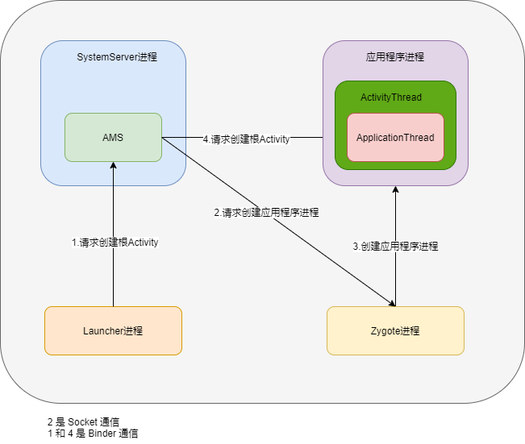

## 1 简介

Activity 的启动过程分为两种：

* 根 Activity 的启动过程（应用程序的启动过程）
* 普通 Activity 的启动过程   

根 Activity 的启动过程和普通 Activity 的启动过程有些部分是相通的，只要分析根 Activity，也就了解整个启动过程。Activity 启动过程分为三部分：

* Launcher 请求 AMS 过程
* AMS 到 ApplicationThread 的调用过程
* ActivityThread 启动 Activity

> 2025 更新：Android 10（API 29）起，AMS 里与 Activity/任务相关的那一半职责拆到了 `ActivityTaskManagerService`（ATMS，系统服务名 `activity_task`）。本文后面的 `ActivityManagerService#startActivityAsUser`、`ActivityStack`/`ActivityStackSupervisor` 等类名，在 Android 10 之后分别对应 ATMS、`Task`/`RootWindowContainer`、`ActivityTaskSupervisor`，读源码时别按 2019 年的类名硬找。

 ## 2 Launcher 请求 AMS 过程

点击桌面图标，调用 Launcher 的 startActivitySafely 方法。

### 2.1  Launcher#startActivitySafely()

```java
public boolean startActivitySafely(View v, Intent intent, ItemInfo item) {
     ...
     //1.启动一个新栈
     intent.addFlags(Intent.FLAG_ACTIVITY_NEW_TASK);
     if (v != null) {
         intent.setSourceBounds(getViewBounds(v));
     }
     try {
         if (Utilities.ATLEAST_MARSHMALLOW
                 && (item instanceof ShortcutInfo)
                 && (item.itemType == Favorites.ITEM_TYPE_SHORTCUT
                  || item.itemType == Favorites.ITEM_TYPE_DEEP_SHORTCUT)
                 && !((ShortcutInfo) item).isPromise()) {
             startShortcutIntentSafely(intent, optsBundle, item);
         } else if (user == null || user.equals(Process.myUserHandle())) {
             //2.启动 Activity << 代码1
             startActivity(intent, optsBundle);
         } else {
             ...
         }
         return true;
     } catch (ActivityNotFoundException|SecurityException e) {
       ...
     }
     return false;
 }
```

### 2.2  Activity#startActivityForResult()

上面代码 1，最终调用到 Activity#startActivityForResult()。

```java
public void startActivityForResult(@RequiresPermission Intent intent, int requestCode,
           @Nullable Bundle options) {
       if (mParent == null) {
           options = transferSpringboardActivityOptions(options);
           //调用 execStartActivity
           //Instrumentation:负责调用 Activity 和 Application 生命周期
           Instrumentation.ActivityResult ar =
               mInstrumentation.execStartActivity(
                   this, mMainThread.getApplicationThread(), mToken, this,
                   intent, requestCode, options);
          ...
       } else {
         ...
       }
   }
```

> 2025 更新：`startActivityForResult()`/`onActivityResult()` 在 Android 11（API 30）已标记废弃，新代码用 `registerForActivityResult(new ActivityResultContracts.StartActivityForResult(), cb)`；底层仍然走 `Instrumentation#execStartActivity`，只是结果回调改由 `ActivityResultRegistry` 分发。

### 2.3 Instrumentation#execStartActivity()

```java
public ActivityResult execStartActivity(...) {
      ...
      try {
          intent.migrateExtraStreamToClipData();
          intent.prepareToLeaveProcess(who);
          //获取 AMS 的代理对象,然后调用 startActivity 方法 -> 重点：调用 AMS#startActivity()
          int result = ActivityManager.getService()
              .startActivity(whoThread, who.getBasePackageName(), intent,
                      intent.resolveTypeIfNeeded(who.getContentResolver()),
                      token, target != null ? target.mEmbeddedID : null,
                      requestCode, 0, null, options);
          checkStartActivityResult(result, intent);
      } catch (RemoteException e) {
          throw new RuntimeException("Failure from system", e);
      }
      return null;
  }
```

### 2.4 IActivityManager 

```java
//IActivityManager 由 AIDL 工具在编译时自动生成的
public static IActivityManager getService() {
       return IActivityManagerSingleton.get();
   }

   private static final Singleton<IActivityManager> IActivityManagerSingleton =
           new Singleton<IActivityManager>() {
               @Override
               protected IActivityManager create() {
                   //1.得到名为”activity”的Service引用
                   final IBinder b = ServiceManager.getService(Context.ACTIVITY_SERVICE);
                   //2.
                   final IActivityManager am = IActivityManager.Stub.asInterface(b);//2
                   return am;
               }
           };
```

> 2025 更新：Android 10 起，`Instrumentation#execStartActivity` 里取的是 `ActivityTaskManager.getService()`（AIDL 接口 `IActivityTaskManager`），调用 `startActivity(...)` 进入 ATMS，而不是 `ActivityManager.getService()`。`ActivityManager.getService()` 仍然存在，但只保留进程、Service、广播等接口。

## 3 AMS 到 ApplicationThread 的调用过程

由上面的代码可以知道 startActivity 最终调用到 AMS#startActivityAsUser。

### 3.1 ActivityManagerService#startActivityAsUser()

```java
@Override
public final int startActivityAsUser(IApplicationThread caller, String callingPackage,
        Intent intent, String resolvedType, IBinder resultTo, String resultWho, int requestCode,
        int startFlags, ProfilerInfo profilerInfo, Bundle bOptions, int userId) {
    //判断调用者进程是否被隔离    
    enforceNotIsolatedCaller("startActivity");
    //检查调用者权限
    userId = mUserController.handleIncomingUser(Binder.getCallingPid(), Binder.getCallingUid(),
            userId, false, ALLOW_FULL_ONLY, "startActivity", null);
    //调用 ActivityStarter#startActivityMayWait
    return mActivityStarter.startActivityMayWait(caller, -1, callingPackage, intent,
            resolvedType, null, null, resultTo, resultWho, requestCode, startFlags,
            profilerInfo, null, null, bOptions, false, userId, null, null,
            "startActivityAsUser");
}
```

### 3.2 ActivityStarter#startActivityLocked()

ActivityStarter#startActivityMayWait() 调用到 ActivityStarter#startActivity()

```java
private int startActivity(...) {
      int err = ActivityManager.START_SUCCESS;
      final Bundle verificationBundle
              = options != null ? options.popAppVerificationBundle() : null;
      ProcessRecord callerApp = null;
      if (caller != null) {
          //获取Launcher进程
          callerApp = mService.getRecordForAppLocked(caller);
          if (callerApp != null) {
            //获取Launcher进程的pid和uid并赋值
              callingPid = callerApp.pid;
              callingUid = callerApp.info.uid;
          } else {
              ...
          }
      }
      ...
      //创建描述类 ActivityRecord(记录 Activity 的所有信息) 
      ActivityRecord r = new ActivityRecord(mService, callerApp, callingPid, callingUid,
              callingPackage, intent, resolvedType, aInfo, mService.getGlobalConfiguration(),
              resultRecord, resultWho, requestCode, componentSpecified, voiceSession != null,
              mSupervisor, container, options, sourceRecord);   
      if (outActivity != null) {
          outActivity[0] = r;
      }
      ...
          doPendingActivityLaunchesLocked(false);
          //ActivityStarter#startActivity()
          return startActivity(r, sourceRecord, voiceSession, voiceInteractor, startFlags, true,
              options, inTask, outActivity);
  }
```

> 2025 更新：Android 10 起用 `WindowContainer` 重构了任务/窗口模型，`ActivityRecord` 同时承担原 `AppWindowToken` 的窗口令牌职责；Android 12（S）前后 `TaskRecord` 基本并入 `Task`，`ActivityStack` 被 `Task`/`DisplayArea` 取代，`ActivityStackSupervisor` 更名为 `ActivityTaskSupervisor`。所以"新建 TaskRecord""拿到 ActivityStack"这类说法要换成"新建/复用 `Task`""拿到 `Task`/`TaskDisplayArea`"（版本边界以 AOSP 为准）。

### 2.3 ActivityStarter#startActivityUnchecked()

上面的代码 ActivityStarter#startActivity() 最终调用到 startActivityUnchecked()

```java
 private int startActivityUnchecked(...) {
...
 if (mStartActivity.resultTo == null && mInTask == null && !mAddingToTask
                && (mLaunchFlags & FLAG_ACTIVITY_NEW_TASK) != 0) {
            newTask = true;
            //创建新的TaskRecord
            result = setTaskFromReuseOrCreateNewTask(
                    taskToAffiliate, preferredLaunchStackId, topStack);
        } else if (mSourceRecord != null) {
            result = setTaskFromSourceRecord();
        } else if (mInTask != null) {
            result = setTaskFromInTask();
        } else {
            setTaskToCurrentTopOrCreateNewTask();
        }
       ...
 if (mDoResume) {
            final ActivityRecord topTaskActivity =
                    mStartActivity.getTask().topRunningActivityLocked();
            if (!mTargetStack.isFocusable()
                    || (topTaskActivity != null && topTaskActivity.mTaskOverlay
                    && mStartActivity != topTaskActivity)) {
               ...
            } else {
                if (mTargetStack.isFocusable() && !mSupervisor.isFocusedStack(mTargetStack)) {
                    mTargetStack.moveToFront("startActivityUnchecked");
                }
                //ActivityRecord 不为null，或者要启动的Activity的状态不是RESUMED状态
                //调用 ActivityStackSupervisor#resumeFocusedStackTopActivityLocked
                mSupervisor.resumeFocusedStackTopActivityLocked(mTargetStack, mStartActivity,
                        mOptions);
            }
        } else {
            mTargetStack.addRecentActivityLocked(mStartActivity);
        }
        ...

}
```

### 2.4 ActivityStackSupervisor#resumeFocusedStackTopActivityLocked()

```java
boolean resumeFocusedStackTopActivityLocked(...) {
    if (targetStack != null && isFocusedStack(targetStack)) {
        return targetStack.resumeTopActivityUncheckedLocked(target, targetOptions);
    }
    //获取要启动的 Activity 所在栈的栈顶的不是处于停止状态的 ActivityRecord
    final ActivityRecord r = mFocusedStack.topRunningActivityLocked();
    if (r == null || r.state != RESUMED) {
        //调用 ActivityStack 的 resumeTopActivityInnerLocked 方法
        //最后调用 ActivityStackSupervisor#startSpecificActivityLocked
        mFocusedStack.resumeTopActivityUncheckedLocked(null, null);
    } else if (r.state == RESUMED) {
        mFocusedStack.executeAppTransition(targetOptions);
    }
    return false;
}
```

### 2.5 ActivityStackSupervisor#startSpecificActivityLocked()

```java
void startSpecificActivityLocked(ActivityRecord r,
           boolean andResume, boolean checkConfig) {
       //获取要启动的 Activity 的所在的应用程序进程
       ProcessRecord app = mService.getProcessRecordLocked(r.processName,
               r.info.applicationInfo.uid, true);
       r.getStack().setLaunchTime(r);
       //如果要启动的 Activity 的所在应用程序进程已经运行的话，调用 realStartActivityLocked
       if (app != null && app.thread != null) {
           try {
               ...
               //调用 realStartActivityLocked    
               realStartActivityLocked(r, app, andResume, checkConfig);//3
               return;
           } catch (RemoteException e) {
               ...
           }
       }
      ...
   }
```

### 2.6 2.5 ActivityStackSupervisor#realStartActivityLocked()

```java
final boolean realStartActivityLocked(...) throws RemoteException {
   ...
          //app.thread 就是 IApplicationThread
          //其中 ApplicationThread 继承了IApplicationThread.Stub
          //ApplicationThread 是 AMS 所在的 SyetemServer进程和应用程序进程的通信桥梁 通过 Binder
          app.thread.scheduleLaunchActivity(new Intent(r.intent), r.appToken,
                  System.identityHashCode(r), r.info, new Configuration(mService.mConfiguration),
                  new Configuration(task.mOverrideConfig), r.compat, r.launchedFromPackage,
                  task.voiceInteractor, app.repProcState, r.icicle, r.persistentState, results,
                  newIntents, !andResume, mService.isNextTransitionForward(), profilerInfo);
  ...      
      return true;
  }
```

> 2025 更新：`scheduleLaunchActivity(...)` 这种"一长串参数"的 Binder 调用在 Android 10 已被 `ClientTransaction` + `LaunchActivityItem` 取代：ATMS 侧 `app.getThread().scheduleTransaction(clientTransaction)`，应用侧由 `TransactionExecutor` 分发执行，`ActivityThread.H` 里对应的是 `EXECUTE_TRANSACTION` 消息，`LaunchActivityItem#execute` 里再调 `handleLaunchActivity`。面试说"scheduleLaunchActivity"不算错，但要能补一句 ClientTransaction。

## 4 ActivityThread 启动 Activity

### 4.1 ActivityThread#scheduleLaunchActivity()

```java
@Override
public final void scheduleLaunchActivity(...) {
    updateProcessState(procState, false);
    //将启动 Activity 的参数封装成 ActivityClientRecord
    ActivityClientRecord r = new ActivityClientRecord();
    ...
    //sendMessage方法向 H 类发送类型为 LAUNCH_ACTIVITY的消息，并将 ActivityClientRecord 传递过去
    //H ActivityThread 的内部类并继承 Handler，是应用程序进程中主线程的消息管理类
    sendMessage(H.LAUNCH_ACTIVITY, r);
}
```

### 4.2 H 类

```java
private class H extends Handler {
      public static final int LAUNCH_ACTIVITY         = 100;
      public static final int PAUSE_ACTIVITY          = 101;
...
public void handleMessage(Message msg) {
          if (DEBUG_MESSAGES) Slog.v(TAG, ">>> handling: " + codeToString(msg.what));
          switch (msg.what) {
              case LAUNCH_ACTIVITY: {
                  Trace.traceBegin(Trace.TRACE_TAG_ACTIVITY_MANAGER, "activityStart");
                  final ActivityClientRecord r = (ActivityClientRecord) msg.obj;
                  //获得 LoadedApk 类型的对象并赋值给 ActivityClientRecord 的成员变量packageInfo 
                  r.packageInfo = getPackageInfoNoCheck(
                          r.activityInfo.applicationInfo, r.compatInfo);
                  //调用 handleLaunchActivity()
                  handleLaunchActivity(r, null, "LAUNCH_ACTIVITY");
                  Trace.traceEnd(Trace.TRACE_TAG_ACTIVITY_MANAGER);
              } break;
              case RELAUNCH_ACTIVITY: {
                  Trace.traceBegin(Trace.TRACE_TAG_ACTIVITY_MANAGER, "activityRestart");
                  ActivityClientRecord r = (ActivityClientRecord)msg.obj;
                  handleRelaunchActivity(r);
                  Trace.traceEnd(Trace.TRACE_TAG_ACTIVITY_MANAGER);
              } break;
            ...
}
```

### 4.3 ActivityThread#handleLaunchActivity()

```java
private void handleLaunchActivity(ActivityClientRecord r, Intent customIntent, String reason) {
    ...
    WindowManagerGlobal.initialize();
    //启动 Activity
    Activity a = performLaunchActivity(r, customIntent);
    if (a != null) {
        r.createdConfig = new Configuration(mConfiguration);
        reportSizeConfigurations(r);
        Bundle oldState = r.state;
        //将 Activity 的状态置为 Resume
        handleResumeActivity(r.token, false, r.isForward,
                !r.activity.mFinished && !r.startsNotResumed, r.lastProcessedSeq, reason);
        ...
    } else {
        try {
            //停止Activity启动
            ActivityManager.getService()
                .finishActivity(r.token, Activity.RESULT_CANCELED, null,
                        Activity.DONT_FINISH_TASK_WITH_ACTIVITY);
        } catch (RemoteException ex) {
            throw ex.rethrowFromSystemServer();
        }
    }
}
```

### 4.4 ActivityThread#performLaunchActivity

```java
private Activity performLaunchActivity(ActivityClientRecord r, Intent customIntent) {
       //获取ActivityInfo类
       ActivityInfo aInfo = r.activityInfo;
       if (r.packageInfo == null) {
       //获取APK文件的描述类LoadedApk
           r.packageInfo = getPackageInfo(aInfo.applicationInfo, r.compatInfo,
                   Context.CONTEXT_INCLUDE_CODE);
       }
       //获取组件
       ComponentName component = r.intent.getComponent();
       ...
       //创建要启动Activity的上下文环境
       ContextImpl appContext = createBaseContextForActivity(r);
       Activity activity = null;
       try {
           java.lang.ClassLoader cl = appContext.getClassLoader();
           //用类加载器来创建 Activity
           activity = mInstrumentation.newActivity(
                   cl, component.getClassName(), r.intent);
         ...
       } catch (Exception e) {
         ...
       }

       try {
           //创建 Application
           Application app = r.packageInfo.makeApplication(false, mInstrumentation);//6
           ...
           if (activity != null) {
              ...
               //初始化 Activity
               activity.attach(appContext, this, getInstrumentation(), r.token,
                       r.ident, app, r.intent, r.activityInfo, title, r.parent,
                       r.embeddedID, r.lastNonConfigurationInstances, config,
                       r.referrer, r.voiceInteractor, window, r.configCallback);

              ...
               if (r.isPersistable()) {
                   //调用Instrumentation#callActivityOnCreate()
                   mInstrumentation.callActivityOnCreate(activity, r.state, r.persistentState);
               } else {
                   mInstrumentation.callActivityOnCreate(activity, r.state);
               }
              ...
           }
           r.paused = true;
           mActivities.put(r.token, r);
       } catch (SuperNotCalledException e) {
           throw e;
       } catch (Exception e) {
         ...
       }

       return activity;
   }
```


## 5 总结



1. 点击桌面应用图标，Launcher 进程将启动 Activity（MainActivity）的请求以 Binder 的方式发送给了AMS

2. AMS 接收到启动请求后，交付 ActivityStarter 处理 Intent和 Flag 等信息，然后再交给ActivityStackSupervisior/ActivityStack 处理 Activity 进栈相关流程。同时以 Socket 方式请求 Zygote 进程fork新进程。

> 2025 更新：兜底流程没变（`ZygoteProcess` 通过 zygote socket 发起 fork），但"进栈"已经交给 `RootWindowContainer`/`Task`，`ActivityStackSupervisior`（原文拼写）现名 `ActivityTaskSupervisor`；另外新进程 fork 出来后要先走 `handleBindApplication`（建 Application、装 ContentProvider），才会收到启动 Activity 的 `ClientTransaction`。

3. Zygote 接收到新进程创建请求后 fork 出新进程
4. 在新进程里创建 ActivityThread 对象，新创建的进程就是应用的主线程，在主线程里开启 Looper 消息循环，开始处理创建Activity。
5. ActivityThread利用 ClassLoader 去加载 Activity、创建 Activity 实例，并回调 Activity 的 onCreate() 方法，完成 Activity 的启动。

## 6 Android 12—16 的变化与面试追问

> 本节覆盖 **Android 12（API 31）—Android 16（API 36）**。Android 10/11 的部分改动直接改写了上面的调用链，也一并标注。标了「以 AOSP/官方文档为准」的，说明不同小版本实现有差异：面试记结论，不必背具体方法名。

### 6.1 Android 12：SplashScreen API 如何接管启动画面

Android 12 之前，冷启动的"白屏"是应用自己在主题里用 `windowBackground` 画一张假图顶住的，系统侧只在 `ActivityRecord` 需要 starting window 时挂一个启动窗口（老实现是 `PhoneWindowManager#addSplashScreen` 那一套）。

Android 12（API 31）起，**系统统一接管启动画面**：

* 冷启动/温启动时，system_server 侧（WMS 的 `StartingSurfaceController` 一类实现，老的 `addSplashScreen` 被它取代）会为 `ActivityRecord` 创建 SplashScreen 窗口，内容 = 应用图标 + `windowSplashScreenBackground` 背景，应用还没画出第一帧就能显示；
* 应用侧只用主题属性定制：`windowSplashScreenBackground`、`windowSplashScreenAnimatedIcon`、`windowSplashScreenIconBackgroundColor`、`windowSplashScreenAnimationDuration`、`postSplashScreenTheme`；
* 想加退出动画就 `SplashScreen#setOnExitAnimationListener()`，回调里拿到 `SplashScreenViewProvider`，动画结束后必须 `remove()`；否则 splash 会一直挂着；
* `postSplashScreenTheme` 必须指向正常主题，否则 splash 主题会残留到 Activity 上；`windowIsTranslucent`、`windowDisablePreview` 等场景下系统可能直接不显示 splash（以官方文档为准）；
* 图标动画有上限（约 1000ms），静态图标 + 短动画是推荐做法；
* 兼容库 `androidx.core:core-splashscreen` 的 `installSplashScreen()` 把同样的行为向下兼容到低版本，是现在的标准接入方式。

对启动流程的影响：

1. `onCreate` 里不需要再 inflate 占位布局，`setContentView()` 越早越好；
2. splash 的退出时机是**应用首帧绘制**（`ViewTreeObserver` 的首帧回调），不是 `onCreate` 返回，更不是 `reportFullyDrawn()`；
3. `SplashScreen#setKeepOnScreenCondition()` 可以延长展示（等首屏数据），但延长时间全额计入启动耗时，且系统侧有上限，别拿它当 loading 页；
4. `Application#onCreate`、`ContentProvider#onCreate` 这些跑在 `Activity#onCreate` 之前的逻辑，现在全部落在 splash 的展示窗口里，是"启动慢"的主要嫌疑人。

### 6.2 Android 10+：ActivityTaskManagerService 从 AMS 拆出

Android 10（API 29）把 AMS 里"Activity/任务"这一半职责拆到了 `ActivityTaskManagerService`（ATMS）：

| 关注点 | 归属 |
| --- | --- |
| Activity 启动、任务栈、启动模式、starting window 决策 | ATMS（服务名 `activity_task`，客户端 `ActivityTaskManager`） |
| 进程管理、Service/广播/Provider 调度、oom_adj | AMS（服务名 `activity`，客户端 `ActivityManager`） |
| 窗口、转场、Surface 与 WindowContainer 树 | WMS（与 ATMS 同进程协作） |

所以上面的链路要改成：

`Instrumentation#execStartActivity` → `ActivityTaskManager.getService().startActivity(...)`（`IActivityTaskManager`）→ ATMS → `ActivityStarter` → `RootWindowContainer`/`Task` → `ActivityTaskSupervisor#realStartActivityLocked` → `app.getThread().scheduleTransaction(ClientTransaction)`。

一句话分工：**ATMS 决定"哪个 Activity 在哪个任务里、以什么模式起来"，AMS 决定"进程还活着吗、要不要杀、四大组件怎么调度"**；两者都在 system_server，通过 `ActivityTaskManagerInternal`/`ActivityManagerInternal` 这类 LocalService 互相调用。

### 6.3 Android 10—16：启动模式与 WindowContainer 模型

启动模式本体没变（`standard`/`singleTop`/`singleTask`/`singleInstance`，配合 `FLAG_ACTIVITY_NEW_TASK`、`CLEAR_TOP`、`CLEAR_TASK`、`NEW_DOCUMENT`、`NO_HISTORY` 等 flag 和 `taskAffinity`）。Android 12（API 31）新增 `singleInstancePerTask`：每个 Task 最多一个实例，但可以同时存在于多个 Task，解决 `singleInstance` 全局只能一个实例过重的问题。

变的是"这些概念落在哪个对象上"：

* Android 10 起引入 `WindowContainer` 重构，Android 12 起 `DisplayArea` 层级成型，整棵树大致是：`RootWindowContainer` → `DisplayContent` → `DisplayArea`（`TaskDisplayArea` 等）→ `Task` → `ActivityRecord`；
* `ActivityRecord` 在 Android 10 合并了原 `AppWindowToken` 的窗口令牌职责，既是任务里的一个 Activity 记录，也是窗口容器树上的节点；
* `TaskRecord` 在 Android 12（S）前后基本被 `Task` 吸收（`Task extends WindowContainer<ActivityRecord>`），`ActivityStack` 被 `Task`/`DisplayArea` 取代，`ActivityStackSupervisor` 更名为 `ActivityTaskSupervisor`（具体版本边界以 AOSP 为准）；
* Android 13/14 起有了 `TaskFragment`（13 起是内部模型，14 起有 `android.window.TaskFragmentOrganizer` 等公开 API），用于在一个 Task 内再分组、支撑多窗口/嵌入 Activity，启动模式的落点从"Task"细化到"TaskFragment"（版本边界以 AOSP 为准）；
* 因此现在问"`singleTask` 的实例存在哪"，答案不是 `TaskRecord`，而是 `Task`（或 `TaskFragment`）里的 `ActivityRecord`。

`singleTask` 的经典坑没变：只有 `taskAffinity` 匹配 + `FLAG_ACTIVITY_NEW_TASK` 才会"找已有任务并清空其上 Activity"；不设 `taskAffinity` 时它退化成"当前任务内单实例"。

### 6.4 Android 8—16：启动耗时统计与线上指标

| 手段 | 衡量什么 | 注意点 |
| --- | --- | --- |
| logcat `Displayed` | 冷启动到**首帧**的时间（TTID） | Android 10 起 tag 是 `ActivityTaskManager`（之前是 `ActivityManager`），由 `ActivityMetricsLogger` 计算，格式 `Displayed com.x/.Main: +1s234ms` |
| `adb shell am start -W` | 单次启动的 `ThisTime`/`TotalTime`/`WaitTime` | `TotalTime` 是 intent 到首帧，`WaitTime` 还包含系统调度排队；加 `-S` 先 force-stop 才是冷启动 |
| `reportFullyDrawn()` | 首屏数据也准备好的时间（TTFD） | 要等列表首屏数据加载完再调，logcat 输出 `Fully drawn ...: +Xs`；只调一次，别当万能指标 |
| Perfetto / `Trace` | 逐段耗时（bindApplication、inflate、draw） | `Trace.beginSection("xxx")` 配合 `am start --start-profiler` 或 Perfetto 抓取 |

`am start -W` 的典型输出（字段随版本略有差异）：

```text
$ adb shell am start -W -S -n com.example/.MainActivity
Starting: Intent { cmp=com.example/.MainActivity }
Status: ok
LaunchState: COLD
Activity: com.example/.MainActivity
ThisTime: 312
TotalTime: 312
WaitTime: 340
```

`ThisTime` 是最后一个 Activity 自己的启动耗时，`TotalTime` 是本次启动到首帧的总耗时（含中间被拉起的 Activity），`WaitTime` 是 `TotalTime` 再加上系统调度/排队的时间——**报告启动性能用 `TotalTime`，别用 `WaitTime` 背锅**。

几个容易被追问的点：

* `Displayed` 在 Android 12 之后更接近"用户看到画面"的时间，因为 splash 由系统绘制，首帧一到就撤；
* `am start -W` 的 `TotalTime` 包含 splash 被 `setKeepOnScreenCondition` 拖住的时长——只要首帧没画出来，计时就不结束；
* `reportFullyDrawn()` 与 splash 退出**无关**，它只影响 TTFD 指标和 logcat；
* 线上采集一般用 `ActivityMetricsLogger` 上报的 atom / Play Vitals，本地用 `am start -W` + Perfetto 对齐。

### 6.5 Android 10—15：后台启动限制对启动链路的影响

* Android 10（API 29）：后台应用默认不能 `startActivity`，判定在 `ActivityStarter` 里由 `BackgroundActivityStartController` 完成；豁免包括有可见窗口、在前台任务栈、设备管理员/系统应用、`PendingIntent` 由前台应用发出等；
* Android 12（API 31）：通知 trampoline 被禁——通知里的 Service/Receiver 不能间接拉起 Activity，必须直接挂 `PendingIntent`；`PendingIntent` 必须显式 `FLAG_IMMUTABLE`/`FLAG_MUTABLE`（targetSdk 31+ 不写会抛 `IllegalArgumentException`）；
* Android 14（API 34）：`PendingIntent` 的 BAL 改为"发送方显式授权"，用 `ActivityOptions#setPendingIntentBackgroundActivityStartMode()` 声明，creator 默认不再放行；隐式 Intent 也不再投递给非 exported 组件；
* Android 15（API 35）：继续收紧（含 `SYSTEM_ALERT_WINDOW` 相关豁免的调整），具体判定以 `BackgroundActivityStartController` 和官方 behavior changes 为准；
* 表现：`startActivity` 通常**不抛异常**，只是界面不出现，logcat 里能看到 `Background activity launch blocked`——排查先看调用发生的时机（是否前台）和 `PendingIntent` 的发送方，而不是怀疑 Activity 写错了。

### 6.6 Android 16（API 36）的边际变化

Android 16 没有推翻上面的启动链路：`ActivityStarter` → `Task` → `ClientTransaction` 的主干仍在。对启动流程有感知的变化主要在 UI 层（edge-to-edge 强制、predictive back 默认）和后台限制的继续收紧，属于"行为更严"而不是"链路换掉"。答题时如果被追问 16 的具体条目，说"以官方 behavior changes 为准"比硬编类名安全。

### 6.7 面试追问（6—8 个）

1. **点桌面图标到 `onCreate` 之间发生了什么？** system_server 侧 ATMS/`ActivityStarter` 算任务和启动模式，Zygote fork 进程，新进程 `handleBindApplication` 建 Application/Provider，再 `ClientTransaction` → `handleLaunchActivity` → `performLaunchActivity` → `onCreate`。
2. **Android 12 之后为什么不用再写假 splash？splash 什么时候消失？** 系统在 starting window 阶段接管；消失时机是应用首帧绘制，`setKeepOnScreenCondition` 只能延长、且计入耗时。
3. **ATMS 和 AMS 为什么拆？** 职责隔离 + 减少锁竞争：Activity/任务的高频操作不再和进程/Service/广播抢同一把 AMS 锁。
4. **`singleTask` 和 `singleInstancePerTask` 区别？** 前者一个任务内单实例、会清空其上 Activity；后者每个任务最多一个实例但可存在多个任务，适合多窗口场景。
5. **`Task`/`TaskRecord`/`ActivityRecord`/`TaskFragment` 什么关系？** `WindowContainer` 树：`RootWindowContainer` → `DisplayContent` → `DisplayArea` → `Task`（原 `TaskRecord`）→ `ActivityRecord`，`TaskFragment` 是 Task 内的再分组。
6. **`Displayed` 和 `reportFullyDrawn` 分别衡量什么？线上怎么采？** TTID vs TTFD；本地 `am start -W`/Perfetto，线上 ActivityMetricsLogger atom / Vitals。
7. **后台 `startActivity` 没反应怎么定位？** 先看 logcat 是否有 `Background activity launch blocked`，再查调用时机、`PendingIntent` 发送方、是否有 FGS/SAW 等豁免。
8. **Android 12+ 冷启动优化有哪些新抓手？** splash 主题精简、把 Provider/App Startup 初始化改成懒加载、Baseline Profile、首帧前不做 IO。