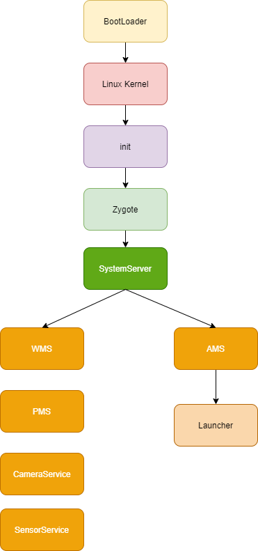

## 1 Android 系统启动流程



> 2025 更新：下面的 1.1~1.7 是原有整理，保留不动；后面补了 init 的 `.rc` / 属性服务、Zygote 的 COW、SystemServer 的服务分组与启动顺序、应用进程与系统进程的区别、开机时间优化，以及 Android 10—16 的结构性变化（GKI / Mainline / A/B / dex2oat 预热 / 16 KB 页）。

### 1.1 启动电源以及系统启动

当电源按下时引导芯片代码开始从预定义的地方（固化在ROM）开始执行。加载引导程序 **BootLoader 到 RAM**，然后执行。

这段固化代码就是 **BootROM**（在 SoC 内部，不可改）：它只做最少的初始化（时钟、DRAM、存储控制器），把 BootLoader 从 flash 读进 RAM 并跳过去执行。它还会检查启动介质和熔丝位（是否允许解锁），是整条信任链的根。

### 1.2 引导程序 BootLoader

引导程序 BootLoader 是在 Android 操作系统开始运行前的一个小程序，主要作用是把系统 OS 拉起来并运行。

现代设备上的 BootLoader 一般分两级：SoC 内置的 Primary BootLoader（如高通的 XBL）和二级的 **ABL / U-Boot / LK**。它负责：

* 校验 boot 分区签名（Verified Boot，dm-verity / AVB）；
* A/B 设备上**选择 slot**（`slot_suffix` 写进 cmdline）；
* 准备 `boot.img`（kernel + ramdisk/dtb）并跳转到内核入口。

### 1.3 Linux 内核启动

内核启动时，设置缓存、被保护存储器、计划列表、加载驱动。当内核完成系统设置，它首先在系统文件中寻找init.rc 文件，并启动 init 进程。

* init.rc 是由 Android 初始化语言编写的脚本，包含 5 种类型：Action、Command、Service、Option、Import。

补充：内核起来后先解压、建立页表、初始化调度器和中断、probe 各驱动，然后挂载根文件系统（initramfs 或 system-as-root），最后 `exec` 第一个用户态进程 **init（PID 1）**。`init.rc` 位于 `/system/etc/init/hw/init.rc`（老版本是 `/init.rc`），同时会 import `/vendor/etc/init`、`/odm/etc/init` 下的片段。

### 1.4 init 进程启动

**初始化和启动属性服务，并且启动 Zygote 进程。**

* 创建和挂载启动所需的文件目录
* 初始化和启动属性服务
* 解析 init.rc 配置文件并启动 Zygote 进程

init 还负责：启动 `ueventd`（创建设备节点）、`logd`、`servicemanager`、`hwservicemanager`、`vndservicemanager`，以及处理 `SIGCHLD` 回收僵尸进程。它是所有用户态服务的父进程。

### 1.5 Zygote 进程启动

创建 Java 虚拟机并为 Java 虚拟机注册 JNI，创建服务端 Socket，启动 SystemServer 进程。

* Zygote：孵化器，通过 fork 的形式创建应用进程和 SystemServer 进程。
* Zygote 启动脚本（init.zygote32.rc、init.zygote32_64.rc、init.zygote64.rc、init.zygote64_32.rc）

Zygote 的入口是 `app_process`（`frameworks/base/cmds/app_process/app_main.cpp`）→ `ZygoteInit.main`。它做的顺序是：创建 Server 端 Socket（`/dev/socket/zygote`）→ `preloadClasses` / `preloadResources` / `preloadSharedLibraries` / `preloadTextResources` → `nativeZygoteInit()` 启动 Binder 线程池 → `forkSystemServer()`。

### 1.6 SystemServer 进程启动

启动 Binder 线程池和 SystemServiceManager，并且启动各种系统服务。

```java
ZygoteInit.nativeZygoteInit() //启动 Binder 线程池 是 Native 方法
```

SystemServer 的 `main` 里调用 `run()`：`Looper.prepareMainLooper()` → `System.loadLibrary("android_servers")` → `createSystemContext()` 建系统 Context → `new SystemServiceManager(...)` → `startBootstrapServices()` / `startCoreServices()` / `startOtherServices()` → `Looper.loop()`。它跑在独立的 `system_server` 进程里（由 Zygote fork 出来），是整个 Framework 的「大管家」。

### 1.7 Launcher 启动

被 SystemServer 进程启动的 ActivityManagerService 会启动 Launcher，Launcher 启动后会将已安装应用的快捷图标显示到界面上。

准确说：`startOtherServices()` 末尾 SystemServer 先拉起 **SystemUI**（`startSystemUi()`，服务组件），再等 `AMS.systemReady()` 完成，系统进入 `PHASE_BOOT_COMPLETED`；之后由 ActivityTaskManager 解析 **HOME Intent**（`Intent.CATEGORY_HOME`）启动 Launcher，Launcher 通过 `LauncherApps`/`PackageManager` 拿到已安装应用列表并渲染图标。具体调用点在版本间有调整，以源码为准。

## 2 全链路总览

### 2.1 阶段与产物

| 阶段 | 运行态 | 关键产物 / 动作 |
| --- | --- | --- |
| BootROM | SoC 固化代码 | 初始化 DRAM，加载 BootLoader |
| BootLoader | ABL / U-Boot / LK | 校验签名、选 slot、加载 boot.img |
| Kernel | 内核态 | 初始化驱动、挂载根文件系统、启动 init |
| init | 用户态 PID 1 | 解析 `.rc`、启动属性服务、ueventd/logd/servicemanager、拉起 Zygote |
| Zygote | 用户态（有 ART 虚拟机） | 预加载类与资源、建 Socket、fork SystemServer |
| SystemServer | `system_server` 进程 | 启动 AMS/PMS/WMS 等百余个系统服务 |
| SystemUI / Launcher | 应用进程 | 状态栏、导航栏、桌面 |

### 2.2 时序（简化）

```
BootROM → BootLoader → Kernel → init(PID 1)
                                   ├── ueventd / logd / servicemanager
                                   └── zygote (fork)
                                          ├── system_server → AMS/PMS/WMS/... → SystemUI
                                          └── app 进程（AMS 请求时 fork）
                                                                     ↓
                                                              Launcher（HOME）
```

## 3 init：`.rc` 解析与属性服务

### 3.1 `.rc` 的语法

| 语法元素 | 作用 | 例子 |
| --- | --- | --- |
| Action（`on`） | 一组在某个 trigger 下执行的命令 | `on boot` / `on property:sys.boot_completed=1` |
| Command | Action 里的具体动作 | `class_start core`、`start zygote`、`mkdir`、`write`、`setprop` |
| Service（`service`） | 定义一个可执行服务 | `service zygote /system/bin/app_process64 ...` |
| Option | Service 的属性 | `class main`、`user system`、`oneshot`、`socket zygote stream 660`、`onrestart` |
| Import（`import`） | 引入其它 `.rc` | `import /vendor/etc/init/hw/init.${ro.hardware}.rc` |

原文说的 5 种类型就是上表这五类：Action、Command、Service、Option、Import。

### 3.2 两个阶段与 trigger

* **first stage**：挂载 `/proc`、`/sys`、`/dev`，建立 tmpfs，加载 SELinux policy，然后重新 `exec` 自己进入 second stage；
* **second stage**：解析所有 `.rc`，启动属性服务，按 trigger 的顺序执行 Action。

trigger 顺序大致是：`early-init` → `init` → `late-init` →（`early-fs`、`fs`、`post-fs`、`late-fs`、`post-fs-data`、`zygote-start`、`early-boot`、`boot`）。`servicemanager` 属于 `class core`，在 `on boot` 的 `class_start core` 里启动；Zygote 属于 `class main`，随后启动 —— 所以 **ServiceManager 一定早于 Zygote 和 SystemServer**。

### 3.3 属性服务

* 属性是全局 key-value：`ro.*`（只读，启动时定）、`persist.*`（落盘 `/data/property`）、`sys.*`、`ctl.start`/`ctl.stop`（控制服务启停）、`init.svc.<name>`（服务状态）。
* 存储在一块共享内存里（`/dev/__properties__`），所有进程只读映射，写入必须经过 init 的 socket，所以「改属性」是受 SELinux 管控的特权操作。
* 用法：`adb shell getprop sys.boot_completed`、`adb shell setprop log.tag.X DEBUG`；代码里 `SystemProperties.get/ set`。
* `on property:xxx=yyy` 让 init 能在属性变化时执行动作，这是「开机完成」等状态联动的常用手段。

## 4 Zygote

### 4.1 为什么需要 Zygote（COW）

每个应用进程都要有一个 ART 虚拟机、一套预加载的 Framework 类（几千个）、常用资源（主题、尺寸、字符串）和 native 库。如果每个进程都从头加载，启动要多花几百毫秒、内存也多几百 MB。

Zygote 的做法：**先在一个进程里把这些东西加载好，之后所有应用进程都 fork 它**。fork 之后父子进程的虚拟地址空间指向同一批物理页（**写时复制 COW**）：只要不写，就一直是共享的。于是：

* 新进程启动只需要 fork + 少量初始化，省掉类加载和资源解析；
* 物理内存上，几千个类和资源在所有进程间**只存一份**；
* 代价是：Zygote 里被频繁写的页会触发 COW 复制，所以 Zygote 要尽量保持「只读」状态（不要在 fork 前做大分配、不要留可变的大缓存）。

### 4.2 Zygote 启动做了什么

1. `app_process` 启动，`AppRuntime` 初始化 ART；
2. `ZygoteInit.main`：`registerZygoteSocket("zygote")` 建 Server Socket（`/dev/socket/zygote`）；
3. `preloadClasses()`（读 `/system/etc/preloaded-classes`）、`preloadResources()`、`preloadSharedLibraries()`、`preloadTextResources()`；
4. `nativeZygoteInit()`：启动 Binder 线程池，让 Zygote 自己也能作为 Binder 服务端；
5. `forkSystemServer()`：fork 出 `system_server`，子进程里 `handleSystemServerProcess` → `RuntimeInit` → `SystemServer.main`；
6. 父进程进入 `runSelectLoop()`，等 AMS 通过 Socket 请求 fork 新应用进程。

### 4.3 fork 与 COW 的细节

* `fork()` 只复制页表，不复制物理页；父子共享的页被标记为只读，任一方写入触发缺页中断，内核复制一份新页 —— 这就是 Copy-On-Write；
* 所以「fork 快」不等于「零成本」：fork 后如果子进程立刻大量写（比如初始化自己的堆），会连续触发 COW，表现为启动耗时和内存上涨；
* Zygote 预加载的对象越多，共享收益越大，但 Zygote 自身的启动也越慢，且 fork 后任何对该区域的写入都会放大 COW 开销 —— 这是「预加载多少」的权衡点。

### 4.4 Zygote 的 Socket 与 forkAndSpecialize

AMS 要启动应用进程时：`Process.start()` → `ZygoteProcess.startViaZygote()` → 往 `/dev/socket/zygote` 写入「uid、gid、nice name、runtime flags、seInfo、目标类（`android.app.ActivityThread`）」等参数 → Zygote 的 `ZygoteConnection.processOneCommand()` 解析后调用：

```java
Zygote.forkAndSpecialize(uid, gid, gids, runtimeFlags, mountExternal,
        seInfo, niceName, fdsToClose, fdsToIgnore, instructionSet, appDataDir, ...)
```

子进程里执行 `handleChildProc` → `ZygoteInit.zygoteInit()` → `RuntimeInit.applicationInit()` → 反射调用 `ActivityThread.main()`，然后 `Looper.loop()`。**注意：应用进程的 uid/gid 是在 fork 之后由 Zygote「降权」设置的**，这也是为什么所有应用进程都「姓 Zygote」但权限各不相同。

### 4.5 32/64 位

`init.zygote64.rc`、`init.zygote64_32.rc`、`init.zygote32_64.rc`、`init.zygote32.rc` 对应不同的位数组合。纯 64 位设备只有一个 `zygote64`；`64_32` 表示主 Zygote 是 64 位、同时提供一个 32 位 secondary zygote（`zygote_secondary`）来跑只提供 32 位 so 的应用。

## 5 SystemServer

### 5.1 启动流程

`Zygote.forkSystemServer` → `SystemServer.main` → `run()`：

1. `Looper.prepareMainLooper()`（主线程 Looper）；
2. `System.loadLibrary("android_servers")`（native 服务实现）；
3. `createSystemContext()`：`ActivityThread.systemMain()` + `ContextImpl.createSystemContext()`，得到系统 Context；
4. `SystemServiceManager` 创建，`LocalServices.addService`；
5. `startBootstrapServices()` → `startCoreServices()` → `startOtherServices()`；
6. `Looper.loop()` 进入消息循环，`Watchdog` 监控卡死。

### 5.2 服务分组

| 组 | 启动方法 | 典型服务 |
| --- | --- | --- |
| Bootstrap | `startBootstrapServices()` | `ActivityManagerService`、`PackageManagerService`、`PowerManagerService`、`LightsService`、`DisplayManagerService`、`UserManagerService`、`Installer`、`UriGrantsManagerService` |
| Core | `startCoreServices()` | `BatteryService`、`UsageStatsService`、`WebViewUpdateService`、`BinderCallsStatsService` |
| Other | `startOtherServices()` | `InputManagerService`、`WindowManagerService`、`NotificationManagerService`、`AlarmManagerService`、`StorageManagerService`、`AccessibilityManagerService`、`JobSchedulerService`、`BluetoothService`、`WifiService` |

分组的含义：Bootstrap 是「其它服务都依赖它」的地基（AMS/PMS 必须最早），Core 是「不需要和其它服务强耦合」的独立模块，Other 是「依赖前面两者、可以晚一点」的服务。

### 5.3 AMS 与 PMS 的启动顺序

两者都在 `startBootstrapServices()` 里，顺序上 **AMS（`ActivityManagerService.Lifecycle`）先被 `SystemServiceManager.startService` 拉起**，随后 `PackageManagerService.main()` 完成包扫描并注册 `package` 服务，再调 `mActivityManagerService.setSystemProcess()`；真正的「可以开始干活」要等 `startOtherServices()` 末尾的 `AMS.systemReady()`。

为什么不能反过来：AMS 的很多逻辑（启动组件、解析 Intent、权限校验）都要查 PMS 的包信息，所以 **PMS 的扫描必须先完成**；但 PMS 启动过程中又需要 AMS 提供进程/权限能力，于是采用「AMS 对象先创建、PMS 扫描、再 `systemReady`」的顺序。具体调用点在不同版本有调整，以源码为准。

### 5.4 SystemUI 与 Launcher 的拉起

* **SystemUI**：`startOtherServices()` 末尾 `startSystemUi()` 用 `startServiceAsUser(Intent(SYSTEM_UI_SERVICE), UserHandle.SYSTEM)` 拉起 `com.android.systemui/.SystemUIService`，并通知 WMS `onSystemUiStarted()`。状态栏、导航栏、最近任务、锁屏都属于它。
* **Launcher**：`AMS.systemReady()` 之后进入 `PHASE_BOOT_COMPLETED`，ActivityTaskManager 在「没有可恢复的 Activity」时解析 HOME Intent 启动 Launcher；Launcher 用 `LauncherApps` 拉应用列表，第一次启动还要建数据库、加载图标，所以「开机后桌面卡一下」通常是 Launcher 自己在忙。
* 顺序上是 **SystemUI 先、Launcher 后**：先有状态栏/导航栏，用户才看得到「系统起来了」，桌面再慢慢加载。

## 6 应用进程与系统进程

| 维度 | 应用进程 | 系统进程（`system_server`、`zygote`、`surfaceflinger`、`servicemanager` 等） |
| --- | --- | --- |
| 创建方式 | Zygote fork（`forkAndSpecialize`） | Zygote fork（system_server）或 init `exec`（native 服务） |
| UID | 独立应用 uid（`u0_aXXX`） | `system`(1000) / `root` / 专用 uid |
| 运行环境 | 有 ART、ActivityThread、主线程 Looper | system_server 有 ART；native 服务没有 |
| 权限 | 受 SELinux domain + 运行时权限约束 | 高权限 domain，可注册系统服务 |
| Binder | 作为 client 调系统服务，也可暴露自己的服务 | 注册并托管系统服务（`ServiceManager.addService`） |
| 生命周期 | 受 AMS 调度，可被 kill/冻结 | 常驻，挂了会触发重启甚至重启设备（`critical` 服务） |
| 内存优先级 | `oom_adj` 随状态变化 | 通常 adj 很低，不易被杀 |

一句话：**应用进程是「被管理者」，系统进程是「管理者和基础设施」**；两者都源自 Zygote，但 uid、SELinux domain、能注册的服务完全不同。

## 7 开机时间优化

先定位，再优化。定位手段：

* `adb logcat -b events | grep boot_progress`：`boot_progress_start`、`boot_progress_system_run`、`boot_progress_pms_start`、`boot_progress_pms_system_scan_start`、`boot_progress_pms_data_scan_start`、`boot_progress_pms_ready`、`boot_progress_ams_ready`、`boot_progress_enable_screen`，一段一段看时间花在哪；
* Perfetto / `atrace` 抓 boot trace（`sched`、`binder`、`freq`、`am`、`wm`）；
* `dumpsys` 看各服务启动耗时（部分版本有 `dumpsys system_server_dumper`/`ServiceManager` 统计）。

优化点：

| 阶段 | 做法 |
| --- | --- |
| BootLoader / Kernel | 减少不必要的驱动、用异步 probe、压缩内核、裁剪 defconfig |
| init | 减少串行 `exec`、非关键服务延迟到 `boot` 之后、并行启动 |
| Zygote | 精简 `preloaded-classes`、减少启动期资源预加载、避免 fork 前的写操作放大 COW |
| ART | boot image + `speed-profile` 预编译热点、`odrefresh` 复用编译产物、Baseline Profile |
| SystemServer | 用 `SystemServerInitThreadPool` 并行、把非关键服务放到后面的 `PHASE`、减少启动期同步 Binder 调用 |
| 界面 | SplashScreen 兜住白屏、`bootanim` 尽早退出、SystemUI/Launcher 预热与懒加载 |

注意：**并行不是万能的**，服务之间有依赖（AMS/PMS 必须先），并行过度会带来锁竞争和更难排查的时序问题。

## 8 Android 10—16 的变化

### 8.1 GKI（通用内核镜像）

* Android 12 起 GKI 落地（内核 5.10），Android 13 的 GKI 2.0 支持多个内核版本（5.10/5.15），后续版本继续跟进（6.1/6.6 等）。
* 思路：Google 维护一份核心内核，厂商把设备相关驱动做成 vendor modules，通过稳定的 **KMI** 对接。Treble 解耦的是 framework 与 HAL，GKI 解耦的是「核心内核」与「厂商模块」，两者一起缩短升级链路。
* 对应用开发基本透明，但影响「内核行为随版本变化」的假设：同一个 API level，不同设备的内核和 Binder 行为可能不同。

### 8.2 Mainline 与 APEX

* Android 10 起引入 Mainline：把部分系统组件做成可独立更新的模块，通过 Google Play 系统更新下发，不必等整机 OTA；APEX 容器也在 Android 10 引入。
* Android 12 起 **ART 成为 Mainline 模块**，可以独立升级 —— 这解释了「同一 Android 版本，不同设备的 ART 行为/性能可能不同」。
* 边界：Mainline 覆盖框架/系统组件，不覆盖 vendor HAL、内核驱动和厂商深度定制；厂商支持的模块列表也不同。

### 8.3 A/B 分区与 Virtual A/B

* A/B（Seamless Updates）从 Android 7 引入：system/boot 等分区有两套（slot a/b），OTA 写入当前不用的 slot，重启时 bootloader 切换；失败可回滚。
* Android 11 起 **Virtual A/B**：用快照把「写另一套分区」虚拟化，减少额外存储占用，同时保留无缝更新；配合增量 OTA（`update_engine` 只传差分包）。
* 对启动链路的影响：BootLoader 多了一步「选 slot」，`slot_suffix` 会写进 kernel cmdline 和属性，OTA 后的首次启动要做校验/合并（snapshot merge）。

### 8.4 ART 与 dex2oat 预热

* 安装时 `dex2oat` 把 dex 编译成本地码；boot image（`boot.art`/`boot.oat`）预编译 Framework 热点，Zygote 直接映射，省掉每个进程的编译。
* Android 7 起「解释 + JIT + profile」混合：先跑，热点记进 profile，设备空闲/充电时按 profile 做 AOT（`speed-profile`）。
* Android 12 起 `odrefresh` 在开机时校验/生成 ART 产物，减少「OTA 后首次启动慢」；Baseline Profile / Cloud Profile 让「刚安装就好用」。
* 这些机制直接影响开机时间：**boot image 和 system_server 的热点预编译做得越好，`boot_progress_ams_ready` 越早**。

### 8.5 16 KB 页大小

* Android 15 起出现 16 KB 页大小的设备（先在开发者选项/模拟器镜像提供），Android 16 上成为正式兼容目标；Google Play 从 2025-11-01 起对含 native 代码、`targetSdk` ≥ 35 的应用提出要求（具体以官方政策为准）。
* 影响启动链路的地方：内核页大小决定 mmap/缺页粒度，`BINDER_VM_SIZE` 从 `1MB - 8KB` 变成 `1MB - 32KB`；native 库必须按 16 KB 对齐（`p_align = 0x4000`），否则 `dlopen` 失败或启动即崩。
* 自查：`adb shell getconf PAGE_SIZE`、`zipalign -c -P 16 -v 4`、`readelf -lW` 看 LOAD 段对齐。

## 9 面试问答

### Q1：说一下 Android 的启动流程？

上电 → BootROM（SoC 固化代码）→ BootLoader（校验、选 slot、加载 boot.img）→ Linux 内核（初始化驱动、挂载根文件系统）→ init（PID 1，解析 `.rc`、启动属性服务和 ueventd/logd/servicemanager）→ Zygote（预加载类与资源、建 Socket、fork SystemServer）→ SystemServer（启动 AMS/PMS/WMS 等系统服务）→ SystemUI → Launcher（HOME Intent）。应用进程由 Zygote 按 AMS 的请求 fork。

### Q2：为什么要有 Zygote？直接用 init fork 应用进程不行吗？

因为每个应用进程都需要 ART 虚拟机、几千个 Framework 类和大量资源。Zygote 先把这些加载好再 fork，子进程通过 COW 与父进程共享物理页，既省启动时间又省内存。init 是 native 进程，没有 ART 和 Framework 的预加载，从它 fork 出来的进程还得自己加载一遍，成本和内存都翻倍。

### Q3：COW 具体省了什么？有什么代价？

省的是「每个进程独立加载一份类与资源」的时间和物理内存：fork 只复制页表，共享页保持只读，谁写谁复制。代价是 fork 后任何对共享页的写入都会触发缺页复制，所以 Zygote 要避免在 fork 前做大分配、避免留下频繁改写的缓存；预加载越多，Zygote 自己启动越慢。

### Q4：SystemServer 里的服务分几组？AMS 和 PMS 谁先启动？

三组：Bootstrap（AMS、PMS、PowerManagerService 等基础设施）、Core（BatteryService、UsageStatsService 等独立模块）、Other（WMS、IMS、通知、蓝牙等依赖前两者的服务）。顺序上 AMS 对象先创建，PMS 完成包扫描后再 `setSystemProcess()`，最后 `AMS.systemReady()` 收尾。原因是 AMS 干活要查 PMS 的包信息，而 PMS 启动又需要 AMS 的进程/权限能力，只能「先建对象、再扫描、最后 ready」。

### Q5：应用进程和系统进程有什么区别？

都源自 Zygote（native 服务除外），但应用进程有独立 uid、受 SELinux 应用 domain 限制、被 AMS 管理，会随内存压力被杀或被冻结；系统进程（system_server、zygote、surfaceflinger、servicemanager）是高权限 domain，注册并托管系统服务，`critical` 服务挂掉会触发重启。一句话：一个是被管理者，一个是管理者与基础设施。

### Q6：开机慢怎么定位、怎么优化？

先用 `boot_progress_*` 事件把时间拆成 BootLoader / kernel / PMS 扫描 / AMS ready / 首帧几段，再用 Perfetto 看具体线程和 Binder 调用。优化按性价比排序：减少 PMS 扫描量（少预装、延迟扫描）、精简 Zygote 预加载、做好 boot image 与 system_server 的热点预编译、SystemServer 并行启动 + 延迟非关键服务、最后才是内核裁剪。**先测量再动手**，否则很容易优化错方向。
