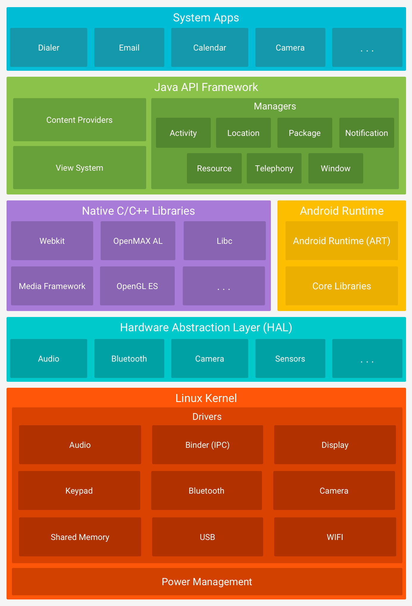

> 2025 更新：五层架构仍然是面试骨架，但 2019 年之后 Android 的关键变化是「层间接口标准化 + 系统组件模块化」：Treble 把 HAL 接口化，Mainline 让部分系统组件绕过整机 OTA 更新，GKI 把内核核心与厂商模块解耦。下面保留原有五层说明，并在对应位置补充这些演进；文末新增面试问答。

## 1 平台架构

> 2025 更新：这张五层图依然成立，但不要再把每一层理解成「必须随整机 OTA 一起更新」的铁板。今天的 Android 更像「稳定的框架接口 + 可独立更新的模块 + 厂商适配层」的组合，具体见第 7 节。

## 2 Linux 内核层

Android 平台的基础是 Linux 内核。例如，[Android Runtime (ART)](https://developer.android.google.cn/guide/platform/#art) 依靠 Linux 内核来执行底层功能，例如线程和低层内存管理。

使用 Linux 内核可让 Android 利用[主要安全功能](https://source.android.google.cn/security/overview/kernel-security.html)，并且允许设备制造商为著名的内核开发硬件驱动程序。

> 2025 更新：GKI（Generic Kernel Image，通用内核镜像）是内核层最重要的变化。
>
> - **核心内核与厂商模块分离**：Google 维护通用核心内核，SoC/设备相关驱动尽量做成可加载的 vendor modules，通过稳定的 KMI（Kernel Module Interface）对接。
> - **减少内核碎片化**：GKI 从 Android 12 起落地，Android 13 起的 GKI 2.0 支持多个内核版本；厂商不用长期维护一棵深度定制内核。
> - **为独立更新铺路**：核心内核可以独立于 vendor 实现升级，但 vendor 模块仍要适配 KMI，所以 GKI 不是「内核完全由 Google 远程替换」，而是把可变部分收敛到模块边界。

## 3 硬件抽象层（HAL）

[硬件抽象层 (HAL)](https://source.android.google.cn/devices/architecture/hal-types) 提供标准界面，向更高级别的 [Java API 框架](https://developer.android.google.cn/guide/platform/#api-framework)显示设备硬件功能。HAL 包含多个库模块，其中每个模块都为特定类型的硬件组件实现一个界面，例如[相机](https://source.android.google.cn/devices/camera/index.html)或[蓝牙](https://source.android.google.cn/devices/bluetooth.html)模块。当框架 API 要求访问设备硬件时，Android 系统将为该硬件组件加载库模块。

> 2025 更新：Project Treble（Android 8.0 引入）把 HAL 真正「接口化」，这是理解 Android 升级速度的关键。
>
> - **`/system` 与 `/vendor` 分离**：框架代码在 system 分区，厂商 HAL 和驱动在 vendor 分区；系统升级不必重新编译整套 vendor 实现。
> - **HAL 接口标准化**：早期用 HIDL 定义接口，后来逐步转向 AIDL HAL；VNDK 提供稳定的 native 库子集，保证 vendor 代码跨版本可运行。
> - **边界仍然存在**：Treble 解决的是 framework 与 vendor 的耦合，不解决 vendor blob 质量、内核驱动和厂商定制 UI 的问题；它让「升级更容易」，不是「升级零成本」。

## 4 系统运行库层

### 4.1 Android Runtime

对于运行 Android 5.0（API 级别 21）或更高版本的设备，每个应用都在其自己的进程中运行，并且有其自己的 [Android Runtime (ART)](https://source.android.google.cn/devices/tech/dalvik/index.html) 实例。ART 编写为通过执行 DEX 文件在低内存设备上运行多个虚拟机，DEX 文件是一种专为 Android 设计的字节码格式，经过优化，使用的内存很少。现代编译工具链由 javac/kotlinc、D8/R8 组成，将 Java/Kotlin 源代码编译为 DEX 字节码，使其可在 Android 平台上运行。

> 2025 更新：原文此处举的 Jack 工具链已经废弃（在早期 AGP 时代被移除），上面已改为现代工具链表述。当前构建链路是：Kotlin/Java 源码 → javac/kotlinc → D8 → DEX，发布阶段再由 R8 做压缩、混淆和优化。

ART 的部分主要功能包括：

- 预先 (AOT) 和即时 (JIT) 编译
- 优化的垃圾回收 (GC)
- 在 Android 9（API 级别 28）及更高版本的系统中，支持将应用软件包中的 [Dalvik Executable 格式 (DEX) 文件转换为更紧凑的机器代码](https://developer.android.google.cn/about/versions/pie/android-9.0#art-aot-dex)。
- 更好的调试支持，包括专用采样分析器、详细的诊断异常和崩溃报告，并且能够设置观察点以监控特定字段

> 2025 更新：ART 的面试展开可以记这三层。
>
> - **AOT + JIT + Profile**：安装时做部分 AOT，运行时用 JIT 和热点方法 Profile 指导后续编译；Baseline Profile 让常用路径在首次启动前就预编译，是启动优化的常用手段。
> - **ART 可独立更新**：从 Android 12 起 ART 作为 Mainline 模块，可通过 Google Play 系统更新升级，不再完全绑定整机 OTA；这也是「同一 Android 版本，不同设备 ART 行为可能不同」的原因之一。
> - **64 位要求**：Google Play 从 2019-08-01 起要求含 native 代码的新应用/更新提供 64 位版本，arm64-v8a 成为主流；NDK 工程要同时检查 ABI、页大小对齐和 32 位依赖。

在 Android 版本 5.0（API 级别 21）之前，Dalvik 是 Android Runtime。如果您的应用在 ART 上运行效果很好，那么它应该也可在 Dalvik 上运行，但[反过来不一定](https://developer.android.google.cn/guide/practices/verifying-apps-art)。

Android 还包含一套核心运行时库，可提供 Java API 框架所使用的 Java/Kotlin 语言与运行时能力。

> 2025 更新：原文的「Java 8 语言功能」是 Jack 时代的过时表述，已改为「Java/Kotlin 语言与运行时能力」。现代 Android 工具链（AGP 8.x）要求 **JDK 17**，常用 Java 17 语言级别和 Kotlin 2.x；Java 8 只是历史兼容基线，不再是「新特性」。D8 的 desugaring 负责把较新的语言特性降到旧设备可运行的字节码。

### 4.2 原生 C/C++ 库

许多核心 Android 系统组件和服务（例如 ART 和 HAL）构建自原生代码，需要以 C 和 C++ 编写的原生库。Android 平台提供 Java 框架 API 以向应用显示其中部分原生库的功能。例如，您可以通过 Android 框架的 [Java OpenGL API](https://developer.android.google.cn/reference/android/opengl/package-summary) 访问 [OpenGL ES](https://developer.android.google.cn/guide/topics/graphics/opengl)，以支持在应用中绘制和操作 2D 和 3D 图形。

如果开发的是需要 C 或 C++ 代码的应用，可以使用 [Android NDK](https://developer.android.google.cn/ndk) 直接从原生代码访问某些[原生平台库](https://developer.android.google.cn/ndk/guides/stable_apis)。

> 2025 更新：NDK 工程在 2025 年要额外关注 16 KB 页大小。Android 15 起出现 16 KB 页大小设备，native 库的 ELF 段需要按 16 KB 对齐重新构建，否则可能无法安装或加载；这是「架构层」直接传导到应用构建的一个典型例子。

## 5 应用框架层

您可通过 Java/Kotlin 调用 Android OS 的整个功能集。这些 API 形成创建 Android 应用所需的构建块，它们可简化核心模块化系统组件和服务的重复使用，包括以下组件和服务：

- 丰富、可扩展的[视图系统](https://developer.android.google.cn/guide/topics/ui/overview)，可用以构建应用的 UI，包括列表、网格、文本框、按钮甚至可嵌入的网络浏览器
- [资源管理器](https://developer.android.google.cn/guide/topics/resources/overview)，用于访问非代码资源，例如本地化的字符串、图形和布局文件
- [通知管理器](https://developer.android.google.cn/guide/topics/ui/notifiers/notifications)，可让所有应用在状态栏中显示自定义提醒
- [Activity 管理器](https://developer.android.google.cn/guide/components/activities)，用于管理应用的生命周期，提供常见的[导航返回栈](https://developer.android.google.cn/guide/components/tasks-and-back-stack)
- [内容提供程序](https://developer.android.google.cn/guide/topics/providers/content-providers)，可让应用访问其他应用（例如“联系人”应用）中的数据或者共享其自己的数据

开发者可以完全访问 Android 系统应用使用的[框架 API](https://developer.android.google.cn/reference/packages)。

> 2025 更新：本节原来的「以 Java 语言编写的 API」已改为「Java/Kotlin 调用」；框架层的 API 仍然以 Java/Kotlin 形式提供，Activity、Window、View、PackageManager 这些基石没有消失。变化在 UI 的写法上——Jetpack Compose 是建立在框架之上的声明式 UI 工具包，不是新的「第六层」。
>
> - Compose 通过 `AndroidComposeView` 接入 View 体系，最终仍走 measure/layout/draw 和 RenderThread；它没有绕开 Activity/Window/Choreographer。
> - XML + View 仍然完全可用，Compose 与 View 可以互操作（`ComposeView`、`AndroidView`）。
> - 现代 UI 更强调单向数据流、状态提升和 Navigation，而不是「找 View 改属性」；但底层 Framework 的生命周期、窗口和输入分发仍是面试重点。

## 6 应用层

Android 随附一套用于电子邮件、短信、日历、互联网浏览和联系人等的核心应用。平台随附的应用与用户可以选择安装的应用一样，没有特殊状态。因此第三方应用可成为用户的默认网络浏览器、短信 Messenger 甚至默认键盘（有一些例外，例如系统的“设置”应用）。

系统应用可用作用户的应用，以及提供开发者可从其自己的应用访问的主要功能。例如，如果您的应用要发短信，您无需自己构建该功能，可以改为调用已安装的短信应用向您指定的接收者发送消息。

## 7 2025 更新：模块化与可更新性

### 7.1 Project Mainline

Project Mainline 从 Android 10 开始引入，目标是把一部分系统组件做成可独立更新的模块，通过 Google Play 系统更新下发，而不是等待厂商整机 OTA。

- **两种主要载体**：APEX（可更新系统组件，如 ART、媒体编解码器）和 APK（如权限控制器、部分系统 UI 组件）。
- **更新路径**：Google Play 系统更新下载模块，部分模块重启后生效；用户感知通常是一次「系统组件更新」，不是完整系统升级。
- **边界**：Mainline 主要覆盖框架/系统组件，不覆盖 vendor HAL、内核驱动和厂商深度定制；不同厂商、不同设备支持的模块列表也不同。
- **对开发者的影响**：系统行为可能在 `SDK_INT` 不变的情况下变化（尤其是权限控制器、媒体组件），所以不能只用系统版本号判断所有行为，仍要以 targetSdk 和官方 behavior changes 为准。

### 7.2 A/B 分区与无缝更新

- Android 7.0 起引入 A/B（Seamless Updates）：设备有 A/B 两套 system/vendor 等分区，OTA 写入当前不使用的 slot，重启时切换。
- 用户在下载/安装更新期间可以继续使用手机，重启后完成切换；如果新系统启动失败，bootloader 可以回退到旧 slot。
- Android 11 起引入 Virtual A/B：用快照把「写另一套分区」虚拟化，减少对额外存储空间的占用，同时保留无缝更新体验。
- 面试里要区分「无缝更新」和「热更新」：前者是系统 OTA 的 A/B 机制，后者是应用代码下发，两者不是一回事。

### 7.3 从五层看 2025 年的变化

| 层 | 2019 年的理解 | 2025 年的补充 |
| --- | --- | --- |
| Linux 内核 | 厂商定制内核，跟随 OTA | GKI + vendor modules，核心内核与驱动解耦 |
| HAL | 厂商实现 HAL 库 | Treble 接口化，HIDL → AIDL HAL，system/vendor 分离 |
| Runtime | ART 默认，AOT/JIT | ART 成为 Mainline 模块，可独立更新；64 位成为主流 |
| 应用框架 | Java API + View | 仍是 Java/Kotlin API，Compose 作为上层 UI 工具包 |
| 应用 | 系统应用与第三方应用 | 模块化、动态特性、Play 分发与按需安装 |

## 8 面试问答

### Q1：Android 为什么要分层？

分层把「硬件差异、系统能力、应用逻辑」隔离开：内核负责进程/内存/驱动，HAL 屏蔽硬件差异，Runtime 提供执行环境，Framework 提供稳定 API，应用只依赖框架。这样厂商可以换硬件、Google 可以演进系统、应用可以跨设备运行；Treble、Mainline、GKI 本质上都是在加固这些边界，让各层能独立升级。

### Q2：Project Treble 解决了什么问题？

Treble 之前，framework 和 vendor HAL 强耦合，升级系统往往要厂商重新适配一整套 HAL，导致新版本覆盖慢。Treble 用 HIDL/AIDL 把 HAL 接口标准化，并把 vendor 实现放到独立分区，让 system 可以单独升级。它解决的是「框架与厂商实现的解耦」，不解决驱动质量、内核碎片化和厂商定制问题。

### Q3：Project Mainline 的更新机制是什么？

Google 把部分系统组件做成 APEX 或 APK 模块，通过 Google Play 系统更新下发，必要时重启生效，从而绕过整机 OTA。它适合 ART、媒体编解码、权限控制器等框架组件；不覆盖 vendor HAL 和内核。对开发者来说，这意味着系统行为可能在 Android 大版本不变时更新，适配要关注模块版本和 behavior changes。

### Q4：GKI 是什么，和 Treble 有什么关系？

GKI 是通用内核镜像：Google 维护一份核心 Linux 内核，厂商把设备相关驱动做成 vendor modules，通过稳定的 KMI 对接。Treble 解耦的是 framework 与 HAL，GKI 解耦的是「核心内核」与「厂商内核模块」，两者一起减少碎片化、缩短升级链路。GKI 不意味着厂商完全不碰内核，vendor 模块仍要适配 KMI。

### Q5：ART 和 Dalvik 的区别是什么？

Dalvik 以 JIT 为主，应用每次运行边解释边编译，启动和长期性能受限；ART 在 5.0 成为默认运行时，采用 AOT + JIT + Profile 的混合模式，安装时预编译、运行时再优化热点，GC 和 64 位支持也更好。两者都执行 DEX，区别在编译策略、运行时性能和内存管理，不是「两种完全不同的语言」。

### Q6：Android 系统启动流程，一句话版？

上电 → BootROM → Bootloader（A/B 设备先选 slot）→ Linux 内核 → `init` 解析 `init.rc` → Zygote 预加载类和资源 → SystemServer 启动 AMS/PMS/WMS 等系统服务 → Launcher。应用进程由 Zygote fork，Activity 再由 AMS 调度启动。

### Q7：A/B 分区为什么能做到无缝更新？

OTA 写入当前不使用的 slot，用户继续使用旧系统；重启时 bootloader 切换到新 slot，若启动失败还能回退。Virtual A/B 用快照减少额外分区占用，保留同样的切换体验。它解决的是系统更新停机时间，不是应用级热修复。

### Q8：Compose 时代，UI 层发生了什么变化？

Compose 用声明式函数描述 UI，状态变化驱动重组，减少了手动找 View、改属性的命令式代码；它建立在 Android Framework 之上，仍通过 `AndroidComposeView` 接入 View 树，最终走测量/布局/绘制。XML + View 没有被淘汰，两者可互操作；面试仍要懂 Activity 生命周期、Window、View 绘制和输入分发，这些是 Compose 的地基。
