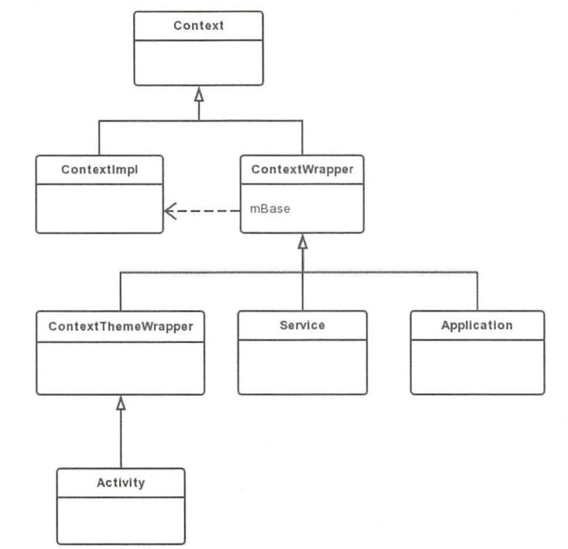

## 1 简介

Context 上下文对象，Android 中很多业务流程都涉及到 Context。



Context 数量 = Activity 数量 + Service 数量 + Application 数量(1)

> 2025 更新：上面这个公式是「有独立生命周期的 Context 实现」的数量，面试常顺着它问「为什么 Application context 不能弹 Dialog」「为什么单例持有 Activity 会泄漏」。本文在保留原整理的基础上，把继承体系、能力差异、泄漏原因和主题继承补齐。

### 1.1 Context 到底是什么

`Context` 是一个抽象类，它是**应用与系统环境之间的门面**：通过它拿资源（`getResources`/`getAssets`/`getString`）、拿系统服务（`getSystemService`）、启动组件（`startActivity`/`startService`/`bindService`）、访问存储（`getFilesDir`/`getSharedPreferences`/`openOrCreateDatabase`）、注册广播、以及拿到 `getApplicationContext()` 和 `getClassLoader()`。它本身不干活，真正的实现在 `ContextImpl`。

## 2 Context 继承体系

### 2.1 类关系

```
Context (abstract)
├── ContextImpl                     // 唯一真正实现，持有 Resources、PackageInfo、SystemService 缓存
└── ContextWrapper                  // 装饰者，把所有调用委托给 mBase
    ├── Application
    ├── Service
    └── ContextThemeWrapper         // 在 base 之上叠一层主题
        └── Activity
```

两个关键点：

* `ContextWrapper` 的所有方法基本都是 `mBase.xxx()`，它只负责「换一个身份」和「附加一点行为」（比如 `Service` 的生命周期、`Activity` 的窗口）；
* `Activity` 比 `Service`/`Application` 多一层 `ContextThemeWrapper`，所以只有 Activity 天然带「自己的主题」；`Application` 和 `Service` 的 base 是 `ContextImpl`，主题是系统默认的。

### 2.2 ContextImpl 与 ContextWrapper 的分工

| 类 | 角色 | 关键点 |
| --- | --- | --- |
| `ContextImpl` | 真正的实现 | `mPackageInfo`（LoadedApk）、`mResources`、`mMainThread`；`getSystemService` 走 `SystemServiceRegistry` 并缓存到 `mServiceCache` |
| `ContextWrapper` | 装饰者 | `attachBaseContext(Context base)` 决定 `mBase`；`getBaseContext()` 返回它 |
| `ContextThemeWrapper` | 主题装饰 | `getTheme()` 在 base 主题上 `applyStyle`，`Activity` 的 `setTheme`/`getTheme` 都由它实现 |

### 2.3 每个实现类在哪创建

| 类型 | 创建位置 | base 是谁 |
| --- | --- | --- |
| Application | `LoadedApk.makeApplication` → `ContextImpl.createAppContext` | 无（`ContextImpl` 自己就是根） |
| Activity | `ActivityThread.performLaunchActivity` → `Activity.attach` 传入 `ContextImpl.createActivityContext` | Application 的 `ContextImpl` |
| Service | `ActivityThread.handleCreateService` → `ContextImpl.createAppContext` | Application 的 `ContextImpl` |
| BroadcastReceiver 的 context | `LoadedApk.ReceiverDispatcher` 里的 `ReceiverRestrictedContext` | Application context 的包装 |
| ContentProvider 的 context | `ActivityThread.installProvider` 传入 Application context | Application 的 `ContextImpl` |

## 3 各种 Context 能做什么、不能做什么

### 3.1 能力对比

| 能力 | Application / Service | Activity | 原因 |
| --- | --- | --- | --- |
| 弹 `Dialog` | ✗ | ✓ | 需要 Activity 的 window token，否则 `BadTokenException: token null is not for an application` |
| `startActivity`（不加 flag） | ✗ | ✓ | 需要调用者所在 Task 的 token，见第 7 节 |
| `startActivity` + `FLAG_ACTIVITY_NEW_TASK` | ✓ | ✓ | 新建/复用 Task，不依赖调用者 |
| `Toast`、`startService`、`bindService` | ✓ | ✓ | 不需要窗口 token |
| `getSystemService(WINDOW_SERVICE)` 后 `addView` | ✗（无权限时） | ✓ | 非 Activity 的 Window 需要 `TYPE_APPLICATION_OVERLAY` 且申请悬浮窗权限 |
| 解析主题属性（`?attr/colorPrimary`） | 取默认值 | 取 Activity 主题 | 只有 Activity 的 `ContextThemeWrapper` 带自定义主题 |
| `LayoutInflater` 加载布局 | ✓（但样式可能不对） | ✓ | 同一条：主题来源不同 |
| 访问文件/DB/SP | ✓ | ✓ | 路径由 `ContextImpl` 的 `mPackageInfo` 决定，同一进程一致 |
| 注册 `BroadcastReceiver` | ✓（生命周期跟 Application） | ✓（跟 Activity） | 是否 `unregister` 取决于宿主生命周期 |
| 作为单例/静态变量长期持有 | ✓（与进程同寿） | ✗（泄漏） | 见第 5 节 |

差异的根源只有两处：一是 **base 不同** —— Activity 的 base 是 `ContextThemeWrapper`，多了主题，Application/Service 没有；二是 **有没有 token** —— Activity 在 `attach` 时从 AMS 拿到 `mToken`（代表它的 `ActivityRecord`），弹窗、启动 Activity 都靠它，Application/Service 没有 token，所以这些操作被系统拒绝。

## 4 Application Context 的创建过程

在 Activity 启动流程源码分析的启动过程中, 最后一个重要的方法是performLaunchActivity, 源码如下：

```java
private Activity performLaunchActivity(ActivityClientRecord r, Intent customIntent) {
    
    ...
    //创建 Application
    Application app = r.packageInfo.makeApplication(false, mInstrumentation);
    ...
    return activity;
}

```

主要看 r.packageInfo.makeApplication -> LpadedApk

```java
@UnsupportedAppUsage
public Application makeApplication(boolean forceDefaultAppClass,
            Instrumentation instrumentation) {
        //不为 null 就直接返回 Application
        if (mApplication != null) {
            return mApplication;
        }
        ...
        try {
            java.lang.ClassLoader cl = getClassLoader();
            if (!mPackageName.equals("android")) {
                ...
            }
            //创建 ContextImpl类型的 appContext
            ContextImpl appContext = ContextImpl.createAppContext(mActivityThread, this);
            //创建了一个 app 实例 反射
            app = mActivityThread.mInstrumentation.newApplication(
                    cl, appClass, appContext);
            appContext.setOuterContext(app);
        } catch (Exception e) {
            ...
        }
        mActivityThread.mAllApplications.add(app);
        mApplication = app;
        if (instrumentation != null) {
            try {
               //最终就调用了application.onCreate()方法
                instrumentation.callApplicationOnCreate(app);
            } catch (Exception e) {
                ...
            }
        }
        return app;
    }
```

### 4.1 补充：创建时序

1. `ActivityThread` 收到 AMS 的 `bindApplication`，`handleBindApplication` 里先 `makeApplication` —— **Application 在第一个组件创建之前就已经存在**；
2. `newApplication` 反射实例化 → `app.attach(context)`（`attachBaseContext`）→ `appContext.setOuterContext(app)`；
3. `callApplicationOnCreate` → `Application.onCreate()`；
4. 之后再 `performLaunchActivity` 创建 Activity，Activity 的 base 就是这个 appContext 及其 `LoadedApk`。

注意 `makeApplication` 的「不为 null 直接返回」：**一个进程只有一个 Application 实例**，这也是 `getApplicationContext()` 全进程唯一的根据。

## 5 `getApplicationContext()` 与 `this` 的区别

### 5.1 对比

| 维度 | `getApplicationContext()` | Activity 里的 `this` |
| --- | --- | --- |
| 实际对象 | `Application`（base 是进程唯一的 `ContextImpl`） | `Activity`（`ContextThemeWrapper` + 自己的 `ContextImpl`） |
| 生命周期 | 与进程一致 | `onCreate` ~ `onDestroy` |
| 主题 | 系统默认主题 | Activity 在清单/`setTheme` 指定的主题 |
| 弹 Dialog / 起 Activity（无 flag） | 不行 | 可以 |
| 能否 `registerReceiver` 后不管 | 需要自己 `unregister`，否则泄漏 | `onDestroy` 里 `unregister`，随页面走 |
| 适合做单例/静态持有 | 适合 | 不适合 |

### 5.2 内存泄漏：为什么单例不能持有 Activity

```java
public class AppManager {
    private static AppManager sInstance;
    private Context mContext;

    private AppManager(Context context) { mContext = context; }

    public static AppManager getInstance(Context context) {
        if (sInstance == null) {
            sInstance = new AppManager(context.getApplicationContext()); // 必须转 Application
        }
        return sInstance;
    }
}
```

`Context` 不是「一个小对象」：Activity 的 Context 通过 `mBase` 链住 `ContextImpl` → `LoadedApk` → `ActivityThread`，往上还挂着 `Window`、`DecorView`、整棵 View 树、`Drawable`/`Bitmap`、`Handler`。静态单例的生命周期是**进程级**，一旦持有 Activity 的 Context，Activity 即使 `finish()` 也无法被 GC —— 因为还有一条 GC Root 可达路径。同样的坑还有：非静态内部类 `Handler`/`Runnable`、静态 View、单例里存的 Listener、`Dialog` 持有 Activity。

排查方式：LeakCanary 的「Activity 泄漏」报告会直接指出持有链；MAT/Studio Profiler 里看 `Activity` 实例数量是否随页面切换增长。

### 5.3 什么时候必须用 Activity

* 弹 `Dialog`、`PopupWindow`、`BottomSheet`（需要 window token）；
* 不带 `NEW_TASK` 启动 Activity；
* 需要主题属性（`?attr/`、`MaterialTheme`）的 View 创建与 inflate；
* 需要 `startActivityForResult` / `ActivityResultLauncher`（必须由 Activity 发起）；
* `registerReceiver` 希望跟随页面生命周期自动注销。

## 6 Context 的数量与生命周期

| Context | 数量 | 生命周期 |
| --- | --- | --- |
| `Application` | 1 | 进程级（第一个组件创建前 → 进程死亡） |
| `Activity` | 每个实例一个 | `onCreate` ~ `onDestroy` |
| `Service` | 每个实例一个 | `onCreate` ~ `onDestroy` |
| `ContextImpl` | Activity/Service 各一个，Application 一个 | 与宿主同寿 |
| `ContextThemeWrapper` / `ReceiverRestrictedContext` | 包装对象，不新增 `ContextImpl` | 与宿主 / `onReceive` 同寿 |

`Context 数量 = Activity 数量 + Service 数量 + 1`。`createConfigurationContext`/`createDisplayContext` 会派生新的 `ContextImpl`（分屏、多语言等场景），不在这个公式里。关键结论：**Context 本身不会泄漏，泄漏的是「长生命周期对象持有了短生命周期的 Context」** —— 单例、静态变量、线程一旦抓住 Activity 的 Context，整条 View 链都跟着活到进程结束。

## 7 为什么 `startActivity` 需要 `FLAG_ACTIVITY_NEW_TASK`

`Activity` 重写了 `startActivity`，走 `startActivityForResult` → `Instrumentation.execStartActivity(..., mToken)`，把 `mToken` 传给 AMS，AMS 就知道新 Activity 应该放进**哪个 Task、哪个位置**（返回栈关系）。

Application/Service 用的是 `ContextImpl.startActivity`，没有 token。`ContextImpl` 里有一段检查：如果 `Intent` 没带 `FLAG_ACTIVITY_NEW_TASK`，就直接抛

```
AndroidRuntimeException: Calling startActivity() from outside of an Activity context
requires the FLAG_ACTIVITY_NEW_TASK flag.
```

（历史上 targetSdk 在 24~27 之间的应用被豁免过，具体条件以源码为准。）

因为 AMS 无法把新 Activity 塞进「调用者的返回栈」——调用者根本没有栈。加上 `NEW_TASK` 后语义变成「找一个合适的 Task，没有就新建」，AMS 自己决定落在哪，不再依赖调用者的 token。副作用是返回键不会回到调用方，这也是「从 Service 起页面后返回行为怪异」的原因。

## 8 `getBaseContext()`、主题继承与常见坑

### 8.1 `getBaseContext()` 是什么

`ContextWrapper.getBaseContext()` 返回 `mBase`，即「这个包装器代理的那个 Context」。

* Activity 的 base 是它的 `ContextImpl`（`attach` 时传入），但 `ContextThemeWrapper` 也参与，所以拿到的可能是 `ContextThemeWrapper` 包过的对象；
* 它的用途主要是框架内部（`LayoutInflater.cloneInContext`、`ContextThemeWrapper.initializeTheme`）；
* **业务代码不应该长期持有 `getBaseContext()`**：它绕过外层包装，Activity 重建后旧 base 可能已经失效；需要 Context 时优先 `this`（Activity 内）或 `getApplicationContext()`（长生命周期）。

### 8.2 主题（Theme）的继承链

1. 清单里 `android:theme` 或 `setTheme()` 指定 Activity 主题；
2. `Activity.attach` 把主题资源 id 交给 `ContextThemeWrapper`；
3. `ContextThemeWrapper.initializeTheme()`：`mTheme = getResources().newTheme()`，再 `mTheme.setTo(getBaseContext().getTheme())` —— **先继承 base 主题，再 `applyStyle` 自己的主题**；
4. 所以自定义主题只需要覆盖差异项，没写的属性自动落到 Application/系统主题上。

### 8.3 用 Application context inflate 会怎样

不会崩，但**样式错**：`LayoutInflater.from(appContext)` 里的 `?attr/colorPrimary`、`?attr/textAppearanceBody1` 会按系统默认主题解析，自定义主题全部失效；如果布局里的控件要求特定主题（比如 Material 组件），会出现颜色、字体、圆角都不对，甚至运行时异常。

正确做法：`LayoutInflater.from(this).cloneInContext(new ContextThemeWrapper(appContext, R.style.AppTheme))`，或者直接用 Activity 的 `LayoutInflater`。

## 9 面试问答

### Q1：Context、ContextWrapper、ContextImpl、ContextThemeWrapper 是什么关系？

`Context` 是抽象门面；`ContextImpl` 是唯一真正实现（资源、包信息、系统服务缓存）；`ContextWrapper` 是装饰者，把所有调用委托给 `mBase`，`Application`/`Service` 都继承它；`ContextThemeWrapper` 再叠一层主题，`Activity` 继承它。所以「Activity 比 Service 多出来的能力」主要是主题和 window token。

### Q2：`getApplicationContext()` 和 Activity 的 `this` 有什么区别？

前者是进程唯一的 `Application`，生命周期与进程一致，没有 Activity 主题、没有 window token，不能弹 Dialog、不能无 flag 起 Activity；后者是当前页面，带主题和 token，但生命周期只到 `onDestroy`。做单例、长期缓存用前者，碰 UI 和窗口用后者。

### Q3：为什么 Application context 不能弹 Dialog？

Dialog 最终要 `WindowManager.addView`，需要 window token 决定它属于哪个窗口、显示在谁上面。Application context 没有 attach 到任何 Activity 的 token，系统会抛 `BadTokenException: token null is not for an application`。Service 同理，要弹就必须用 `TYPE_APPLICATION_OVERLAY` 并申请悬浮窗权限。

### Q4：单例持有 Activity 的 Context 为什么会内存泄漏？怎么改？

单例是静态的、活到进程结束，它持有 Activity 的 Context 就等于持有整棵 View 树、Window、Bitmap 的引用链，`finish()` 后这些对象仍有 GC Root 可达，无法回收。改成 `context.getApplicationContext()`，或者把需要 Context 的方法改成传参、用完即弃。排查用 LeakCanary 看引用链。

### Q5：为什么从 Service 或 Application 启动 Activity 要加 `FLAG_ACTIVITY_NEW_TASK`？

因为 AMS 需要知道新 Activity 放进哪个 Task。Activity 有 `mToken`，能放进自己的返回栈；Service/Application 没有 token，只能靠 `NEW_TASK` 让 AMS 新建或复用一个 Task。不加就抛 `AndroidRuntimeException`。

### Q6：一个应用到底有多少个 Context？

有独立生命周期的实现对象 ≈ Activity 数 + Service 数 + 1（Application）。每次创建 Activity/Service 都会新建一个 `ContextImpl`，Application 只有一个。此外还有包装类（`ContextThemeWrapper`、`ReceiverRestrictedContext`）和 `createConfigurationContext`/`createDisplayContext` 生成的派生 Context，它们不改变上面这个量级。

### Q7：`getBaseContext()` 和 `this` 有什么区别？

`this` 是当前对象（Activity/Service），`getBaseContext()` 是它内部代理的那个 Context。日常开发几乎不需要 `getBaseContext()`：它绕过外层包装，容易拿到已经失效的旧对象，还破坏了主题/生命周期语义。要 Context 就用 `this` 或 `getApplicationContext()`。

### Q8：为什么说「Activity 泄漏」本质上往往是「Context 泄漏」？

因为 Activity 就是 Context，且它的 Context 链上挂着界面资源。持有 Activity 的 Context（或它的 View、Drawable、Handler）与持有 Activity 本身等价；而 Application Context 不会反向持有 Activity，所以「把 Activity 的 Context 换成 Application Context」是成本最低的修法。
