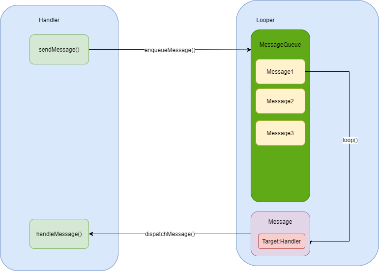

## 1 消息机制

Android 消息机制本质上是 Handler 运行机制和 MessageQueue 以及Looper 工作过程，这三者所组成的一个整体运行机制。Android 消息循环机制如下图所示：



具体分为四大要素:

- Message(消息)：需要被传递的消息，消息分为硬件产生的消息(如按钮、触摸)和软件生成的消息。
- MessageQueue(消息队列)：**负责消息的存储与管理**，负责管理由 Handler 发送过来的Message。读取会自动删除消息，单链表维护，插入和删除上有优势。在其 next() 方法中会无限循环，不断判断是否有消息，有就返回这条消息并移除。
- Handler(消息处理器)：负责 Message 的发送及处理。主要向消息池发送各种消息事件(Handler.sendMessage())和处理相应消息事件(Handler.handleMessage())，按照先进先出执行，内部使用的是单链表的结构。
- Looper(消息循环器)：负责关联线程以及消息的分发，在该线程下从 MessageQueue获取 Message，分发给Handler，Looper创建的时候会创建一个 MessageQueue，调用loop()方法的时候消息循环开始，其中会不断调用messageQueue的next()方法，当有消息就处理，否则阻塞在messageQueue的next()方法中。当Looper的quit()被调用的时候会调用messageQueue的quit()，此时next()会返回null，然后loop()方法也就跟着退出。

整个消息的循环流程还是比较清晰的：

* Handler 通过 sendMessage() 发送消息 Message 到消息队列 MessageQueue，MessageQueue 负责消息的存储与管理。
* Looper 通过loop() 不断获取 Message，并将 Message 交给对应的 target handler 来处理。

* target handler 调用自身的 handleMessage() 方法来处理 Message。

> 2025 更新：上面第一条「硬件产生的消息（如按钮、触摸）」是 2019 年的常见说法，需要纠正：触摸/按键事件不是 `Message`，而是由 `InputDispatcher` 通过 `InputChannel`（socketpair）投递到应用，主线程 `ViewRootImpl` 里的 `InputEventReceiver` 把对应 fd 注册进主线程 Looper 的 epoll；VSYNC 同理。也就是说硬件事件与 `Message` 共用同一个 native `Looper` 的 epoll 循环，但不进 `MessageQueue` 链表，真正走 `Handler` 的仍是软件消息。

## 2 消息队列创建

消息机制中有一个很重要的部分就是消息队列 MessageQueue，主要有两个操作插入（enqueueMessage）和读取（next）。我们先来看看消息队列的创建。

```java
public final class MessageQueue {
    ...
    private long mPtr; // 地址值
    private native static long nativeInit();
    ...
    MessageQueue(boolean quitAllowed) {
        mQuitAllowed = quitAllowed;
        mPtr = nativeInit();//本地方法
    }    
}

//Looper 中创建 MessageQueue
public final class Looper {
    
  private Looper(boolean quitAllowed) {
      //创建消息队列
      mQueue = new MessageQueue(quitAllowed);
      //指向当前线程
      mThread = Thread.currentThread();
   }  
}
```

我们可以看到调用本地方法完成初始化。

```c++
static jlong android_os_MessageQueue_nativeInit(JNIEnv* env, jclass clazz) {
    //构建 NativeMessageQueue 对象
    NativeMessageQueue* nativeMessageQueue = new NativeMessageQueue();
    if (!nativeMessageQueue) {
        jniThrowRuntimeException(env, "Unable to allocate native queue");
        return 0;
    }

    nativeMessageQueue->incStrong(env);
    //将对象的地址值转成 long 型传递给 Java 层
    return reinterpret_cast<jlong>(nativeMessageQueue);
}
```

接下来我们看看 NativeMessageQueue。

```c++
NativeMessageQueue::NativeMessageQueue() : //继承 NativeMessageQueue
        mPollEnv(NULL), mPollObj(NULL), mExceptionObj(NULL) {
   
    //判断是否为当前线程创建过了 Looper 对象
    mLooper = Looper::getForThread();
    if (mLooper == NULL) {
        //创建 Looper 对象
        mLooper = new Looper(false);
        //为线程设置 Looper
        Looper::setForThread(mLooper);
    }
}
```

接下来看看如何构造 Looper。

```java
Looper::Looper(bool allowNonCallbacks) :
        mAllowNonCallbacks(allowNonCallbacks), mSendingMessage(false),
        mResponseIndex(0), mNextMessageUptime(LLONG_MAX) {
    int wakeFds[2];
    //创建管道
    int result = pipe(wakeFds);
    LOG_ALWAYS_FATAL_IF(result != 0, "Could not create wake pipe.  errno=%d", errno);
    //读端文件描述符
    mWakeReadPipeFd = wakeFds[0];
    //写端文件描述符
    mWakeWritePipeFd = wakeFds[1];
    ...
    //创建 epoll 实例，将它的文件描述符保存在变量 mEpollFd 中
    mEpollFd = epoll_create(EPOLL_SIZE_HINT);
    LOG_ALWAYS_FATAL_IF(mEpollFd < 0, "Could not create epoll instance.  errno=%d", errno);
    struct epoll_event eventItem;
    memset(& eventItem, 0, sizeof(epoll_event)); // zero out unused members of data field union
    eventItem.events = EPOLLIN;
    eventItem.data.fd = mWakeReadPipeFd;
    //将管道读端描述符添加到 epoll 中，以便监听管道的写操作
    result = epoll_ctl(mEpollFd, EPOLL_CTL_ADD, mWakeReadPipeFd, & eventItem);
    LOG_ALWAYS_FATAL_IF(result != 0, "Could not add wake read pipe to epoll instance.  errno=%d",
            errno);
}
```

pipe、epoll 是 Linux 端的知识，这里简单解释一下。

* 管道（pipe）是一种最基本的 IPC 机制，作用于有血缘关系的进程之间，完成数据传递。
* epoll：I/O多路复用，监听多个文件描述符的IO读写事件，是Linux内核为处理大批量文件描述符]而作了改进的poll。

> 2025 更新：上面的 `Looper::Looper` 用 `pipe(wakeFds)` 创建唤醒管道，是 Android 9 及更早的实现。Android 10 起 AOSP 改成 `eventfd(0, EFD_NONBLOCK | EFD_CLOEXEC)`（成员为 `mWakeEventFd`），并由 `rebuildEpollLocked()` 统一创建 epoll 实例、用 `epoll_ctl(EPOLL_CTL_ADD)` 注册该 fd；唤醒路径不变，仍是「写 fd → epoll 可读 → `pollInner` 返回」。所以面试说「pipe + epoll」不算错，但更准确的现代说法是「eventfd + epoll」，详见 6.1。

## 3 消息的添加

我们通常会调用 handler 的 sendXXX() 或 postXXX() ，实际调用的 MessageQueue的enqueueMessage()方法，将消息插入到目标线程的消息队列中。

```java
public final class MessageQueue {
    
      boolean enqueueMessage(Message msg, long when) {
            //每个消息都必须有个target handler
            if (msg.target == null) {
                throw new IllegalArgumentException("Message must have a target.");
            }
            
            //每个消息必须没有被使用
            if (msg.isInUse()) {
                throw new IllegalStateException(msg + " This message is already in use.");
            }
            //加锁
            synchronized (this) {
                //正在退出时，回收 Message，加入消息池。
                if (mQuitting) {
                    ...
                    //回收   
                    msg.recycle();
                    return false;
                }
    
                msg.markInUse();
                msg.when = when;
                //mMessages表示当前需要处理的消息，队头的消息
                Message p = mMessages;
                boolean needWake;
                
                if (p == null || when == 0 || when < p.when) {
                    // New head, wake up the event queue if blocked.
                    msg.next = p;
                    mMessages = msg;
                    needWake = mBlocked;
                } else {
                    needWake = mBlocked && p.target == null && msg.isAsynchronous();
                    //将消息按照时间顺序插入到消息队列中
                    Message prev;
                    for (;;) {
                        prev = p;
                        p = p.next;
                        if (p == null || when < p.when) {
                            break;
                        }
                        if (needWake && p.isAsynchronous()) {
                            needWake = false;
                        }
                    }
                    msg.next = p; // invariant: p == prev.next
                    prev.next = msg;
                }
                //唤醒消息队列
                if (needWake) {
                    nativeWake(mPtr);
                }
            }
            return true;
        }
}
```

## 3 消息循环

使用 Looper 来进行消息循环。

```java
public class LooperThread extends Thread {
    public Handler mHandler;
    public void run() {
        Looper.prepare();
        mHandler = new Handler() {
            public void handleMessage(Message msg) {
                // process incoming messages here
            }
        };
        Looper.loop();
    }
        
//Looper.prepare()
private static void prepare(boolean quitAllowed) {
  if (sThreadLocal.get() != null) {
    throw new RuntimeException("Only one Looper may be created per thread");
  }
  sThreadLocal.set(new Looper(quitAllowed));
}
    
//创建主线程的Looper，在 ActivityThread 中使用，一般我们用不到
public static void prepareMainLooper() {
        prepare(false);
        synchronized (Looper.class) {
            if (sMainLooper != null) {
                throw new IllegalStateException("The main Looper has already been prepared.");
            }
            sMainLooper = myLooper();
       }
}    
```

Looper 使用 Looper.prepare() 方法来创建 Looper ，并且会使用 ThreadLocal 来实现与当前线程的绑定功能。然后 Looper.loop()  则不断从 MessageQueue 中获取 Message 。

```java
public final class Looper {
     ...
     public static void loop() {
        //获取当前线程的 Looper
        final Looper me = myLooper();
        if (me == null) {
            throw new RuntimeException("No Looper; Looper.prepare() wasn't called on this thread.");
        }
        
        //获取当前线程的消息队列
        final MessageQueue queue = me.mQueue;
        //确保当前线程处于本地进程中，Handler仅限于处于同一进程间的不同线程的通信。
        Binder.clearCallingIdentity();
        final long ident = Binder.clearCallingIdentity();
        //进入loop主循环方法
        for (;;) {
            //不断的获取下一条消息，这个方法可能会被阻塞
            Message msg = queue.next();
            if (msg == null) {
                return;
            }       
            ...
            //处理消息
            try {
                msg.target.dispatchMessage(msg);
            } finally {
                ...
            }
            ...  
            //把message回收到消息池，复用。
            msg.recycleUnchecked();
        }
     }
}
```

loop() 方法主要做了三件事：

* 调用 MessageQueue#next() 读取下一条 Message。

* 把 Message 分发给相应的 target，调用 dispatchMessage()。
* 再把分发的 Message 回收到消息池，以便重复利用。

## 5 消息的分发与处理

Looper.loop() 里面调用 next()  和 dispatchMessage() 对消息进行分发与处理。

### 5.1 消息的分发

```java
public final class MessageQueue {
    
    Message next() {
            ...
           //注册到消息队列中空闲Handler个个数
           int pendingIdleHandlerCount = -1; 
           //表示无消息到来时，当前线程需要进入睡眠状态的时间，
           //0:不进入睡眠状态，-1:进入无限等待的睡眠状态，直到有人将它唤醒
           int nextPollTimeoutMillis = 0;
           for (;;) {
               if (nextPollTimeoutMillis != 0) {
                   Binder.flushPendingCommands();
               }
   
               //阻塞操作，检测当前线程的消息队列中是否有消息需要处理
               //里面也是 pipe / epoll
               nativePollOnce(ptr, nextPollTimeoutMillis);
   
               //查询下一条需要执行的消息
               synchronized (this) {
                   final long now = SystemClock.uptimeMillis();
                   Message prevMsg = null;
                   //mMessages代表了当前线程需要处理的消息
                   Message msg = mMessages;               
                   if (msg != null && msg.target == null) {
                       do {
                           prevMsg = msg;
                           msg = msg.next;
                       } while (msg != null && !msg.isAsynchronous());
                   }
                   if (msg != null) {
                       
                       if (now < msg.when) {
                           //如果当前消息头是延时消息，比当前时间长的话，计算延时等待的时间并赋值
                           nextPollTimeoutMillis = (int) Math.min(msg.when - now, Integer.MAX_VALUE);
                       } 
                       //如果消息的执行时间小于当前时间，则说明该消息需要立即执行，则将该消息返回，并从消息队列中                    
                       else {
                           mBlocked = false;
                           if (prevMsg != null) {
                               prevMsg.next = msg.next;
                           } else {
                               mMessages = msg.next;
                           }
                           msg.next = null;
                           ...
                           return msg;
                       }
                   } else {
                       // 如果没有消息需要处理，将nextPollTimeoutMillis置为-1，让当前线程进入无限睡眠状态，直到被其他线程唤醒。
                       nextPollTimeoutMillis = -1;
                   }
   
                   //所有消息都已经被处理，准备退出。
                   if (mQuitting) {
                       dispose();
                       return null;
                   }  
                   //pendingIdleHandlerCount:等待执行的Handler的数量
                   //mIdleHandlers:空闲 Handler 列表
                   if (pendingIdleHandlerCount < 0
                           && (mMessages == null || now < mMessages.when)) {
                       pendingIdleHandlerCount = mIdleHandlers.size();
                   }
                   if (pendingIdleHandlerCount <= 0) {
                       //当没有空闲的Handler需要执行时进入阻塞状态
                       mBlocked = true;
                       continue;
                   }
   
                   //mPendingIdleHandler:IdleHandler数组
                   if (mPendingIdleHandlers == null) {
                       mPendingIdleHandlers = new IdleHandler[Math.max(pendingIdleHandlerCount, 4)];
                   }
                   mPendingIdleHandlers = mIdleHandlers.toArray(mPendingIdleHandlers);
               }
   
               //只有在第一次循环时，才会去执行idle handlers，执行完成后重置pendingIdleHandlerCount为0
               for (int i = 0; i < pendingIdleHandlerCount; i++) {
                   final IdleHandler idler = mPendingIdleHandlers[i];
                   //释放 Handler 的引用
                   mPendingIdleHandlers[i] = null;
   
                   boolean keep = false;
                   try {
                       keep = idler.queueIdle();
                   } catch (Throwable t) {
                       Log.wtf(TAG, "IdleHandler threw exception", t);
                   }
   
                   if (!keep) {
                       synchronized (this) {
                           mIdleHandlers.remove(idler);
                       }
                   }
               }
               pendingIdleHandlerCount = 0;         
               nextPollTimeoutMillis = 0;
           }
       } 
}
```


> 2025 更新：上面 `next()` 里的 `nativePollOnce(ptr, nextPollTimeoutMillis)` 就是整个消息机制的阻塞点，注释里的「里面也是 pipe / epoll」在 Android 10 之后应理解为 eventfd + epoll；`nextPollTimeoutMillis` 的三种取值（0 / -1 / 正数）与 `mBlocked` 的配合是高频追问，详见 6.1。

### 5.2 消息的处理

```java
public class Handler {
        ...
        public void dispatchMessage(Message msg) {
            //当Message存在回调方法时，优先调用Message的回调方法message.callback.run()
            if (msg.callback != null) {
                //实际调用的就是message.callback.run();
                handleCallback(msg);
            } else {
                //如果我们设置了Callback回调，优先调用Callback回调。
                if (mCallback != null) {
                    if (mCallback.handleMessage(msg)) {
                        return;
                    }
                }
                //如果我们没有设置了Callback回调，则回调自身的Callback方法。
                handleMessage(msg);
            }
        }
}
```

Looper.loop() 是个死循环，不断调用 MessageQueue.next() 获取 Message ，并调用msg.target.dispatchMessage(msg) 切换到 Handler 来分发消息，以此来完成消息的回调。

https://blog.csdn.net/start_mao/article/details/98963744

## 6 Android 12—16 的变化与面试追问

> 2025 更新：第 1—5 节来自 2019 年的 AOSP 9/10，`Message`、`MessageQueue`、`Looper`、`Handler` 四件套的骨架至今没有变化，原文仍然成立；本节只补 2019 年之后新增的机制、以及面试会追问的部分。API 级别：12=31、13=33、14=34、15=35、16=36。

### 6.1 MessageQueue 的 epoll 与 nativePollOnce

`MessageQueue` 在 Java 层只有一个 `long mPtr`，指向 native 的 `NativeMessageQueue`，后者持有一个 native `Looper`。所有「阻塞 / 唤醒」都发生在 native `Looper` 里：

1. `Looper.loop()` 不断调用 `MessageQueue.next()`；
2. `next()` 的 `for (;;)` 里先调 `nativePollOnce(mPtr, nextPollTimeoutMillis)`；
3. native 侧 `Looper::pollOnce()` → `pollInner()` → `epoll_wait(mEpollFd, ..., timeoutMillis)`；
4. 有 fd 就绪（唤醒 fd、输入 fd、VSYNC fd）或超时，`epoll_wait` 返回，控制权回到 Java 层继续扫链表。

所以「消息队列」的本质是「一个 epoll 多路复用器 + 一条按 `when` 排序的单链表」。`nextPollTimeoutMillis` 有三种取值：

| 取值 | 含义 | 典型场景 |
| --- | --- | --- |
| `0` | 不阻塞，立即返回 | 刚处理完一条消息，需要重扫队列 |
| `-1` | 无限等待，直到有人 `nativeWake` | 队列为空且没有 IdleHandler |
| `> 0` | 最多等这么久 | 队头是延时消息，取 `msg.when - now` |

唤醒侧对应 `enqueueMessage()` 里的 `needWake`：插入队头时 `needWake = mBlocked`；插入队中只有「队头是屏障且新消息是异步」才需要唤醒。`nativeWake()` 在 native 层就是往唤醒 fd 写一个 1，让 `epoll_wait` 立即返回。

> 2025 更新：Android 10 起 native `Looper` 把 `pipe()` 换成了 `eventfd()`，epoll 注册与唤醒语义完全一致，读源码时看到 `mWakeEventFd` 不要以为是另一套机制。

主线程的 epoll 里除了唤醒 fd，还注册了输入通道（`InputEventReceiver`）和 VSYNC（`DisplayEventReceiver` 的 BitTube）。这就是「一次触摸、一次 VSYNC 为什么能把主线程从 `nativePollOnce` 里唤醒」的答案，也是「Looper 是线程的事件循环，不只是消息队列」的依据。

### 6.2 同步屏障与 Choreographer

同步屏障是一条 `target == null` 的特殊消息，由 `MessageQueue#postSyncBarrier()` 插入（`@hide`，不是 SDK API），用 `removeSyncBarrier(token)` 移除。`next()` 扫到屏障后会跳过所有同步消息，只返回 `isAsynchronous()` 为 true 的异步消息：

```java
// MessageQueue#next() 中的屏障处理（AOSP 骨架）
if (msg != null && msg.target == null) {
    do {
        prevMsg = msg;
        msg = msg.next;
    } while (msg != null && !msg.isAsynchronous());
}
```

`ViewRootImpl#scheduleTraversals()` 正是这样用的：先挂屏障挡住普通同步消息，再向 `Choreographer` 请求一次 traversal 回调。

```java
void scheduleTraversals() {
    if (!mTraversalScheduled) {
        mTraversalScheduled = true;
        // 1. 先挂同步屏障
        mTraversalBarrier = mHandler.getLooper().getQueue().postSyncBarrier();
        // 2. 再请求 traversal（Choreographer 内部用异步消息）
        mChoreographer.postCallback(Choreographer.CALLBACK_TRAVERSAL, mTraversalRunnable, null);
    }
}
```

`Choreographer` 往主线程 `Handler` 发 `MSG_DO_FRAME`、`MSG_DO_SCHEDULE_CALLBACK` 时都会 `msg.setAsynchronous(true)`，因此能穿过屏障先执行；`doTraversal()` 里第一件事是 `removeSyncBarrier(mTraversalBarrier)`，然后才 `performTraversals()`。这样这一帧的 measure/layout/draw 就不会被同一帧里排在前面的普通消息拖后，尽量贴近 VSYNC。

两点必须说清：

- 屏障不是「提高优先级」的通用开关。没有异步消息时，屏障会让所有同步消息一直等，忘记 `removeSyncBarrier` 就是典型的「界面点了没反应」。
- 应用侧不要反射 `postSyncBarrier`：它是 hidden API，且容易出事故。公开的异步消息手段是 `Message#setAsynchronous(true)`（API 22）与 `Handler#createAsync(Looper)`（API 28）。

### 6.3 IdleHandler 的正确用法

`MessageQueue.IdleHandler#queueIdle()` 在 `next()` 里执行，时机是「当前没有到期消息、马上就要阻塞」。返回 `true` 表示保留，返回 `false` 表示执行一次后移除：

```kotlin
Looper.myQueue().addIdleHandler {
    // 一次只做一小块可延迟的工作
    if (hasMoreWork()) true else false
}
```

启动优化里常用它，原因是首帧提交后主线程通常进入空闲，把「非首屏必需」的初始化（预连接、预加载、统计上报）挪到这里，可以不拖慢首帧。但它的语义边界必须讲清：

- 它只代表「队列暂时没消息」，不代表「这一帧已经渲染完成」。首帧前后可能触发多次，也可能刚触发就被新消息打断。
- 它跑在主线程，做 IO、数据库、大 JSON 解析一样卡帧；正确做法是分片（做完还返回 `true`）或直接切到 `Dispatchers.IO`。
- 它和 `Choreographer.postFrameCallback`（与 VSYNC 绑定，每帧一次）、`View.post`（等 attach 后执行）、`Activity#reportFullyDrawn`（启动耗时统计口径）都不是一回事。Jetpack App Startup 解决初始化顺序与依赖，Baseline Profile 解决首帧前代码未被 AOT 编译，都替代不了 IdleHandler。

### 6.4 Handler 内存泄漏的现代写法

泄漏链路没变：`MessageQueue` → `Message` → `target`（Handler）→ 匿名内部类或 Lambda 捕获的 Activity，而主线程队列的生命周期远长于 Activity。变化在于现在很少再手写 Handler：

```kotlin
// 协程作用域：随 viewLifecycleOwner 销毁自动取消，不需要手动 removeCallbacks
viewLifecycleOwner.lifecycleScope.launch {
    repeatOnLifecycle(Lifecycle.State.STARTED) { viewModel.uiState.collect { render(it) } }
}

// 必须用 Handler 时：静态内部类 + WeakReference
private class SafeHandler(activity: Activity) : Handler(Looper.getMainLooper()) {
    private val ref = WeakReference(activity)
    override fun handleMessage(msg: Message) { ref.get()?.onMessage(msg) }
}

// 兜底：清掉队列里挂着的回调
override fun onDestroy() {
    handler.removeCallbacksAndMessages(null)
    super.onDestroy()
}
```

- `new Handler()` 的无参构造在 API 30 被标记 `@Deprecated`（隐式取当前线程 Looper，子线程直接崩），显式传 `Looper.getMainLooper()` 更稳。
- `viewLifecycleOwner.lifecycleScope` 的取消点是 `onDestroyView`，`Fragment.lifecycleScope` 是 `onDestroy`，视图相关的收集必须用前者。
- `postDelayed` 的 Runnable 只要还在队列里就持有它捕获的一切；`removeCallbacksAndMessages(null)` 只是兜底，治本还是作用域取消。LeakCanary 给出的引用链通常就是 `MessageQueue → Message → target → Activity`。

### 6.5 HandlerThread 还是协程

| 维度 | `HandlerThread` | 协程 |
| --- | --- | --- |
| 本质 | 一个线程 + 一个 `Looper`，串行执行 | 调度器上的可挂起任务 |
| 并发 | 单线程串行，天然无锁 | `Default` 是 CPU 并行池，`IO` 是阻塞池 |
| 取消 | 只能 `quitSafely()` 整体退出 | `Job.cancel()` 逐任务取消 |
| 适合 | native 回调、Camera/Sensor、长生命周期的串行队列 | 业务逻辑、请求编排、结构化并发 |

- 需要严格串行、且回调来自 native 或第三方 SDK（必须给它一个 Looper）时，`HandlerThread` 仍是对的工具。
- 纯 Kotlin 业务优先协程：`Dispatchers.Default` 做 CPU 计算，`Dispatchers.IO` 做阻塞 IO；要串行用 `Dispatchers.Default.limitedParallelism(1)`，不建议再 `newSingleThreadContext`。
- `IntentService` 在 API 30 被废弃，后台串行任务优先 `WorkManager` 或协程；`HandlerThread` 不用时记得 `quitSafely()`，否则线程一直活着。

### 6.6 Looper 的消息监控（Android 12+ 的 Observer）

Android 12（API 31）起，AOSP 的 `Looper` 里多了一个 `@hide` 的 `Observer` 接口和进程级静态 `setObserver()`：

```java
// AOSP Looper.java（@hide，非 SDK API）
public interface Observer {
    Object messageDispatchStarting();
    void messageDispatched(Object token, Message msg);
    void dispatchingThrewException(Object token, Message msg, Exception exception);
}
```

它在 `loop()` 分发消息的流程里被调用（较新版本把单次分发拆成了 `loopOnce()`）：分发前拿 token，分发后回调，抛异常走 `dispatchingThrewException`，因此能精确统计「哪条消息、属于哪个 Handler、耗时多少」，系统侧用它打 Perfetto 的 `message_queue` 轨迹。对 App 它是非 SDK API、反射会踩 hidden API 限制，线上监控更常见的是 `Looper#setMessageLogging(Printer)`（公开 API，消息前后打点，早期 BlockCanary 就基于它），以及 `Choreographer` 帧回调 + `FrameMetrics`/`JankStats`。

### 6.7 主线程 Looper、Choreographer 与 VSYNC

主线程 Looper 是三个来源的汇聚点：`Handler` 消息、输入事件、VSYNC。VSYNC 路径为：`Choreographer` 构造时创建 `FrameDisplayEventReceiver`（`DisplayEventReceiver` 内部是一对 BitTube/socketpair），其 fd 注册进主线程 Looper 的 epoll；`scheduleVsync()` → `nativeScheduleVsync()`；下一个 VSYNC 到来时 fd 可读，主线程从 `nativePollOnce` 醒来，`doFrame()` 按固定顺序执行回调：

1. `CALLBACK_INPUT`（输入）
2. `CALLBACK_ANIMATION`（动画）
3. `CALLBACK_INSETS_ANIMATION`（窗口 inset 动画）
4. `CALLBACK_TRAVERSAL`（`performTraversals`：measure/layout/draw）
5. `CALLBACK_COMMIT`（提交，供 `FrameMetrics` 统计）

这解释了两个常见现象：主线程被一条耗时消息占住时，输入与 VSYNC 只能排队，表现为「掉帧 + 点击延迟」；`postFrameCallback` 里拿到的是 VSYNC 时间（`frameTimeNanos`）而非回调真正执行的时刻，做动画要用它而不是 `System.currentTimeMillis()`。

### 6.8 面试追问

Q1：`Looper` 死循环为什么既不会 ANR 也不占满 CPU？
死循环阻塞在 `epoll_wait` 上，线程睡眠不耗 CPU；ANR 是 AMS 对输入、广播、Service 的超时判定，只有该处理的消息迟迟处理不完才会触发。

Q2：同步屏障解决什么问题？
让异步消息（traversal）插队到同步消息之前，保证一帧的 measure/layout/draw 不被普通消息拖后；用完必须 `removeSyncBarrier`。

Q3：`postDelayed(0)` 和 `IdleHandler` 有什么区别？
前者是普通消息，按 `when` 排队，可能紧接着当前消息执行；后者只在队列空闲、即将阻塞时执行，适合「有空再做」的低优先级初始化。

Q4：子线程能直接更新 UI 吗？
不能，`ViewRootImpl#checkThread()` 会抛 `CalledFromWrongThreadException`；未 attach 的 View 改属性可能不报错，但不可依赖。

Q5：延时消息为什么不准？
`when` 基于 `SystemClock.uptimeMillis()`（不含深度睡眠），加上前序消息耗时、队列排序、VSYNC 对齐与 Doze 限制，实际执行只会晚不会早。

Q6：`quit()` 和 `quitSafely()` 的区别？
`quit` 立即丢弃所有消息（含延时），`quitSafely` 先处理已到期消息、丢弃延时消息；两者都让 `next()` 返回 null 使 `loop()` 退出。

Q7：`Message.obtain()` 为什么比 `new Message()` 好？
复用 `sPool` 池（上限 50 条）避免频繁分配触发 GC，`recycle()` 回池，`Handler.sendMessage` 内部也走 `obtain`。

Q8：`HandlerThread` 与 `Dispatchers.Default` 怎么选？
串行且需要 Looper（native 回调、Camera/Sensor）选 `HandlerThread`；业务逻辑选协程，用 `limitedParallelism(1)` 代替单线程调度器，并用作用域拿取消能力。
