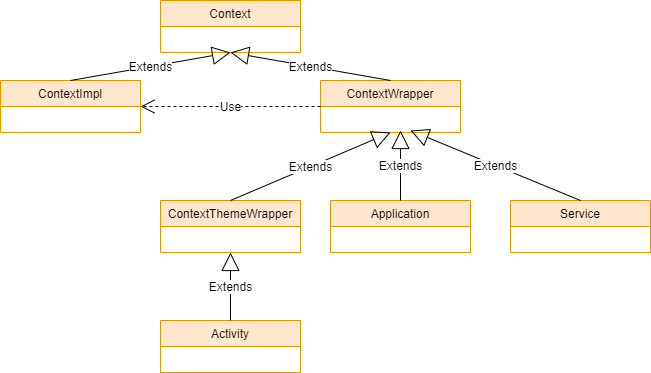
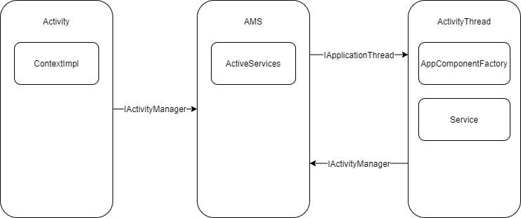

## 1 Context



* Activity、Service、Application 都是 ContextWrapper 的子类；
* ContextWrapper 里面引用着一个 ContextImpl 实例；
* ContextWrapper 里所有的方法都是通过调用 ContextImpl 进行实现；

## 2 源码

startService 会调用 ContextImpl 中。

### ContextImpl#startService()

```java
class ContextImpl extends Context {
    @Override
    public ComponentName startService(Intent service) {
        warnIfCallingFromSystemProcess();
        //1.调用 startServiceCommon 函数
        return startServiceCommon(service, false, mUser);
    }
    private ComponentName startServiceCommon(Intent service, boolean requireForeground,
            UserHandle user) {
        try {
            validateServiceIntent(service);
            service.prepareToLeaveProcess(this);
            //2.调用 AMS 的 startService()
            ComponentName cn = ActivityManager.getService().startService(
                mMainThread.getApplicationThread(), service, service.resolveTypeIfNeeded(
                            getContentResolver()), requireForeground,
                            getOpPackageName(), user.getIdentifier());
            return cn;
        } catch (RemoteException e) {
            throw e.rethrowFromSystemServer();
        }
    }
}
```

> 2025 更新：`startForegroundService()` 走的也是这条 `startServiceCommon` → `AMS#startService` → `ActiveServices#startServiceLocked`，区别只是 `requireForeground=true`。Android 8.0（API 26）起，这条路径会给 Service 挂一个"必须尽快 `startForeground()`"的计时器（约 5 秒），超时先 ANR、再抛 `RemoteServiceException`（Android 12 起为 `ForegroundServiceDidNotStartInTimeException`）。

###  ActivityManagerService#startService()

```java
   public ComponentName startService(IApplicationThread caller, Intent service,
            String resolvedType, boolean requireForeground, String callingPackage, int userId)
            throws TransactionTooLargeException {
        .....
        synchronized(this) {
            final int callingPid = Binder.getCallingPid();
            final int callingUid = Binder.getCallingUid();
            final long origId = Binder.clearCallingIdentity();
            ComponentName res;
            try {
                //1.调用ActiveServices#startServiceLocked()；
                res = mServices.startServiceLocked(caller, service,
                        resolvedType, callingPid, callingUid,
                        requireForeground, callingPackage, userId);
            } finally {
                Binder.restoreCallingIdentity(origId);
            }
            return res;
        }
    }
```

### ActiveServices#startServiceLocked()

```java
ComponentName startServiceLocked(IApplicationThread caller, Intent service, String resolvedType,
            int callingPid, int callingUid, boolean fgRequired, String callingPackage, final int userId)
            throws TransactionTooLargeException {
        ...
        //1.创建并且封装启动 Service 的相关数据
        ServiceLookupResult res =
            retrieveServiceLocked(service, resolvedType, callingPackage,
                    callingPid, callingUid, userId, true, callerFg, false, false);
        if (res == null) {
            return null;
        }
        if (res.record == null) {
            return new ComponentName("!", res.permission != null
                    ? res.permission : "private to package");
        }
        ServiceRecord r = res.record;
        if (!mAm.mUserController.exists(r.userId)) {
            Slog.w(TAG, "Trying to start service with non-existent user! " + r.userId);
            return null;
        }
        ...
        //2.调用 startServiceInnerLocked()；
    ComponentName startServiceInnerLocked(Servic  
        ComponentName cmp = startServiceInnerLocked(smap, service, r, callerFg, addToStarting);
        return cmp;
    }
```

### ActiveServices#startServiceInnerLocked()

```java
    ComponentName startServiceInnerLocked(ServiceMap smap, Intent service, ServiceRecord r,
            boolean callerFg, boolean addToStarting) throws TransactionTooLargeException {
        ...
        //调用 bringUpServiceLocked
        String error = bringUpServiceLocked(r, service.getFlags(), callerFg, false, false); 
        if (error != null) {
            return new ComponentName("!!", error);
        }
        return r.name;
    }
```

### ActiveServices#bringUpServiceLocked()

```java
 private String bringUpServiceLocked(ServiceRecord r, int intentFlags, boolean execInFg,
            boolean whileRestarting, boolean permissionsReviewRequired)
            throws TransactionTooLargeException {
        ...
        final boolean isolated = (r.serviceInfo.flags&ServiceInfo.FLAG_ISOLATED_PROCESS) != 0;
        final String procName = r.processName;
        String hostingType = "service";
        ProcessRecord app;
        if (!isolated) {
            app = mAm.getProcessRecordLocked(procName, r.appInfo.uid, false);
            if (DEBUG_MU) Slog.v(TAG_MU, "bringUpServiceLocked: appInfo.uid=" + r.appInfo.uid
                        + " app=" + app);
            if (app != null && app.thread != null) {
                try {
                    app.addPackage(r.appInfo.packageName, r.appInfo.longVersionCode, mAm.mProcessStats);
                    //4.调用 realStartServiceLocked
                    realStartServiceLocked(r, app, execInFg);
                    return null;
                } catch (TransactionTooLargeException e) {
                    throw e;
                } catch (RemoteException e) {
                    Slog.w(TAG, "Exception when starting service " + r.shortName, e);
                }
            }
        } else {
            app = r.isolatedProc;
            if (WebViewZygote.isMultiprocessEnabled()
                    && r.serviceInfo.packageName.equals(WebViewZygote.getPackageName())) {
                hostingType = "webview_service";
            }
        }
       ...
    }
```

> 2025 更新：Android 12（API 31）起，后台应用调 `startForegroundService()` 会被 `ForegroundServiceStartNotAllowedException` 拦下（只在豁免场景放行，如已有前台服务、有可见窗口、高优先级 FCM、精确闹钟等）；Android 14（API 34）起还会在这里校验 `android:foregroundServiceType` 与配套权限，缺 type 抛 `MissingForegroundServiceTypeException`、缺权限抛 `SecurityException`。

### ActiveServices#realStartServiceLocked()

```java
    private final void realStartServiceLocked(ServiceRecord r,
            ProcessRecord app, boolean execInFg) throws RemoteException {
        ...
        boolean created = false;
        try {
            if (LOG_SERVICE_START_STOP) {
                String nameTerm;
                int lastPeriod = r.shortName.lastIndexOf('.');
                nameTerm = lastPeriod >= 0 ? r.shortName.substring(lastPeriod) : r.shortName;
                EventLogTags.writeAmCreateService(
                        r.userId, System.identityHashCode(r), nameTerm, r.app.uid, r.app.pid);
            }
            synchronized (r.stats.getBatteryStats()) {
                r.stats.startLaunchedLocked();
            }
            mAm.notifyPackageUse(r.serviceInfo.packageName,
                                 PackageManager.NOTIFY_PACKAGE_USE_SERVICE);
            app.forceProcessStateUpTo(ActivityManager.PROCESS_STATE_SERVICE);
            //代码一：通知 ActivityThread，真正的创建Service；
            app.thread.scheduleCreateService(r, r.serviceInfo,
                    mAm.compatibilityInfoForPackageLocked(r.serviceInfo.applicationInfo),
                    app.repProcState);
            r.postNotification();
            created = true;
        } catch (DeadObjectException e) {
            ...
        } finally {
            ...
        }
        //代码二：通知ActivityThread调用Service的onStartCommand方法
        sendServiceArgsLocked(r, execInFg, true);
    
    }
```

> 2025 更新：`scheduleCreateService` 之后仍然是 `handleCreateService` 里反射建实例 + `attach` + `onCreate`，这一步没变；变的是前台服务：`startForeground(id, notification)` 在 Android 14 起要带 type，Android 15 起 `dataSync`/`mediaProcessing` 有 6 小时配额，超时回调 `Service#onTimeout()`，所以 `onCreate` 里的初始化不要依赖"服务会长期活着"。

### 代码一：**ActivityThread**#scheduleCreateService()

scheduleCreateService() 其实就是通过Handler机制进行线程切换，最后会调用handleCreateService();

```java
 private void handleCreateService(CreateServiceData data) {
        unscheduleGcIdler();
        //1.获取LoadedApk对象，负责解析manifest文件；
        LoadedApk packageInfo = getPackageInfoNoCheck(
                data.info.applicationInfo, data.compatInfo);
        Service service = null;
        try {
            //2.通过类加载器，创建Service实例
            java.lang.ClassLoader cl = packageInfo.getClassLoader();
            //3.创建 Servie 对象,AppComponentFactory#instantiateService()
            service = packageInfo.getAppFactory()
                    .instantiateService(cl, data.info.name, data.intent);
        } catch (Exception e) {
            ...
        }
        try {
            if (localLOGV) Slog.v(TAG, "Creating service " + data.info.name);
            ContextImpl context = ContextImpl.createAppContext(this, packageInfo);
            context.setOuterContext(service);
            Application app = packageInfo.makeApplication(false, mInstrumentation);
            //4.Service 对象,初始化基本设置
            service.attach(context, this, data.info.name, data.token, app,
                    ActivityManager.getService());
            //5.调用 service 的onCreate生命周期函数
            service.onCreate();
            mServices.put(data.token, service);
            ...
        }
    }
```

> 2025 更新：`handleCreateService` 在主线程执行 `service.onCreate()`。`startForegroundService()` 的计时从这次启动进入 `ActiveServices` 就开始算，`onCreate`、`onStartCommand` 的耗时都吃这 5 秒，所以异步初始化（下载、读库、等定位）放在 `onCreate` 里等基本必超时；正确姿势是 `onCreate` 里立刻 `startForeground()`（通知先发"准备中"），数据好了再更新通知。

### 代码二：ActivityThread#scheduleServiceArgs()

```java
   private final void sendServiceArgsLocked(ServiceRecord r, boolean execInFg,
            boolean oomAdjusted) throws TransactionTooLargeException {
        ...        
       Exception caughtException = null;
        try {
            //调用 scheduleServiceArgs,实现其他的生命周期方法的调用
            r.app.thread.scheduleServiceArgs(r, slice);
        } catch (TransactionTooLargeException e) {
            ...
        }
        ...
    }
```

### ActivityThread#handleServiceArgs()

scheduleServiceArgs()最终通过 Handler 机制切换线程，并且调用handleServiceArgs()；

```java
 private void handleServiceArgs(ServiceArgsData data) {
        Service s = mServices.get(data.token);
        if (s != null) {
            try {
                if (data.args != null) {
                    data.args.setExtrasClassLoader(s.getClassLoader());
                    data.args.prepareToEnterProcess();
                }
                int res;
                if (!data.taskRemoved) {
                    //调用 Service#onStartCommand
                    res = s.onStartCommand(data.args, data.flags, data.startId);
                } else {
                    s.onTaskRemoved(data.args);
                    res = Service.START_TASK_REMOVED_COMPLETE;
                }
               ...
            } catch (Exception e) {
                ...
            }
        }
    }
```

> 2025 更新：`onStartCommand` 的返回值（`START_STICKY`/`START_NOT_STICKY`/`START_REDELIVER_INTENT`）语义没变，但"进程被杀后系统再把 Service 拉起来"在 Android 8.0 之后受后台执行限制、Doze、App Standby 影响，`START_STICKY` 并不等于"一定重启"；需要可靠执行的后台任务交给 `WorkManager`/`JobScheduler`，别指望 Service 自愈。`onTaskRemoved` 里做重活同样会撞后台限制。

## 3 总结



## 4 Android 12—16 的变化与面试追问

> 本节覆盖 **Android 12（API 31）—Android 16（API 36）**，并把 Android 8.0（API 26）就引入的 `startForegroundService` 规则一并补齐——它是后面所有前台服务限制的地基。

### 4.1 Android 8.0—12：startForegroundService 与 5 秒规则

`startForegroundService()` 和 `startService()` 走的是同一条 `ActiveServices#startServiceLocked`，区别只是 `requireForeground = true`（源码里的 `fgRequired` 参数），于是系统在创建 `ServiceRecord` 后会额外挂一个"前台服务计时器"：

* 官方文档给的窗口是 **5 秒**：Service 必须在这段时间内调用 `startForeground(id, notification)`；
* 超时的表现分两段：先 ANR（AOSP 里 `SERVICE_START_FOREGROUND_ANR_DELAY` 是 5s 量级），再抛 `android.app.RemoteServiceException`；
* Android 12（API 31）起异常细化为 `RemoteServiceException$ForegroundServiceDidNotStartInTimeException`，可以用 `getTypeId()`、`getServiceClassName()` 定位是哪个服务；
* AOSP 里还有一个 `SERVICE_START_FOREGROUND_TIMEOUT`（10s 量级）的崩溃判定，和文档的 5s 不完全一致——记"5 秒内必须 `startForeground`"这个结论，具体毫秒数以 AOSP 为准。

实践结论：

* `onCreate`/`onStartCommand` 第一行就 `startForeground()`，不要先做网络、读文件、等回调；
* `startForeground()` 要在主线程调用，且通知必须有效（channel 已创建、`POST_NOTIFICATIONS` 状态处理过）；
* `ContextCompat.startForegroundService()` 是兼容写法，低版本自动退化成 `startService()`。

### 4.2 Android 12：后台起前台服务会被直接拒绝（FGS 启动限制）

Android 12（API 31）起，应用在**后台**调用 `startForegroundService()` 会抛 `ForegroundServiceStartNotAllowedException`（`IllegalStateException` 的子类）。常见豁免：

* 应用有可见窗口（前台 Activity）；
* 应用已有前台服务在运行；
* 高优先级 FCM 消息触发的启动；
* 精确闹钟（`SCHEDULE_EXACT_ALARM`/`USE_EXACT_ALARM`）到点触发的启动；
* 用户刚授权过 while-in-use 权限（如定位/麦克风/相机）；
* 设备管理员、`ROLE_DIALER`、配套设备等系统角色；
* `SYSTEM_ALERT_WINDOW`（Android 15 起这一豁免在 BAL 判定里被收紧，以官方文档为准）。

注意它和 BAL（后台启动 Activity）不是一套判定：BAL 拦 `startActivity`，FGS 限制拦 `startForegroundService`；但两者共用 `BackgroundActivityStartController` 一类的判定逻辑和很多豁免条件。

### 4.3 Android 14：foregroundServiceType 必填

targetSdk 34（Android 14）起：

1. manifest 的 `<service>` 必须声明 `android:foregroundServiceType`（可多个，用 `|` 分隔）；
2. 调 `startForeground()` 时必须传本次使用的 type（`ServiceCompat.startForeground(service, id, notification, type)`）；
3. 不声明 type（或传 `0`）会抛 `MissingForegroundServiceTypeException`（API 34 新增）；type 与 manifest 声明不匹配、或缺少该 type 的配套权限，通常是 `SecurityException`（以官方文档为准）。

常用 type 与配套权限（都是 manifest 权限，`FOREGROUND_SERVICE` 本身是 normal 权限）：

| type | 配套权限 | 典型场景 |
| --- | --- | --- |
| `camera` | `FOREGROUND_SERVICE_CAMERA` | 后台录像/相机处理 |
| `microphone` | `FOREGROUND_SERVICE_MICROPHONE` | 录音、语音助手 |
| `location` | `FOREGROUND_SERVICE_LOCATION` | 导航、轨迹记录 |
| `connectedDevice` | `FOREGROUND_SERVICE_CONNECTED_DEVICE` | 蓝牙/穿戴/投屏 |
| `dataSync` | `FOREGROUND_SERVICE_DATA_SYNC` | 同步、上传下载 |
| `mediaPlayback` | `FOREGROUND_SERVICE_MEDIA_PLAYBACK` | 音乐/视频播放 |
| `mediaProcessing`（15） | `FOREGROUND_SERVICE_MEDIA_PROCESSING` | 转码、AI 处理 |
| `mediaProjection` | `FOREGROUND_SERVICE_MEDIA_PROJECTION` | 录屏、投屏采集 |
| `phoneCall` | `FOREGROUND_SERVICE_PHONE_CALL` | VoIP/通话 |
| `remoteMessaging` | `FOREGROUND_SERVICE_REMOTE_MESSAGING` | 消息同步 |
| `health` | `FOREGROUND_SERVICE_HEALTH` | 运动/健康数据 |
| `shortService`（14） | 无专属权限，3 分钟上限 | 短任务但需前台 |
| `specialUse`（14） | `FOREGROUND_SERVICE_SPECIAL_USE` | 兜底（需说明理由） |
| `systemExempted` | 系统应用 | 系统组件 |

坑点：

* type 要和实际行为一致：声明 `location` 就得有定位权限且真的在定位，滥用 `specialUse` 上架会被拒；
* 多个 type 同时使用时，每个 type 的权限都要满足；
* Android 13（API 33）的 `POST_NOTIFICATIONS` 没授予时，前台服务**仍能运行**，只是通知不显示——不要误判成服务没起来。

### 4.4 Android 15：dataSync / mediaProcessing 超时

Android 15（API 35）给两类"有时间上限"的前台服务加了硬超时：

* `dataSync`：24 小时内累计约 **6 小时**；
* `mediaProcessing`：24 小时内累计约 **6 小时**（该 type 也是 15 新增）；
* `shortService`（14 引入）：单次 **3 分钟**。

超时后系统回调 `Service#onTimeout(int startId, int fgsType)`（API 35；`onTimeout(int startId)` 是 34 为 `shortService` 提供的单参版本），应用必须尽快 `stopSelf(startId)`；不处理会被系统停掉并留下 `RemoteServiceException` 记录。

这意味着"用 `dataSync` 常驻同步"在 15 上不可行：长任务应该拆成多次 `WorkManager`/`JobScheduler`，或在超时回调里保存进度、下次续传。

另外 Android 15 起，`BOOT_COMPLETED` 广播不能再启动 `dataSync`/`camera`/`mediaPlayback`/`phoneCall`/`mediaProjection`/`microphone` 类型的 FGS——"开机自启 + 前台服务"这条老路被堵了一半。

### 4.5 bindService 与 ServiceConnection 的现代注意点

* `bindService()` 返回 `false` 的常见原因，按排查顺序：
  1. Intent 解析不到（显式 Intent 类名写错、组件没 exported）；
  2. 权限不足（目标服务声明了 `android:permission`）；
  3. **包可见性**：Android 11（API 30）起要 `<queries>` 声明或 `QUERY_ALL_PACKAGES`，否则查不到别的应用的 Service；
  4. 目标应用未安装/被禁用。
* `android:exported`：targetSdk 31（Android 12）起带 `<intent-filter>` 的组件必须显式声明，否则安装失败。
* `ServiceConnection` 的四个回调：`onServiceConnected`（绑定成功）、`onServiceDisconnected`（**只有进程崩溃/被杀才回调**，`unbindService` 不会）、`onBindingDied`（API 26+，绑定失效需重新 bind）、`onNullBinding`（API 28+，`onBind` 返回 null）。
* 泄漏：`unbindService` 只能解一次，多解抛 `IllegalArgumentException: Service not registered`；Activity 销毁时没解绑会抛 `ServiceConnectionLeaked`。
* 生命周期组合：`startService` + `bindService` 同时存在时，`stopService` 不会销毁仍在绑定的服务，`unbindService` 也不会停掉 start 过的服务，两者都结束才走 `onDestroy`。
* `bindService` 本身不受"后台不能起 FGS"限制，但进程优先级由 `ServiceRecord` 的绑定关系决定，应用退后台后进程仍可能被杀，`onBindingDied` 要能自愈。

### 4.6 Android 16（API 36）的边际变化

Android 16 没有改 Service 生命周期，也没有改 `startForeground` 的 API 形状，主要是延续 15 的前台服务超时/后台限制趋势，并对 `onTimeout` 未 `stopSelf` 的行为继续收紧。面试被问到 16 的具体新条目，答"以官方 behavior changes 为准"即可，不要硬编类名。

### 4.7 面试追问（6—8 个）

1. **`startService` 和 `startForegroundService` 区别？为什么是 5 秒？** 后者带 `fgRequired`，系统要保证前台服务及时可见，否则后台进程会被滥用；超时抛 `ForegroundServiceDidNotStartInTimeException`。
2. **`startForegroundService` 后不调 `startForeground` 会怎样？** 先 ANR 再 `RemoteServiceException` 崩溃，日志里能搜到服务名。
3. **Android 14 为什么强制 `foregroundServiceType`？** 让系统知道 FGS 在用哪些敏感资源，从而按 type 校验权限、做超时与配额；缺 type/权限分别是 `MissingForegroundServiceTypeException` 和 `SecurityException`。
4. **Android 15 的 `dataSync` 超时怎么处理？** 实现 `onTimeout(startId, fgsType)`，保存进度并 `stopSelf(startId)`，长任务交给 `WorkManager` 续跑。
5. **后台起前台服务被拒怎么定位？** 看是否抛 `ForegroundServiceStartNotAllowedException`，再对豁免清单（前台窗口、已有 FGS、高优先级 FCM、精确闹钟等）。
6. **`bindService` 返回 false 怎么排查？** Intent/exported → 权限 → `<queries>` 包可见性 → 应用是否安装。
7. **`onServiceDisconnected` 和 `onBindingDied` 区别？** 前者是连接建立后服务进程挂了，后者是 binder 失效（如服务进程重启），后者需要重新 `bindService`。
8. **`startService` + `bindService` 混用时 Service 何时销毁？** 两个引用都清零：`stopService`/`stopSelf` 且无绑定，或所有 `unbindService` 且未 start。