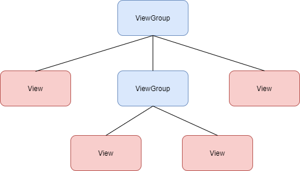
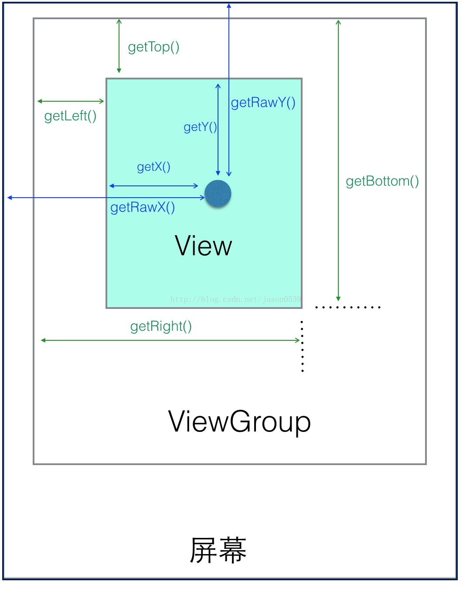

## 1 View 和 ViewGroup

* View 是 Android 控件的基类
* ViewGroup 继承 View



`View` 负责「自己怎么画」，`ViewGroup` 负责「孩子们放哪、多大」：

| 职责 | View | ViewGroup |
| --- | --- | --- |
| 测量 | `onMeasure` 算自己的尺寸 | `onMeasure` 遍历子 View 调 `measureChildWithMargins`，再定自己 |
| 布局 | `onLayout` 空实现（位置由父容器给） | `onLayout` 决定每个子 View 的 `left/top/right/bottom` |
| 绘制 | `onDraw` 画自己 | `dispatchDraw` 遍历子 View 的 `draw` |
| 背景 | `setBackground` 画在自己区域 | 默认 `setWillNotDraw(true)`，需要背景/`onDraw` 时手动关掉 |

## 2 View 的坐标



### 2.1 View 获取自身宽高

由上图可知 `View` 自身的高度计算公式：

- width = getRight() - getLeft()
- height = getBottom() - getTop()

`View` 源码中提供的 `getWidth()` 和 `getHeight()` 获取 `View` 的宽高，内部处理是相同的。注意区分 `getWidth()`（layout 后的实际宽度）与 `getMeasuredWidth()`（measure 后的测量宽度）：一般相等，但父容器在 layout 阶段可能重新分配（如 `LinearLayout` 的 `weight`）。

### 2.2 View 自身坐标

下面方法获取 `View` 到父控件的距离：

- getTop()：View 自身顶部到父控件顶部距离
- getBottom()：View 自身底部到父控件顶部距离
- getLeft()：View 自身左边到父控件左边距离
- getRight()：View 自身右边到父控件左边距离

另外还有 `getX()/getY()`：等于 `left + translationX`、`top + translationY`，**包含平移**，所以在做动画/拖拽时要用它而不是 `getLeft()`。

### 2.3 MotionEvent 提供方法

当我们点击手机屏幕时候，点击事件会封装成 `MotionEvent`，然后由 `onTouchEvent(MotionEvent ev)` 方法进行处理，`MotionEvent` 提供获取焦点左边的方法：

- getX()：视图坐标，点击位置距离控件左边距离
- getY()：视图坐标，点击位置距离控件顶部距离
- getRawX()：绝对坐标，点击位置距离整个屏幕左边距离
- getRawY()：绝对坐标，点击位置距离整个屏幕顶部距离

## 3 View 滑动

* layout()
* offsetLeftAndRight() 和 offsetTopAndBottom(）
* LayoutParmas
* 动画
* scrollTo 和 scrollBy
  * scrollTo  移动到具体点
  * scrollBy 移动增量，最终调用 scrollTo  
* Scroller 配合 View.computeScroll()

## 4 View 树：DecorView / Window / WindowManager

### 4.1 `setContentView` 之后发生了什么

1. `Activity.setContentView` → `PhoneWindow.setContentView`；
2. `PhoneWindow.installDecor()` 创建 `DecorView`，按主题加载 `screen_xxx.xml` 生成「系统栏占位 + `android.R.id.content`」的结构；
3. 用户的布局被 `addView` 到 `mContentParent`（就是 `android.R.id.content`）；
4. `ActivityThread.handleResumeActivity` 里 `wm.addView(decorView, lp)` —— **这时 View 树才真正挂到 Window 上**；
5. `WindowManagerImpl.addView` → `WindowManagerGlobal.addView`：`new ViewRootImpl(...)`，然后 `root.setView(decor, lp, panelParentView)`。

所以顺序是：**DecorView 先建好 → 用户布局塞进 content → resume 时由 WMS 分配 Surface → ViewRootImpl 发起第一次 traversal**。

### 4.2 DecorView 的结构

```
DecorView (FrameLayout)
└── LinearLayout (vertical)
    ├── 状态栏背景 / 导航栏背景（按主题可有可无）
    └── FrameLayout  ← android.R.id.content，setContentView 的内容放这里
```

`DecorView` 是整个窗口的根，`Window` 是「窗口的抽象」（实现类 `PhoneWindow`），`WindowManager` 是「管理窗口的接口」（实现 `WindowManagerImpl` → 真正干活的是 `WindowManagerGlobal` 和 WMS）。三者关系：**Window 持有 DecorView，WindowManager 把 DecorView 交给 WMS 并创建 ViewRootImpl**。

### 4.3 ViewRootImpl 的角色

`ViewRootImpl` 实现了 `ViewParent`，是 **View 树与 WMS 之间的桥梁**：

* 持有 `mView`（DecorView）、`mSurface`、`mChoreographer`、`mHandler`（`ViewRootHandler`）；
* `setView` 时通过 `IWindowSession` 向 WMS `addWindow`，拿到 `Surface`；
* 负责调度 `performTraversals()`（measure/layout/draw）；
* 把输入事件从 WMS 分发给 View 树，并执行 `requestLayout`/`invalidate` 的最终合并与触发。

## 5 MeasureSpec 与 measure

### 5.1 三种模式

`MeasureSpec` 是一个 32 位 int：**高 2 位是 mode，低 30 位是 size**。

| 模式 | 含义 | 典型来源 |
| --- | --- | --- |
| `EXACTLY` | 父容器已定死尺寸 | `match_parent` / 具体 dp |
| `AT_MOST` | 父容器给了上限，自己不能超过 | `wrap_content` |
| `UNSPECIFIED` | 不限制，自己看着办 | `ScrollView` 里的子 View、`ListView` 测量 item |

### 5.2 measure 的流程

1. 父容器 `measureChildWithMargins(child, ...)` → `getChildMeasureSpec(...)` 算出子 View 的 spec；
2. 子 View `measure(widthSpec, heightSpec)`（`final`，不能重写）；
3. `measure` 内部：如果尺寸没变且没有 `PFLAG_FORCE_LAYOUT`，直接用缓存；否则调 `onMeasure`；
4. `onMeasure` 里根据 spec 算出期望尺寸，最后必须 `setMeasuredDimension(w, h)`；
5. 父容器在所有子 View 测量完后，用 `resolveSizeAndState` 定自己的尺寸。

### 5.3 为什么 `wrap_content` 和 `match_parent` 一样大

自定义 View 如果只写 `super.onMeasure(...)` 而不处理 `AT_MOST`，`View.getDefaultSize()` 对 `AT_MOST` 和 `EXACTLY` 都返回 `specSize`，于是 `wrap_content` 变成了「撑满父容器」。

正确写法：

```java
@Override
protected void onMeasure(int widthMeasureSpec, int heightMeasureSpec) {
    int desiredW = getPaddingLeft() + contentWidth + getPaddingRight();
    int desiredH = getPaddingTop() + contentHeight + getPaddingBottom();
    setMeasuredDimension(
            resolveSize(desiredW, widthMeasureSpec),
            resolveSize(desiredH, heightMeasureSpec));
}
```

`resolveSize` 会按 mode 取 `min(desired, specSize)` 或 `specSize`，这样 `AT_MOST` 才能得到「内容大小」。

### 5.4 父容器怎么给子 View 算 spec

`ViewGroup.getChildMeasureSpec(parentSpec, padding, childDimension)`：

| 子 View 的 LayoutParams | 父容器是 EXACTLY | 父容器是 AT_MOST | 父容器是 UNSPECIFIED |
| --- | --- | --- | --- |
| 具体值（如 100dp） | EXACTLY 100 | EXACTLY 100 | EXACTLY 100 |
| `match_parent` | EXACTLY 剩余空间 | AT_MOST 剩余空间 | UNSPECIFIED 0 |
| `wrap_content` | AT_MOST 剩余空间 | AT_MOST 剩余空间 | UNSPECIFIED 0 |

## 6 layout 与 draw

### 6.1 layout 流程

1. `View.layout(l, t, r, b)` → `setFrame()` 记录四个边界，返回「位置是否变化」；
2. 位置变化或强制布局时调 `onLayout(changed, l, t, r, b)`；
3. `View` 的 `onLayout` 是空实现（自己不需要摆孩子），`ViewGroup` 是抽象方法，必须遍历 `child.layout(...)`；
4. `LinearLayout` 在 `onLayout` 里按 orientation 累加偏移，`RelativeLayout` 要按依赖关系多次测量/布局。

### 6.2 draw 的六步

`View.draw(Canvas)` 的顺序固定：

1. 画背景 `drawBackground`；
2. 保存 layer（为 `fade`/`alpha` 动画准备）；
3. `onDraw(canvas)` —— 画自己；
4. `dispatchDraw(canvas)` —— 画孩子（`ViewGroup` 才有意义）；
5. `onDrawForeground(canvas)` —— 滚动条、`foreground`、`defaultFocusHighlight`；
6. 恢复 layer，画 decorations。

自定义 View 只重写 `onDraw`；自定义 ViewGroup 想画背景/内容时要先 `setWillNotDraw(false)`，否则 `WILL_NOT_DRAW` 标记会让 `onDraw` 不被调用。

## 7 `requestLayout` 与 `invalidate`

### 7.1 区别

| 维度 | `requestLayout()` | `invalidate()` |
| --- | --- | --- |
| 作用 | 请求重新测量 + 布局 | 请求重新绘制 |
| 触发条件 | 尺寸/位置可能变化（改 LayoutParams、`setText` 导致宽度变） | 内容/外观变化（颜色、进度、选中态） |
| 传播方向 | 向上冒泡到 `ViewRootImpl`，再由上往下 measure/layout | 向上合并 `dirty` 区域，最终由 `ViewRootImpl` 调度 draw |
| 下一帧做的事 | `performMeasure` → `performLayout`（通常伴随重绘） | `performDraw`，不 measure/layout |
| 代价 | 高（整棵子树可能重新测量） | 低（只重绘脏区域） |

一句话：**invalidate 只重画，requestLayout 要重新算尺寸；requestLayout 常常顺带一次重绘，但 invalidate 绝不会触发测量布局。**

### 7.2 源码路径

* `requestLayout`：置 `PFLAG_FORCE_LAYOUT` → `mParent.requestLayout()` 一路到 `ViewRootImpl.requestLayout()` → `scheduleTraversals()`；在 layout 过程中再次请求会被延后处理，避免无限递归。
* `invalidate`：`invalidateInternal` → `mParent.invalidateChild(this, dirty)`，`ViewGroup` 把脏区换算成父坐标并合并 → `ViewRootImpl.invalidateChildInParent` → `scheduleTraversals()`。

### 7.3 常见误用

* 在 `onDraw` 里调 `requestLayout()` → 每帧都重新测量，卡顿甚至死循环；
* 只改颜色却调 `requestLayout()` → 白跑一遍测量布局；在 `onLayout` 里改子 View 的 LayoutParams → 容易抖动；
* 子线程直接调 `invalidate()` → 非 UI 线程操作 View，可能崩（用 `postInvalidate()`）。

## 8 `View.post` 与 `Handler`

```java
// 未 attach：先存进 HandlerActionQueue
// 已 attach：直接投递到 AttachInfo.mHandler（主线程 Handler）
public boolean post(Runnable action) {
    final AttachInfo attachInfo = mAttachInfo;
    if (attachInfo != null) return attachInfo.mHandler.post(action);
    getRunQueue().post(action);
    return true;
}
```

关键点：

1. **未 attach 时**，`Runnable` 存在 `HandlerActionQueue` 里；`dispatchAttachedToWindow` 时 `executeActions(handler)` 把队列里的任务 `postDelayed` 到主线程 Handler；
2. 所以无论哪条路径，任务都在**当前这次 traversal 之后**执行 —— 这正是 `View.post` 能拿到 `getWidth()/getHeight()` 的原因（此时 measure/layout 已完成）；
3. `View.post` 和 `Handler.post` 的区别：前者绑定 View 的 attach 状态与主线程 Handler，后者要自己管理 Looper 和泄漏；
4. 如果 View 永远不 attach（`new TextView()` 后没加进树），任务永远不会执行，还持有 Runnable 造成泄漏；`postDelayed` 同理，内部 Handler 是 `ViewRootImpl.ViewRootHandler`，运行在主线程。

## 9 ViewRootImpl 与 Choreographer

### 9.1 一帧的调度

`ViewRootImpl.scheduleTraversals()` 做三件事：`mTraversalScheduled = true`、往 `Choreographer` 注册 `mTraversalRunnable`（`CALLBACK_TRAVERSAL`）、插入同步屏障。`Choreographer` 在 vsync 到来时回调 `doFrame`，`mTraversalRunnable` 执行 `doTraversal()` → `performTraversals()`。

### 9.2 Choreographer 的回调顺序

同一次 vsync 内按注册类型顺序执行：`CALLBACK_INPUT`（输入）→ `CALLBACK_ANIMATION`（属性动画、`ViewPropertyAnimator`）→ `CALLBACK_INSETS_ANIMATION`（系统栏 insets 动画，较新版本）→ `CALLBACK_TRAVERSAL`（measure/layout/draw）→ `CALLBACK_COMMIT`（提交，较新版本）。

所以「输入先于动画、动画先于绘制」，这也是 `Choreographer` 能保证动画和绘制在同一帧内对齐的原因。

### 9.3 同步屏障

`ViewRootImpl` 会往主线程 `MessageQueue` 插入一个**同步屏障**（`postSyncBarrier`），让后面的异步消息（traversal）优先执行，避免被普通消息（比如一堆 `Handler.post`）拖到下一帧。`doTraversal` 结束后再移除屏障。

## 10 Surface 与 SurfaceFlinger：一帧怎么上屏

`Surface` 是应用侧的绘制目标，本质是 `BufferQueue` 的生产者端；`SurfaceFlinger` 是消费者，负责把所有 Layer 合成后送显示。

1. App 线程 `Choreographer.doFrame` → `ViewRootImpl.doTraversal` → measure/layout/draw；
2. 硬件加速下，`draw` 把命令记录到 `RenderNode`，`ThreadedRenderer` 把状态同步给 RenderThread；
3. RenderThread `drawFrame` 调用 `eglSwapBuffers` → `queueBuffer`，把画好的 `GraphicBuffer` 还给 `BufferQueue`；
4. `SurfaceFlinger` 在下一个 vsync 收到 buffer，按 Z 序用 HWC（或 GPU）合成所有 Layer；
5. `HWC` 把合成结果交给显示控制器，扫描上屏。

BufferQueue 通常是**三级缓冲**：App 在画 A，SF 在用 B 合成，C 空闲；如果 App 画得太慢，`dequeueBuffer` 拿不到空闲 buffer 就会阻塞 —— 这就是掉帧/jank 的底层原因。

## 11 WindowInsets 与 edge-to-edge

* `WindowInsets` 描述系统占用区域：`systemBars()`（状态栏+导航栏）、`displayCutout()`（刘海）、`ime()`（输入法）、`systemGestures()`、`mandatorySystemGestures()`、`tappableElement()`。
* Android 15（targetSdk 35）起默认 edge-to-edge：内容延伸到系统栏后面，必须自己处理 insets；Android 16（targetSdk 36）起连退出开关都移除（具体以官方文档为准）。
* 标准写法：

```java
WindowCompat.setDecorFitsSystemWindows(window, false);
ViewCompat.setOnApplyWindowInsetsListener(root) { v, insets ->
    val bars = insets.getInsets(WindowInsetsCompat.Type.systemBars()
            or WindowInsetsCompat.Type.displayCutout())
    v.updatePadding(bars.left, bars.top, bars.right, bars.bottom)
    WindowInsetsCompat.CONSUMED
};
```

* 注意点：`fitsSystemWindows` 在复杂布局里不可靠；列表/输入框要用 insets 动态加 padding；沉浸式全屏用 `WindowInsetsControllerCompat.hide(systemBars())`；三键导航和手势导航的 insets 数值不同，要分别验证。

## 12 自定义 View 的三种方式

| 方式 | 做法 | 适用 | 必须处理 |
| --- | --- | --- | --- |
| 继承 `View` | 重写 `onDraw`，必要时 `onMeasure` | 单一图形、进度条、图表 | `wrap_content`、padding、`onDraw` 不 new 对象 |
| 继承 `ViewGroup` | 重写 `onMeasure` + `onLayout` | 流式布局、九宫格、自定义容器 | `generateLayoutParams`、margin、`measureChildWithMargins` |
| 继承已有控件 | 如 `extends AppCompatTextView` | 在现有行为上加功能 | 构造方法三件套、兼容 `defStyleAttr` |

补充一种更常见的「组合式自定义 View」：`LayoutInflater` 加载一个布局 + 自定义 `FrameLayout`，不需要碰 measure/layout，成本最低。性能注意：`onDraw` 里不要 `new` 对象/`allocate`、不要做耗时计算（会被调用很多次）；能用 `canvas.clipRect` 就别整块重绘；`ViewStub`/`merge` 减少布局层级。

## 13 面试问答

### Q1：一次 measure/layout/draw 是谁驱动的？

`requestLayout`/`invalidate` 把请求冒泡到 `ViewRootImpl`，它向 `Choreographer` 注册 `CALLBACK_TRAVERSAL`；vsync 到来时 `doFrame` 调 `performTraversals`，依次 `performMeasure`（`mView.measure`）→ `performLayout`（`mView.layout`）→ `performDraw`（`mView.draw`）。`DecorView` 是根，父容器负责给子 View 算 `MeasureSpec`，再递归下去。

### Q2：MeasureSpec 三种模式的区别？为什么 `wrap_content` 会变成撑满？

`EXACTLY` 是定死、`AT_MOST` 是给上限、`UNSPECIFIED` 是不限制。`View` 默认的 `getDefaultSize` 对 `AT_MOST` 也返回 `specSize`，所以自定义 View 不重写 `onMeasure` 时 `wrap_content` 等于 `match_parent`。修法是按内容算出 desired 尺寸后 `resolveSize`。

### Q3：`requestLayout` 和 `invalidate` 的区别？

`requestLayout` 标记 `PFLAG_FORCE_LAYOUT`，向上冒泡到 `ViewRootImpl`，下一帧走 measure + layout（尺寸变了通常还会重绘）；`invalidate` 只把脏区往上合并，下一帧只 `draw`。反过来不成立：`invalidate` 不会触发测量布局。误用最常见的是「只改颜色却 requestLayout」和「onDraw 里 requestLayout」。

### Q4：`View.post` 和 `Handler.post` 有什么区别？为什么能拿到宽高？

`View.post` 在未 attach 时把任务存进 `HandlerActionQueue`，attach 时统一投递到主线程 Handler；已 attach 就直接投。两条路径都在当前 traversal 之后执行，所以 `getWidth()` 已经有值。`Handler.post` 需要自己持有 Looper，容易配错线程或泄漏；如果 View 永远不 attach，`View.post` 的任务就永远不会跑。

### Q5：`getWidth()` 和 `getMeasuredWidth()` 有什么区别？

前者是 layout 之后的实际宽度（`right - left`），后者是 measure 之后的测量宽度（`setMeasuredDimension`）。一般相等，但 `LinearLayout` 的 weight、`TableLayout`、约束布局等会在 layout 阶段重新分配，导致两者不同。判断「测量是否完成」用 `isLaidOut()`/`getMeasuredWidth()`，取最终尺寸用 `getWidth()`。

### Q6：Surface 是什么？一帧是怎么上屏的？

`Surface` 是 `BufferQueue` 的生产者端，App 往里 `queueBuffer`，`SurfaceFlinger` 作为消费者取走合成。链路：vsync → `Choreographer` → traversal → RenderThread `drawFrame` → `eglSwapBuffers`/`queueBuffer` → `SurfaceFlinger` 合成（HWC/GPU）→ 显示控制器 → 屏幕。三级缓冲保证流水线，但 App 太慢时 `dequeueBuffer` 会阻塞，表现为掉帧。

### Q7：edge-to-edge 怎么适配？

`WindowCompat.setDecorFitsSystemWindows(window, false)` 让内容延伸到系统栏后面，再用 `ViewCompat.setOnApplyWindowInsetsListener` 取 `systemBars()`/`displayCutout()` 的 insets 给根布局加 padding；不要依赖 `fitsSystemWindows`，也不要把状态栏颜色写死。Android 15 起默认强制，16 起不能 opt-out。

### Q8：自定义 View 要注意什么？

四件事：`wrap_content` 要自己处理（否则等于 `match_parent`）、padding 要在 `onMeasure`/`onDraw` 里算进去、`onDraw` 里不要分配对象、`ViewGroup` 想画内容要 `setWillNotDraw(false)`。再往上就是性能：减少层级（`merge`/`ViewStub`）、避免过度重绘、复杂图形考虑 `RenderNode`/`Canvas` 缓存。
