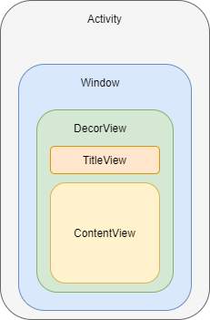

## 1 简介

View 绘制流程，指的是 measure、layout、draw。

* measure：测量
* layout：布局
* draw：绘制

> 2025 更新：measure/layout/draw 的三段式从 Android 1.0 至今没有变，但 Android 5.0（API 21）起 draw 默认硬件加速，实际被拆成「UI 线程把绘制命令录进 DisplayList」+「RenderThread 用 GPU 渲染」两段。2019 年之后真正的变化都在这条渲染管线和它下游的合成上，见 5.1—5.7。

## 2 View 的绘制流程入口

我们都知道，Activity 由 Window、DecorView(TitleView、ContentView)构成。



调用 Activity 的 startActivity 方法时，最终调用到 ActivityThread#handleLaunchActivity 方法来创建 Activity。

```java
private void handleLaunchActivity(...){
     //1.创建 Activity
    Activity a = performLaunchActivity(r, customIntent);
    if (a != null) {
        ...
        //2.将 Activity 的状态置为 Resume
        handleResumeActivity(...);
}
```

ActivityThread#handleResumeActivity()

```java
public void handleResumeActivity(...){
    ...
    //1.调用 performResumeActivit()
    final ActivityClientRecord r = performResumeActivity(token, finalStateRequest, reason);
    if (r.window == null && !a.mFinished && willBeVisible) {
            //2.获取 window
            r.window = r.activity.getWindow();
            //3.获取 DecorView
            View decor = r.window.getDecorView();
            //4.获取 WM, WindowManager 继承 ViewManager
            ViewManager wm = a.getWindowManager();
            WindowManager.LayoutParams l = r.window.getAttributes();
            a.mDecor = decor;
            l.type = WindowManager.LayoutParams.TYPE_BASE_APPLICATION;
            l.softInputMode |= forwardBit;
            if (r.mPreserveWindow) {
                ...
            }
            if (a.mVisibleFromClient) {
                if (!a.mWindowAdded) {
                    a.mWindowAdded = true;
                    //5.添加 View，WindowManagerImpl 中实现
                    wm.addView(decor, l);
                } else {
                    ...
                }
            }

}
```

WindowManagerImpl#addView()

```java
public void addView(...){
    ...
    //mGlobal -> WindowManagerGlobal    
    mGlobal.addView(view, params, mDispaly, mParentWindow);    
}
```

WindowManagerGlobal#addView()

```java
public void addView(View view, ViewGroup.LayoutParams params,
           Display display, Window parentWindow) {
     ...
     synchronized (mLock) {
         //1.创建 ViewRootImpl
         root = new ViewRootImpl(view.getContext(), display);
         
         try {
             //2.ViewRootImpl#setView
             root.setView(view, wparams, panelParentView);
         }
     }
     
 }
```

总结：

```java
-> ActivityThread#handleLaunchActivity 
-> ActivityThread#handleResumeActivity()
-> WindowManagerImpl#addView()
-> WindowManagerGlobal#addView()
-> ViewRootImpl#setView() // 这里还没有显示出来
```

> 2025 更新：`setView()` 末尾会 `requestLayout()`，由 `ViewRootImpl#scheduleTraversals()` 通过 `Choreographer` 把 traversal 挂到下一个 VSYNC 上，所以「addView 之后到真正上屏」至少还差一个 VSYNC 周期——这正是「这里还没有显示出来」的原因，细节见 5.1。

> 2025 更新：方法名拼写应为 `performTraversals`（原文标题与正文的 `performTraveals` 少了一个 r）。这个方法的骨架在 Android 12—16 没有变化，变的是它内部调用的渲染路径：硬件加速后 `performDraw()` 只是「录制 DisplayList 并交给 RenderThread」，见 5.1、5.2。

## 3 ViewRootImpl 的 performTraveals

 ViewRootImpl#performTraveals 中 ViewTree 才开始真正的绘制流程。

```java
 private void performTraversals() {
     if (!mStopped || mReportNextDraw) {              
                if (focusChangedDueToTouchMode || mWidth != host.getMeasuredWidth()
                        || mHeight != host.getMeasuredHeight() || contentInsetsChanged ||
                        updatedConfiguration) {
                    int childWidthMeasureSpec = getRootMeasureSpec(mWidth, lp.width);
                    int childHeightMeasureSpec = getRootMeasureSpec(mHeight, lp.height);
                    //1.执行测量
                    performMeasure(childWidthMeasureSpec, childHeightMeasureSpec);
                }
      if (didLayout) {
          //2.执行布局
          performLayout(lp, mWidth, mHeight); 
      }
         
      if (!cancelDraw && !newSurface) {
           ...
           //3.执行绘制    
           performDraw();   
      }
         
 }
```

## 4 View 的 measure 

measure 用来测量 View 的宽高。

* View:  测量自身
* ViewGroup： 不仅要测量自身，还要**遍历调用子 View 的 measure()**

### 4.1 View#onMeasure()

View#onMeasure()

```java
protected void onMeasure(int widthMeasureSpec, int heightMeasureSpec) {
        setMeasuredDimension(getDefaultSize(getSuggestedMinimumWidth(), widthMeasureSpec),
                getDefaultSize(getSuggestedMinimumHeight(), heightMeasureSpec));
    }
```

View#setMeasuredDimension()

```java
   protected final void setMeasuredDimension(int measuredWidth, int measuredHeight) {
        boolean optical = isLayoutModeOptical(this);
        if (optical != isLayoutModeOptical(mParent)) {
            Insets insets = getOpticalInsets();
            int opticalWidth  = insets.left + insets.right;
            int opticalHeight = insets.top  + insets.bottom;

            measuredWidth  += optical ? opticalWidth  : -opticalWidth;
            measuredHeight += optical ? opticalHeight : -opticalHeight;
        }
        setMeasuredDimensionRaw(measuredWidth, measuredHeight);
    }
```

View# getDefaultSize()

```java
   public static int getDefaultSize(int size, int measureSpec) {
        int result = size;
        //获取测量模式
        int specMode = MeasureSpec.getMode(measureSpec);
        //获取测量大小
        int specSize = MeasureSpec.getSize(measureSpec);
        switch (specMode) {
        case MeasureSpec.UNSPECIFIED:
            result = size;
            break;
        case MeasureSpec.AT_MOST:
        case MeasureSpec.EXACTLY:
            result = specSize;//wrap_content 和 match_parent 效果一样
            break;
        }
        return result;
    }
```

View#getSuggestedMinimumWidth()

```java
protected int getSuggestedMinimumWidth() {
        //根据是否设置背景取值
        return (mBackground == null) ? mMinWidth : max(mMinWidth, mBackground.getMinimumWidth());
    }
```

### 4.2 ViewGroup 的 measure

## View 的 layout


## View 的 draw


## 5 Android 12—16 的变化与面试追问

> 2025 更新：measure/layout/draw 的骨架没有变，2019 年之后的变化集中在「draw 之后」：RenderThread、RenderNode/DisplayList、BLAST、SurfaceFlinger 合成、高刷新率与 Compose。API 级别：12=31、13=33、14=34、15=35、16=36；本节提到的类名均可在 AOSP `frameworks/base` 中找到，具体调用层次以 AOSP 为准。

### 5.1 performTraversals 与 Choreographer / VSYNC

`requestLayout()`、`invalidate()` 最终都会走到 `ViewRootImpl#scheduleTraversals()`：

```java
void scheduleTraversals() {
    if (!mTraversalScheduled) {
        mTraversalScheduled = true;
        mTraversalBarrier = mHandler.getLooper().getQueue().postSyncBarrier();
        mChoreographer.postCallback(Choreographer.CALLBACK_TRAVERSAL, mTraversalRunnable, null);
    }
}
```

VSYNC 到来 → `Choreographer.doFrame()` → `doTraversal()` → `removeSyncBarrier()` → `performTraversals()`。`performTraversals()` 里按 measure → layout → draw 顺序执行，而且不是每次都全做：只有尺寸、配置、焦点变化才重新 measure/layout，draw 则受脏区域限制。`mTraversalScheduled` 保证同一帧内多次 `requestLayout` 只调度一次；`Choreographer` 的 `frameTimeNanos` 是 VSYNC 时间，不是回调真正执行的时刻。

同一帧里 `Choreographer` 的回调顺序是 input → animation → insets animation → traversal → commit；traversal 排在动画之后，所以动画改的属性写入 `RenderNode` 后，同一次 VSYNC 就能被录制进这一帧的 DisplayList。`mTraversalRunnable` 是一次性的，执行时会把 `mTraversalScheduled` 复位，下一次 `requestLayout` 才会重新调度。

`performDraw()` 分两条路：硬件加速时走 `mAttachInfo.mThreadedRenderer.draw(mView, mAttachInfo, this)`，否则走 `drawSoftware()` 用软件 `Canvas` 直接画。

### 5.2 RenderThread、RenderNode 与 DisplayList

硬件加速下，`onDraw` 里的 `canvas.drawXxx()` 只是往 `RenderNode` 的 DisplayList 里**录制命令**，并不立即光栅化：

1. `View#updateDisplayListIfDirty()` → `renderNode.beginRecording()` → `View.draw(canvas)` → `endRecording()`；
2. 属性（`alpha`、`translationX/Y`、`scale`、`rotation`、`elevation`、`clipBounds`）写在 `RenderNode` 上，只更新属性，不需要重新录制；
3. `syncAndDrawFrame()` 把树交给 RenderThread（`RenderProxy` → `DrawFrameTask`），由 RenderThread 用 Skia GPU 真正画；
4. 画完 `eglSwapBuffers`/`queueBuffer` 把 buffer 交回 `BufferQueue`，UI 线程不必等 GPU。

递归下发时 `ViewGroup#drawChild` 会把子 View 的 `RenderNode` 通过 `canvas.drawRenderNode()` 挂到父节点上，最终形成一棵 RenderNode 树；只有被标记 dirty 的子树（`PFLAG_DIRTY`、`mRecreateDisplayList`）才重新录制，其余直接复用上一帧的 DisplayList。

这解释了两个高频结论：属性动画比反复 `invalidate()` 便宜，因为它只改 RenderNode 属性、不重走 `onDraw`；而 `onDraw` 里如果改了内容，就必须重新录制 DisplayList，代价远大于改属性。

> 2025 更新：源码里 `ViewRootImpl` 持有的渲染器在较新版本是 `ThreadedRenderer`（继承自 `android.graphics.HardwareRenderer`），不同版本命名与调用层次略有差异，以 AOSP 为准。

### 5.3 硬件加速的利与弊

`android:hardwareAccelerated` 可在 Application、Activity、Window 三级配置，targetSdk ≥ 14 默认开启；单点回退用 `View#setLayerType(LAYER_TYPE_SOFTWARE, null)`。

- 利：DisplayList 缓存、GPU 光栅化、属性动画不重录、RenderThread 与 UI 线程并行，掉帧时 UI 线程还能继续处理输入。
- 弊：部分 Canvas 操作在硬件加速下不支持或表现不同（如某些 `MaskFilter`、`setShadowLayer`、复杂 `clipPath`、非 `SRC_OVER` 的 `Xfermode`），需要软件层回退；`LAYER_TYPE_HARDWARE` 会额外占用显存（宽 × 高 × 4 字节），`saveLayer` 这类离屏操作更贵；离屏层首次使用有录制与上传成本；`LAYER_TYPE_SOFTWARE` 会让该 View 及其子树都失去硬件加速。
- 实践：对「复杂但静态、只做 alpha/旋转动画」的 View 临时开硬件层再还原；`buildDrawingCache()`/`getDrawingCache()` 已在 API 28 废弃，不要再用来做缓存。

### 5.4 Surface、SurfaceFlinger 与 HWC 合成

应用画在 `Surface` 上，`Surface` 是 `BufferQueue` 的生产端：`dequeueBuffer()` 取一块 `GraphicBuffer` → GPU 绘制 → `queueBuffer()` 交回。Android 11 起窗口默认走 `BLASTBufferQueue` + `SurfaceControl.Transaction`，把 buffer 与窗口属性放进同一个事务提交，减少「画面和位置不同步」。

`SurfaceFlinger` 是消费者，收集所有 layer 后交给 `HWComposer`（HWC2/HWC3，新版转向 AIDL composer）：能被显示硬件直接叠加的走 device composition，叠不了的由 GPU 做 client composition（`RenderEngine`）。合成结果送屏，`presentFence`/`releaseFence` 控制节奏，buffer 没 release 前生产者不能重写同一块。

合成节奏由 VSYNC 驱动：SurfaceFlinger 每个 VSYNC 醒来一次，latch 最新可用的 buffer 再合成。所以「UI 线程画完」只是把 buffer 入队，真正上屏还要等 SurfaceFlinger 的某一次合成，这也是「为什么改了背景不会立刻看到」的原因之一。

Triple buffering：BufferQueue 一般配 3 个 buffer，App 画第 N 帧时 SurfaceFlinger 可能正在显示 N-1、GPU 还在处理 N-2。buffer 越多越不容易卡住生产者，但端到端延迟越大；具体数量由 BufferQueue 配置和厂商实现决定，以 AOSP 为准。Android 12 起 SurfaceFlinger 有 FrameTimeline 这类帧调度/追踪机制，`JankStats` 等工具就是基于这些帧数据做卡顿归因。

### 5.5 高刷新率与帧率

60Hz 的帧预算是 16.6ms，90/120/144Hz 分别是 11.1/8.3/6.9ms——同样的 `onDraw` 在 120Hz 设备上更容易掉帧。

- `Display#getSupportedModes()` / `Display.Mode#getRefreshRate()` 查设备能力；`Choreographer` 的回调间隔会随刷新率变化，动画应以 `frameTimeNanos` 为时间基准，不要写死 16ms。
- `Surface#setFrameRate()`（API 30，Android 11）向系统表达期望帧率；Android 12（API 31）起提供带 `changeFrameRateStrategy` 的三参数重载：视频用 `FRAME_RATE_COMPATIBILITY_FIXED_SOURCE`，UI/游戏用默认值，避免「系统选了非整数倍刷新率导致抖动」。
- Android 15 起部分设备支持可变刷新率（VRR），帧率切换更动态，具体行为仍以官方文档和厂商实现为准。
- 自适应刷新率下同一个应用可能在 60Hz 与 120Hz 之间切换，滚动、动画、视频播放的帧率策略不同，不要假设「一帧固定 16ms」，也不要在固定周期里假设回调次数。

### 5.6 onDraw 的性能要点

- 不在 `onDraw` 里分配对象：`Paint`、`Rect`、`Path`、`Matrix` 做成字段复用，文本用缓存的 `StaticLayout`；`onDraw` 里的临时对象会直接变成 GC 压力。
- `canvas.clipRect()` 限定重绘区域、减少过度绘制；`canvas.quickReject()` 跳过完全在屏幕外的内容（大画布、地图、列表自绘）。
- `saveLayer()`/`saveLayerAlpha()` 会开离屏缓冲，能不用就不用；`invalidate(Rect)` 只脏一块，比 `invalidate()` 便宜；无 `onDraw` 的 `ViewGroup` 记得 `setWillNotDraw(true)`。
- 验证手段：开发者选项的「调试 GPU 过度绘制」、`adb shell dumpsys gfxinfo <package>`、`FrameMetrics`/`JankStats`。
- 文本与图片：`StaticLayout` 缓存排版结果，图片不要在 `onDraw` 里 `decode`，缩放用 `Paint#setFilterBitmap(true)` 并尽量用带目标矩形的 `drawBitmap` 重载。
- 复杂但静态的内容可以缓存：`setLayerType(LAYER_TYPE_HARDWARE, null)` 会把该 View 渲染到离屏 layer 并复用，适合只做位移/透明度动画的大图或地图。

### 5.7 Compose 的测量/布局/绘制与 View 的差异

- Compose 用 `Layout(modifier, measurePolicy = { measurables, constraints -> ... })`：`measurable.measure(constraints)` 得到 `Placeable`，再 `layout(width, height) { placeable.placeRelative(x, y) }`。子项**只允许测量一次**，没有 View 的 `MeasureSpec` 三模式，取而代之的是 `Constraints`（`minWidth/maxWidth` 等）；intrinsics 走单独的 `IntrinsicMeasureScope`。
- 阶段是 composition → layout（measure + place）→ draw。状态变化只让受影响的 `LayoutNode` 失效，不像 View 那样从 `ViewRootImpl` 重新 `requestLayout` 整棵树。
- 绘制走 `DrawScope`：`Modifier.drawBehind`、`drawWithContent`、`drawWithCache`；`graphicsLayer` 对应独立的 layer（Compose 1.7 起有自己的 `GraphicsLayer`），与 `RenderNode` 的思路一致。
- 与 View 的关系：`AndroidComposeView` 本身是一个 `ViewGroup`，作为「单个 View」参与 View 的 measure/layout/draw，所以两套体系可以互相嵌套；动画的 `withFrameNanos` 底层仍是 `Choreographer`（`AndroidUiFrameClock`），与 View 的 traversal 共享同一个 VSYNC。
- `SubcomposeLayout` 会在测量阶段重新组合子项，开销明显高于普通 `Layout`，只在「尺寸决定内容」的场景用；Compose 的绘制最终落在 `AndroidComposeView` 的 `RecordingCanvas` 上，仍回到 View 的 DisplayList 体系。

### 5.8 面试追问

Q1：`performTraversals` 一帧做了哪些事？
measure → layout → draw；只有尺寸/配置变化才重新 measure/layout，draw 只画脏区域；硬件加速时 draw 只是录制 DisplayList 并 `syncAndDrawFrame`。

Q2：`invalidate()` 和 `requestLayout()` 的区别？
`invalidate` 只标记重绘（走 draw，必要时重新录制 DisplayList），`requestLayout` 会向上设置 `PFLAG_FORCE_LAYOUT` 并触发 measure/layout，代价更大。

Q3：为什么属性动画比 `invalidate()` 便宜？
属性只改 `RenderNode` 的属性，RenderThread 直接复用已有 DisplayList；`invalidate()` 若内容变了就要重走 `onDraw` 重新录制。

Q4：硬件加速下 `onDraw` 有哪些坑？
部分绘制 API 不支持或表现不同、离屏层耗显存、`LAYER_TYPE_SOFTWARE` 会拖累整棵子树；遇到渲染异常先用软件层定位，再找替代画法。

Q5：120Hz 设备上为什么还是卡？
帧预算只有 8.3ms，`onDraw` 里的分配/复杂路径/过度绘制都会超时；另外 `Choreographer` 回调里做同步 IO 也会挤掉这一帧。

Q6：`Surface`、`SurfaceFlinger`、HWC 各自负责什么？
`Surface` 是应用的生产端（BufferQueue producer），SurfaceFlinger 是合成者（消费者），HWC 决定哪些层能由显示硬件直接叠加、哪些要 GPU 合成。

Q7：Compose 的测量和 View 有什么本质区别？
Compose 是一次测量 + `Constraints` + `Placeable`，不允许重复测量子项，失效粒度是单个 `LayoutNode`；View 是 `MeasureSpec` + 递归 `onMeasure`，`requestLayout` 会蔓延整条父链。

Q8：UI 线程画完就上屏了吗？
没有。绘制只是把 buffer 入队 `BufferQueue`，SurfaceFlinger 在下一次 VSYNC 合成时才可能显示；三缓冲下同一时刻可能有 3 帧在流水线上，这也是「代码很快但手感有延迟」的来源。
