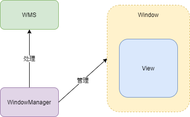

## 1 Window、WindowsManager、WMS

* Window 是一个抽象类，实现类为 PhoneWindow，对 View 进行管理。
* WindowManager 是一个接口类，继承于接口 ViewManager，管理 Window（更新、添加、删除操作等），实现类为 WindowManagerImpl

* WindowManager 具体的工作交由 WMS 处理，WindowManager 和 WMS 通过 Binder 跨进程通信。

具体如下图所示：



## 2 WindowManager 的关联类

WindowManager 是一个接口类，继承于接口 **ViewManager**，管理 Window（更新、添加、删除操作等），实现类为 WindowManagerImpl。

```java
//ViewManager.java
public interface ViewManager
{
       
    public void addView(View view, ViewGroup.LayoutParams params);//添加
    public void updateViewLayout(View view, ViewGroup.LayoutParams params);//更新
    public void removeView(View view);//移除
}

```

###  2.1 Window 创建

Window 是一个抽象类，实现类为 PhoneWindow，在 Activity 中 attach 中创建。

```java
//Activity.java
final void attach(...) {
   // 创建 PhoneWIndow
   mWindow = new PhoneWindow(this, window, activityConfigCallback);
   ...
   // setWindowManager 这个方法在 Window 中     
   mWindow.setWindowManager(
                (WindowManager)context.getSystemService(Context.WINDOW_SERVICE),
                mToken, mComponent.flattenToString(),
                (info.flags & ActivityInfo.FLAG_HARDWARE_ACCELERATED) != 0);    
   ... 
} 

//Window.java
public void setWindowManager(WindowManager wm, IBinder appToken, String appName,
            boolean hardwareAccelerated) {
        ...
        //这里最终创建 WindowManagerImpl    
        if (wm == null) {
            wm = (WindowManager)mContext.getSystemService(Context.WINDOW_SERVICE);
        }
        // 创建 WindowManagerImpl 将 Window 传进去，WindowManagerImpl 持有 Window 就可以进行操作
        mWindowManager = ((WindowManagerImpl)wm).createLocalWindowManager(this);  
}

//WindowManagerImpl.java
private WindowManagerImpl(Context context, Window parentWindow) {
     mContext = context;
     mParentWindow = parentWindow;
}

//WindowManagerImpl 并没有什么功能，最终交由 WindowManagerGlobal 实现，例如 addView
@Override
public void addView(@NonNull View view, @NonNull ViewGroup.LayoutParams params) {
    applyDefaultToken(params);
    //private final WindowManagerGlobal mGlobal = WindowManagerGlobal.getInstance();
    mGlobal.addView(view, params, mContext.getDisplay(), mParentWindow);
}
```

## 3 Window 属性

定义在 WindowManager 内部类 LayoutParams 中，主要相关的是三种属性：

* Type（类型）
* Flag（标志）
* SoftInputMode（软键盘相关模式）

### 3.1 Type（类型）

三种：

* Application Window（应用程序窗口）：Type 值 1-99
* Sub Window（子窗口）：不能独立存在，依赖于其他窗口，Type 值1000-1999
* Sysytem Window（系统窗口）：Toast、输入法窗口、系统错误窗口等，Type 值 2000-2999

### 3.2 Flag（标志）

用来控制 Window 显示，定义在 WindowManager 内部类 LayoutParams 中。

```java
Window win = getWindow();
win.addFlags(WindowManager.LayoutParams.FLAG_SHOW_WHEN_LOCKED);
//win.setFlags(WindowManager.LayoutParams.FLAG_SHOW_WHEN_LOCKED);

//弹出窗口后的内容变暗。
public static final int FLAG_DIM_BEHIND       = 0x00000002;
//弹出窗口后的内容变模糊。
public static final int FLAG_BLUR_BEHIND       = 0x00000004;
//弹出窗口不能获得按键输入事件，事件将会往其他窗口传递。
public static final int FLAG_NOT_FOCUSABLE     = 0x00000008;
//弹出窗口不接受触摸屏事件，事件将会往其他窗口传递。
public static final int FLAG_NOT_TOUCHABLE     = 0x00000010;
//当设备休眠时，点击触摸屏，弹出窗口将收到这个触摸事件。
public static final int FLAG_NOT_TOUCH_MODAL   = 0x00000020;
//触摸事件被系统所消耗，用户不会看到他们点击屏幕有什么反应。
public static final int FLAG_TOUCHABLE_WHEN_WAKING = 0x00000040;
//弹出窗口可见时，保持设备常亮不变。
public static final int FLAG_KEEP_SCREEN_ON    = 0x00000080;
//弹出窗口占满整个屏幕，忽略周围的装饰边框（例如状态栏）。
public static final int FLAG_LAYOUT_IN_SCREEN   =0x00000100;
//允许弹出窗口扩展到屏幕之外。
public static final int FLAG_LAYOUT_NO_LIMITS   =0x00000200;
//弹出窗口显示时，隐藏所有的屏幕装饰（例如状态条）。
public static final int FLAG_FULLSCREEN     = 0x00000400;
//此选项将覆盖FLAG_FULLSCREEN选项，并强制屏幕装饰（如状态条）弹出。
public static final int FLAG_FORCE_NOT_FULLSCREEN   =0x00000800;
//弹出窗口半透明的显示处理方法，又称“点透”。通常用于图形处理较差的设备。
public static final int FLAG_DITHER           = 0x00001000;
//弹出窗口不允许屏幕截图。
public static final int FLAG_SECURE           = 0x00002000;
//弹出窗口特殊模式，布局参数用于指示显示比例。
public static final int FLAG_SCALED           = 0x00004000;
//当屏幕有贴着脸时，防止面颊对屏幕造成误操作。
public static final int FLAG_IGNORE_CHEEK_PRESSES   = 0x00008000;
//确保窗口内容不会被装饰条（状态栏）盖住。
public static final int FLAG_LAYOUT_INSET_DECOR = 0x00010000;
//窗口不能与输入法交互，覆盖输入法窗口。（同时设置FLAG_NOT_FOCUSABLE，窗口将能够与输入法交互，输入法窗口覆盖）
public static final int FLAG_ALT_FOCUSABLE_IM = 0x00020000;
//当触屏事件发生在弹出窗口之外，可以通过设置此标志接收到一个MotionEvent.ACTION_OUTSIDE事件。
public static final int FLAG_WATCH_OUTSIDE_TOUCH = 0x00040000;
//当屏幕锁定时，弹出窗口可以被看到。这使得应用程序窗口优先于锁屏界面。可配合FLAG_KEEP_SCREEN_ON
public static final int FLAG_SHOW_WHEN_LOCKED = 0x00080000;
//系统墙纸显示为弹出窗口背景。窗口必须是半透明的。
public static final int FLAG_SHOW_WALLPAPER = 0x00100000;
//窗口一旦显示出来，系统将点亮屏幕。
public static final int FLAG_TURN_SCREEN_ON = 0x00200000;
//弹出窗口时解除锁屏。锁屏界面非加密才能解锁。如果是加密的，需要设置了FLAG_SHOW_WHEN_LOCKED
public static final int FLAG_DISMISS_KEYGUARD = 0x00400000;
//锁屏界面淡出时，继续运行它的动画。
public static final int FLAG_KEEP_SURFACE_WHILE_ANIMATING =0x10000000;
//以原始尺寸显示窗口。
public static final int FLAG_COMPATIBLE_WINDOW = 0x20000000;
//设置此选项的窗口将无条件获得焦点。
public static final int FLAG_SYSTEM_ERROR = 0x40000000;
```

### 3.3 SoftInputMode（软键盘相关模式）

| SoftInputMode                  | 描述                                                       |
| :----------------------------- | :--------------------------------------------------------- |
| SOFT_INPUT_STATE_UNSPECIFIED   | 没有指定状态，系统会选择一个合适的状态或依赖于主题的设置   |
| SOFT_INPUT_STATE_UNCHANGED     | 不会改变软键盘状态                                         |
| SOFT_INPUT_STATE_HIDDEN        | 当用户进入该窗口时，软键盘默认隐藏                         |
| SOFT_INPUT_STATE_ALWAYS_HIDDEN | 当窗口获取焦点时，软键盘默认隐藏                           |
| SOFT_INPUT_ADJUST_RESIZE       | 当软键盘弹出时，窗口会调整大小                             |
| SOFT_INPUT_ADJUST_PAN          | 当软键盘弹出时，窗口不需要调整大小，要确保输入焦点是可见的 |

```java
getWindow().setSoftInputMode(WindowManager.LayoutParams.SOFT_INPUT_STATE_HIDDEN);
```

## 4 Window 操作

WindowManage 对 Window 进行管理，也就是 Window 的添加、更新、删除操作，最终交由 WMS 处理。窗口操作分为两个部分：

* WIndowManager 处理的部分
* WMS 处理的部分

> 2025 更新：Android 12 起，WMS 内部以 `WindowContainer` 树组织 Display/Task/Activity/Window，并用 `SurfaceControl`/`Transaction` 把窗口层级和缓冲区提交给 SurfaceFlinger；前文的 `Session#addToDisplay` 调用链仍可作为入门，但现代代码会经过 `DisplayContent`、`WindowState`、`BLASTBufferQueue` 等对象。

### 4.1 Window 的添加过程

在 Activity 启动流程中，如果 进程不存在，会创建新进程，运行 **ActivityThread**，当界面要和用户进行交互，就会调用 Activity 的 handlerResumeActivity()，最终调用到 WindowManagerGlobal#addView。

```java
//WindowManagerGlobal#addView
public void addView(View view, ViewGroup.LayoutParams params,
            Display display, Window parentWindow) {
        
        //进行检查合法性
        ...
        final WindowManager.LayoutParams wparams = (WindowManager.LayoutParams) params;
        //如果是父窗口不为null，根据父窗口，子窗口 wparams 进行调整
        if (parentWindow != null) {
            parentWindow.adjustLayoutParamsForSubWindow(wparams);
        } else {
            // If there's no parent, then hardware acceleration for this view is
            // set from the application's hardware acceleration setting.
            final Context context = view.getContext();
            if (context != null
                    && (context.getApplicationInfo().flags
                            & ApplicationInfo.FLAG_HARDWARE_ACCELERATED) != 0) {
                wparams.flags |= WindowManager.LayoutParams.FLAG_HARDWARE_ACCELERATED;
            }
        }

        ViewRootImpl root;
        View panelParentView = null;

        synchronized (mLock) {
            ...
            //mViews：ArrayList<View>      将 view 添加到 View 列表中 
            mViews.add(view);
            //mRoots：ArrayList<ViewRootImpl>  将 root 添加到 ViewRootImpl 列表中  
            mRoots.add(root);
            //mParams：ArrayList<WindowManager.LayoutParams> 将 params 添加到 LayoutParams 列表中  
            mParams.add(wparams);
            try {
                //ViewRootImpl.setView 添加窗口 ViewRootImpl 作用
                //1.View 树的根并管理 View 树
                //2.触发View的测量、布局和绘制
                //3.输入事件的中转站
                //4.管理Suface
                //5.负责与 WMS 进行进程间的通信    
                root.setView(view, wparams, panelParentView);
            } catch (RuntimeException e) {             
                if (index >= 0) {
                    removeViewLocked(index, true);
                }
                throw e;
            }
        }
    }

//ViewRootImpl#setView
public void setView(View view, WindowManager.LayoutParams attrs, View panelParentView) {
     try {
           ...
         //通过 IWindowSession 是一个 Binder 对象，是 Client 代理，Server 端实现为 Session，
         //Session#addToDisplay 运行在 WMS 中
         res = mWindowSession.addToDisplay(...);    
}
    
//Session#addToDisplay    
@Override
public int addToDisplay(...) {
     //调用 WMS#addWindow 方法，将自身 session 传进去，步骤如下
     //1.WMS使用 ArrayList 保存 Session
     //2.WMS 为窗口添加 Surface
     //3.SurfaceFlinger 将这些 Surface 混合绘制到屏幕 上
     return mService.addWindow(this,..);
}      
```

### 4.2 Window 更新过程

Window  更新最终调用到 WindowManagerGlobal#updateViewLayout

```java
//WindowManagerGlobal#updateViewLayout
public void updateViewLayout(View view, ViewGroup.LayoutParams params) {
        if (view == null) {
            throw new IllegalArgumentException("view must not be null");
        }
        if (!(params instanceof WindowManager.LayoutParams)) {
            throw new IllegalArgumentException("Params must be WindowManager.LayoutParams");
        }

        final WindowManager.LayoutParams wparams = (WindowManager.LayoutParams)params;
        //重新设置布局
        view.setLayoutParams(wparams);      
        synchronized (mLock) {
            //重新注册信息
            int index = findViewLocked(view, true);
            ViewRootImpl root = mRoots.get(index);
            mParams.remove(index);
            //添加新的布局信息
            mParams.add(index, wparams);
            //ViewRootImpl 进行UI的更新
            root.setLayoutParams(wparams, false);
       }
}

//ViewRootImpl#setLayoutParams
void setLayoutParams(WindowManager.LayoutParams attrs, boolean newView) {
        synchronized (this) {
          ...
          //更新 UI 参数         
          ...  
          mWindowAttributesChanged = true;
          //调用 scheduleTraversals 
          scheduleTraversals();
          }
      }

void scheduleTraversals() {
       if (!mTraversalScheduled) {
           //加Tag
          mTraversalScheduled = true;
          mTraversalBarrier = mHandler.getLooper().getQueue().postSyncBarrier();
           //mChoreographer 用于接收显示系统的VSync信号，在下一个帧渲染时控制执行回调
           //就是执行 mTraversalRunnable 是一个线程
           mChoreographer.postCallback(
                    Choreographer.CALLBACK_TRAVERSAL, mTraversalRunnable, null);
           if (!mUnbufferedInputDispatch) {
                scheduleConsumeBatchedInput();
           }
           notifyRendererOfFramePending();
           pokeDrawLockIfNeeded();
       }
   }

//TraversalRunnable
final class TraversalRunnable implements Runnable {
      @Override
       public void run() {
           doTraversal();
       }
}

void doTraversal() {
      if (mTraversalScheduled) {
         //取消Tag
          mTraversalScheduled = false;
          mHandler.getLooper().getQueue().removeSyncBarrier(mTraversalBarrier);

          if (mProfile) {
              Debug.startMethodTracing("ViewAncestor");
          }
          //View tree 开始 View 工作流程
          performTraversals();
          ...
        }
    }

private void performTraversals() {
     //更新 Window 视图、又执行 Window 中 View 的绘制流程
      ...
      try {
        //内部调用IWindowSession的relayout方法来更新Window视图
        relayoutResult = relayoutWindow(params, viewVisibility, insetsPending);
        ...
        if (!mStopped || mReportNextDraw) {
              if (focusChangedDueToTouchMode || mWidth != host.getMeasuredWidth()
                 || mHeight != host.getMeasuredHeight() || contentInsetsChanged ||
                 updatedConfiguration) {
                   int childWidthMeasureSpec = getRootMeasureSpec(mWidth, lp.width);
                   int childHeightMeasureSpec = getRootMeasureSpec(mHeight, lp.height);
                    //调用 View 的 measure
                   performMeasure(childWidthMeasureSpec, childHeightMeasureSpec);
                }   
            }
         }

       if (didLayout) {
          //调用 View 的 Layout
          performLayout(lp, mWidth, mHeight);
       }  

       if (!cancelDraw && !newSurface) {
            //调用 View 的 SDraw
            performDraw();
        }
}
```

### 4.3 Window 删除过程

和 添加、删除一样，Window  删除最终调用到 WindowManagerGlobal#removeView

```java
//WindowManagerGlobal#removeView
public void removeView(View view, boolean immediate) {
        ...
      synchronized (mLock) {
          int index = findViewLocked(view, true);
          View curView = mRoots.get(index).getView();
	      // 关键代码
          removeViewLocked(index, immediate);
          ...
      }
}

//WindowManagerGlobal#removeViewLocked
private void removeViewLocked(int index, boolean immediate) {
      ViewRootImpl root = mRoots.get(index);
      View view = root.getView();
      ...
	   //调用 ViewRootImpl#die
       boolean deferred = root.die(immediate);
       if (view != null) {
          view.assignParent(null);
          if (deferred) {
		
             mDyingViews.add(view);
          }
       }
}

//ViewRootImpl#die
boolean die(boolean immediate) {
        if (immediate && !mIsInTraversal) {
	       //1.同步删除
            doDie();
            return false;
        }
        ...
	   //2.异步删除
        mHandler.sendEmptyMessage(MSG_DIE);
        return true;
}

//同步删除 ViewRootImpl#doDie 
void doDie() {
        //检查线程
        checkThread();
        synchronized (this) {
            if (mRemoved) {
                return;
            }
            mRemoved = true;
            if (mAdded) {
		        //调用ViewRootImpl#dispatchDetachedFromWindow
                dispatchDetachedFromWindow();
            }
           ...
        }
	    //WindowManagerGlobal 类相关 window 的相关的参数清除
        WindowManagerGlobal.getInstance().doRemoveView(this);
}

//ViewRootImpl#dispatchDetachedFromWindow
void dispatchDetachedFromWindow() {
        mFirstInputStage.onDetachedFromWindow();
        if (mView != null && mView.mAttachInfo != null) {
            mAttachInfo.mTreeObserver.dispatchOnWindowAttachedChange(false);
            mView.dispatchDetachedFromWindow();
        }
        ...
        try {
	      // 通过 Binder 和 WMS 进行 IPC 进程间通信，SystemServer进程中，
	      // 调用 Session 的remove方法
	      // 最终调用 WMS 的 removeWindow 方法，将window移除。
           mWindowSession.remove(mWindow);
        } catch (RemoteException e) {
        }
        ...
    }

//异步删除 ViewRootImpl#ViewRootHandler()
final ViewRootHandler mHandler = new ViewRootHandler();
final class ViewRootHandler extends Handler {
        @Override
        public void handleMessage(Message msg) {
            switch (msg.what) {
		        //收到 MSG_DIE
                case MSG_DIE:
		            //调用 doDie 方法
                    doDie();
                    break;
            }
        }
    }
```


## 5 Android 12—16 的变化与面试追问

> 2025 更新：前文以 Android 9/10 的 `Session#addToDisplay` 链路入门。Android 12 起 WMS 的窗口组织、合成路径和大屏/Insets 行为变化很大；本节按 Android 12—16（API 31—36）补充，具体实现以对应 AOSP 分支为准。

### 5.1 WindowContainer 树：WMS 的“骨架”

现代 WMS 不再用零散的 Window 列表描述层级，而是用 `WindowContainer` 树把“显示设备—任务—Activity—窗口”组织起来。典型路径可以理解为：

`RootWindowContainer` → `DisplayContent` → `TaskDisplayArea`/`DisplayArea` → `Task`/`TaskFragment` → `ActivityRecord` → `WindowState`；`WindowToken` 作为窗口令牌参与挂载，`WindowState` 是真正承载 `SurfaceControl` 的叶子节点之一。

* `RootWindowContainer` 管理所有 Display，`DisplayContent` 管理一块屏幕上的 DisplayArea 和窗口策略。
* `Task`/`TaskFragment` 既服务于 Activity 任务，也服务于分屏、`ActivityEmbedding` 和桌面窗口；`ActivityRecord` 不再直接散落在 `ActivityStack` 里。
* 每个 `WindowContainer` 都可能对应一个 `SurfaceControl`，对位置、层级、透明度、裁剪的修改通过 `SurfaceControl.Transaction` 批量提交，避免逐条 IPC。
* WMS 通过 `WindowOrganizer`/`TaskOrganizer` 与 SystemUI 的 WM Shell 协作；分屏、桌面窗口、过渡动画很多逻辑在 Shell，而不是全塞在 WMS。

这也解释了为什么“Window 的添加”不再是简单的 `addWindow`：`ViewRootImpl` 通过 `IWindowSession` 请求 WMS 创建 `WindowState`/`SurfaceControl`，WMS 把 `WindowState` 挂到对应的 `WindowToken`/Task 上，再由 `SurfaceFlinger` 合成。

`WindowState` 还承载了窗口策略：`LayoutParams`、`WindowToken`、`Session`、输入通道、焦点/触摸区域、Insets 状态和动画 leash。WMS 在 `DisplayContent` 上做布局（`performLayoutLockedInner` 一类流程），把计算后的 frame 写进 `WindowState`，再通过 `SurfaceControl.Transaction` 一次性提交；这比在每个 Window 上单独 set 位置更利于多窗口和过渡动画的一致性。

### 5.2 多窗口、分屏、自由窗口与 Android 16 大屏

* Android 7 引入分屏，Android 8 引入自由窗口（freeform），但早期更多是“能跑”；Android 12L 开始针对大屏做任务栏、分屏和兼容性适配。
* Android 12/13 起，`ActivityEmbedding`（`androidx.window.embedding`）让应用把两个 Activity 嵌入同一任务的分栏中，`SplitPairRule`、`SplitPlaceholderRule` 是应用侧常见入口；底层依赖 `TaskFragment` 和 WM Shell。
* Android 14/15 继续完善多窗口与桌面窗口（desktop windowing）：自由窗口可以像桌面系统一样移动、缩放，`Activity.isInMultiWindowMode()`、`onMultiWindowModeChanged()`、`Configuration` 变化成为必须处理的路径。
* Android 15 起大屏/桌面模式更普遍；Android 16 对 target 36 且 `smallestScreenWidthDp >= 600` 的设备，系统会忽略 `android:screenOrientation`、`android:resizeableActivity=false`、`minAspectRatio`/`maxAspectRatio` 等限制（官方列出的例外除外），应用必须能适配任意方向和尺寸。
* 适配大屏不要只靠 `android:configChanges` 硬扛；应使用 `WindowSizeClass`、`SlidingPaneLayout`、`NavRail`/`List-Detail` 等自适应布局，并在 `onConfigurationChanged()` 中正确重建/恢复状态。
* 分屏/自由窗口下，`Activity` 可能处于 `RESUMED` 但不可见，或与其他 Activity 同时 `RESUMED`；不要把“onResume 就等于用户正在看”当成绝对前提。
* 多窗口下的生命周期要按 `onTopResumedActivityChanged()`、`onMultiWindowModeChanged()` 和 `Configuration` 综合判断；只监听 `onResume/onPause` 很容易在分屏拖拽、窗口失焦时判断错。
* `ActivityEmbedding` 不是简单的 `Fragment` 分栏：它由系统 TaskFragment/Shell 参与，Activity 仍按独立生命周期运行；测试时要覆盖分栏比例变化、占位页、跨应用跳转和返回栈。

### 5.3 edge-to-edge 强制与 WindowInsets

Android 15（target 35）开始，非浮动窗口默认 edge-to-edge：状态栏/导航栏透明，应用内容绘制到系统栏后面；Android 16（target 36）进一步移除临时 opt-out，edge-to-edge 成为硬要求。

* Android 15 可以用主题属性 `android:windowOptOutEdgeToEdgeEnforcement` 临时退出，但这只是过渡；target 36 不要再依赖。
* `Window#setDecorFitsSystemWindows(false)` 让 DecorView 不再自动为系统栏留空间；`WindowCompat.setDecorFitsSystemWindows(window, false)` 是兼容写法。
* 现代做法是 `enableEdgeToEdge()`（AndroidX Activity）+ `WindowInsets` 监听：给根 View 加 padding/margin，而不是写死状态栏高度。
* 常用 Insets 类型：`WindowInsets.Type.systemBars()`、`displayCutout()`、`ime()`、`tappableElement()`、`systemGestures()`、`mandatorySystemGestures()`；不要只处理状态栏而漏掉手势导航条、横屏挖孔和 IME。
* `WindowInsetsCompat`/`ViewCompat.setOnApplyWindowInsetsListener` 处理 API 差异；`WindowInsetsControllerCompat` 控制状态栏图标明暗和系统栏显隐。
* `Window.setStatusBarColor()`/`setNavigationBarColor()` 在 target 35 上基本失效，改颜色应通过 `SystemBarStyle` 或让内容延伸到系统栏后面。
* 边到边之后，列表/滚动容器要处理 `clipToPadding=false`、底部按钮避让 IME、`FitsSystemWindows` 与 `consumed` 的传播，否则很容易出现“最后一项被导航条盖住”。
* Insets 监听要返回新的 `WindowInsetsCompat` 或明确 `consumeSystemBars()`，避免父 View 消费后子 View 拿不到；`WindowInsetsAnimationCompat` 适合做 IME 跟手动画，但不要在里面做重布局。
* 沉浸式/全屏场景要区分“隐藏系统栏”和“内容延伸到系统栏后面”：前者用 `WindowInsetsControllerCompat.hide()`，后者才是 edge-to-edge；两者混用会出现返回后布局跳动。

```kotlin
// AppCompatActivity / ComponentActivity
enableEdgeToEdge(
    statusBarStyle = SystemBarStyle.auto(Color.TRANSPARENT, Color.TRANSPARENT),
    navigationBarStyle = SystemBarStyle.auto(lightScrim, darkScrim)
)

ViewCompat.setOnApplyWindowInsetsListener(root) { view, insets ->
    val bars = insets.getInsets(
        WindowInsetsCompat.Type.systemBars() or WindowInsetsCompat.Type.displayCutout()
    )
    view.setPadding(bars.left, bars.top, bars.right, bars.bottom)
    insets
}
```

### 5.4 预测性返回与 WMS/Shell 的配合

预测性返回（predictive back）不是简单的“返回动画”，而是把手势进度提前交给应用/系统：用户手指拖动时就开始预览返回目标，松手才真正提交，取消则回弹。

* Android 13 起可以 opt-in：manifest 的 `android:enableOnBackInvokedCallback="true"`，用 `OnBackInvokedDispatcher.registerOnBackInvokedCallback()` 替代/补齐 `onBackPressed()`。
* Android 14 增加 `OnBackAnimationCallback`/`BackEventCompat`，应用可以拿到手指进度、滑动距离，做自定义预览动画。
* Android 15/16 逐步默认启用；Android 16 target 36 起，系统默认走预测性返回，旧的 `onBackPressed()`、`onKeyDown(KEYCODE_BACK)` 路径不再可靠，必须迁移到 `OnBackInvokedCallback`（AndroidX 可用 `OnBackPressedDispatcher`）。
* WMS 侧由 `BackNavigationController` 之类的协调者与 WM Shell、InputDispatcher 配合：边缘手势先进入系统手势区，Shell 驱动预览动画，提交时才回调应用的 `OnBackInvokedCallback`；取消时应用不应收到“已返回”。
* 三键导航和手势导航的行为不同；测试时两种导航模式都要覆盖，尤其是全屏、沉浸式、输入法弹出和多窗口场景。

### 5.5 高刷新率、FrameRate 与 SurfaceControl/SurfaceFlinger

高刷新率适配的核心不是“申请 120Hz”，而是把“内容适合多少帧”告诉系统，让 SF/HWC 在流畅和功耗之间决策。

* 读取屏幕能力：`Display.getSupportedModes()`、`Display.Mode.getRefreshRate()`；请求模式可用 `WindowManager.LayoutParams.preferredDisplayModeId`，旧的 `preferredRefreshRate` 优先级较低。
* 应用侧声明帧率：`Surface.setFrameRate(frameRate, compatibility)`（API 30）用于媒体/游戏等有明确帧率的场景；Android 15 起可用 `View.setRequestedFrameRate()` 给 View 层级提请求。不要把所有页面硬编码成 120Hz。
* `Choreographer` 按 VSync 调度，`FrameTimeline` 能区分 App/UI 线程与 SF 的耗时；掉帧要判断是主线程、RenderThread 还是合成阶段的问题。
* `SurfaceControl` 是应用窗口在 SurfaceFlinger 中的“图层句柄”，`Surface` 是生产端；Android 12 起应用窗口逐步走 `BLASTBufferQueue`，把 buffer 提交和 `SurfaceControl.Transaction` 解耦。
* `SurfaceControl.Transaction` 可以批量设置位置、矩阵、透明度、层级、裁剪、frame rate，最后 `apply()` 原子提交；WMS 用它移动/缩放窗口，避免一改一刷。
* `BLASTBufferQueue` 把 App 的 buffer 生产与 SF 的 transaction 同步起来：`ViewRootImpl` 不再各自维护一条老式 BufferQueue，`SurfaceView` 等场景也逐步切到 BLAST；排查合成问题时要知道“buffer 什么时候进 SF”与“transaction 什么时候 apply”是两条时间线。
* SurfaceFlinger 负责把各层合成：优先走 HWC 硬件合成，不合适时回退 GPU；合成前按 Z 序、透明度、脏区处理。`BufferQueue` 常见 triple buffering（3 个 buffer），能减少生产/消费抖动，但会增加一帧左右延迟，具体 buffer 数由图形栈决定。
* AOSP 的 RenderEngine 支持 GL/Vulkan 后端，部分版本/设备会启用 Vulkan 合成路径；它不是“用了 Vulkan 就一定更快”，而是降低 CPU 驱动开销、统一 GPU 路径，仍需看 HWC 能力和功耗。
* 高刷适配还要看 `FrameTimeline` 的 App/SF 时间线：App 在 120Hz 下每帧只有约 8.3ms，任何主线程抖动都会被放大；不要只盯着 `Choreographer` 的 doFrame 日志，要同时看 RenderThread 和 SF 的合成耗时。

```kotlin
val transaction = SurfaceControl.Transaction()
transaction.setPosition(surfaceControl, x, y)
    .setAlpha(surfaceControl, 0.8f)
    .setLayer(surfaceControl, 1)
    .apply()
```

### 5.6 面试追问

**Q1：WindowContainer 树解决了什么问题？**

它把 Display、Task、Activity、Window 组织成可递归操作的容器树，让 WMS 能统一处理层级、裁剪、变换、可见性和 SurfaceControl；分屏、自由窗口、ActivityEmbedding、过渡动画都可以在树上做，而不是为每种窗口形态写一套特殊逻辑。`WindowState` 只是叶子，真正的“窗口关系”在容器树里。

**Q2：Android 16 为什么忽略方向/resizable 限制？**

大屏和桌面模式下，用户期望窗口可以自由缩放、旋转，应用不应该用 `screenOrientation` 把手机布局锁死。Android 16 对 target 36 的大屏设备强制忽略这些限制，倒逼应用使用自适应布局、`WindowSizeClass` 和处理 `Configuration` 变化。例外场景以官方文档为准，但不要把“游戏/相机”当万能借口。

**Q3：edge-to-edge 怎么适配？**

先 `enableEdgeToEdge()` 或 `setDecorFitsSystemWindows(false)`，再用 `WindowInsetsCompat` 给根 View 分配系统栏、挖孔、IME 的 padding；状态栏图标明暗用 `WindowInsetsControllerCompat`。不要写死 24dp/48dp，也不要只处理竖屏状态栏。Android 15 的 opt-out 只是过渡，target 36 必须真正适配。

**Q4：预测性返回中 WMS 做了什么？**

WMS/Shell 负责识别边缘手势、驱动返回预览动画、维护返回目标栈；输入事件先给系统手势，提交时才通过 `OnBackInvokedCallback` 通知应用，取消则回弹。应用要做的是注册回调、处理进度，并确保 `onBackPressed()` 不再承担唯一返回逻辑。

**Q5：高刷为什么不能写死 120Hz？**

因为屏幕可能支持 60/90/120/144Hz 多模式，系统还要考虑 LTPO、功耗、发热和内容帧率。应用应通过 `Display.Mode`/`preferredDisplayModeId` 选择合适模式，通过 `Surface.setFrameRate()`/`View.setRequestedFrameRate()` 声明内容帧率，让 SF/HWC 决策；硬编码高刷会带来耗电和兼容性问题。

**Q6：Surface、SurfaceControl、SurfaceFlinger 是什么关系？**

`Surface` 是应用的生产端，往里 `dequeueBuffer`/`queueBuffer`；`SurfaceControl` 是 WMS/SF 侧的图层句柄，描述位置、层级、变换；`SurfaceFlinger` 是合成服务，按 VSync 把各层合成后交给 HWC/Display。应用通过 Binder 让 WMS 创建/操作 SurfaceControl，真正的 buffer 流转走 BufferQueue/BLAST。

**Q7：Triple Buffering 的利弊？**

3 个 buffer 让生产端在消费端占用一个 buffer 时仍有回旋空间，减少因 VSync 抖动导致的 jank；代价是排队延迟增加，触摸到显示的延迟可能变大。是否启用、buffer 数多少由 BufferQueue、SF 策略和设备决定，不能简单说“越多越流畅”。

**Q8：Vulkan 在 SurfaceFlinger 里解决什么？**

它提供一条更统一的 GPU 合成路径，减少 GL 驱动开销和 CPU 提交成本，并便于利用现代 GPU 特性；但合成通常优先走 HWC，Vulkan 主要影响 GPU fallback/RenderEngine 路径。是否默认启用取决于 Android 版本、GPU 厂商和设备配置，面试时不要把它说成“Android 16 全面 Vulkan 化”。