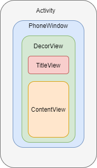

## 1 Activity 构成



平常布局展示在ContentView中。

## 2 事件分发

事件分发的本质其实就是把事件（Touch）封装成 **MotionEvent** 类，然后传递给 View 的层级处理。

MotionEvent 事件类型主要有下面四种：

|                           |                          |
| ------------------------- | ------------------------ |
| MotionEvent.ACTION_DOWN   | 按下事件（事件开始）     |
| MotionEvent.ACTION_UP     | 抬起事件（与 DOWN 对应） |
| MotionEvent.ACTION_MOVE   | 移动事件                 |
| MotionEvent.ACTION_CANCEL | 结束事件                 |

> 2025 更新：`ACTION_CANCEL` 不是用户「结束」出来的事件，而是事件序列被收回时由系统或父容器补发的（父容器中途拦截、View 被移除、窗口失焦等）。它没有配对的 `ACTION_UP`，收到后必须复位按下态、长按、拖拽等内部状态，详见 7.2。

事件分发由三个方法协作完成：

- dispatchTouchEvent()：事件分发
- onTouchEvent()：消费事件、在 dispatchTouchEvent() 中调用
- onInterceptTouchEvent()：拦截事件、**只有 ViewGroup 有**、在 dispatchTouchEvent() 中调用

## 3 dispatchTouchEvent()

主要是负责分发，是安卓事件分发过程中的核心。

* 返回 **TRUE**，则表明对事件已经处理，不用继续调用其余组件的分发方法，即**停止分发**。
* 返回 **FALSE**，则表明对事件不能处理，需要按照规则**继续分发**事件，在不复写该方法的情况下，除了一些特殊的组件，其余组件都是默认返回 False。

> 2025 更新：这里的「继续分发」要分清层次——`dispatchTouchEvent` 返回 false 只表示「这次事件我没消费」，父容器的 `onTouchEvent` 仍有机会兜底；而且一旦 `ACTION_DOWN` 被某个 View 消费，同一手势的 MOVE/UP 就固定发给它（`mFirstTouchTarget`），不会因为中间某次返回 false 再改投别的 View。完整链路和返回值语义见 7.1。

### 3.1 Activity#dispatchTouchEvent()

可以用以下伪代码说明：

```java
public boolean dispatchTouchEvent(MotionEvent ev) {
    if (child.dispatchTouchEvent(ev)) {
        return true;//子 View 消费事件,返回 TRUE，让调用者知道该事件已被消费
    } else {
        return onTouchEvent(ev);//子 View 没有消费事件，调用自身的 onTouchEvent
    }
}
```

- 事件经过传递后，事件**被消费**了（返回 TRUE），则 Activity 的分发方法也返回 TRUE，表示该事件已经被消费了。
- 事件经过传递后，事件**没有被消费**（返回 FALSE），则 Activity 调用 **onTouchEvent()** 去处理。
- onTouchEvent 消费事件，返回 **TRUE**（表示已消费事件），并作为 dispatchTouchEvent() 的返回值，让调用它的对象知道 Activity 消费事件。
- onTouchEvent **没有消费事件**，返回 **FALSE**（表示未消费事件），并作为 dispatchTouchEvent() 的返回值。让调用它的对象知道该 Activity 没有消费事件，需要继续处理。

> 2025 更新：上面是伪代码。真实实现里 `Activity#dispatchTouchEvent` 是先调 `getWindow().superDispatchTouchEvent(ev)`（`PhoneWindow` → `DecorView` → 整棵 View 树），只有它返回 false 时才调 `Activity#onTouchEvent`；`Activity` 自己并不要拿到 `child` 去分发。见 7.1 的完整链路。

### 3.2 ViewGroup#dispatchTouchEvent()

```java
public boolean dispatchTouchEvent(MotionEvent ev) {
    if (!onInterceptTouchEvent(ev)) {
        return child.dispatchTouchEvent(ev);//不拦截，则传给子 View 进行分发处理
    } else {
        return onTouchEvent(ev);//拦截事件，交由自身 onTouchEvent 方法处理
    }
}
```

- 返回 FALSE（不拦截），则交给子 View 去调用 dispatchTouchEvent() 方法
- 返回 TRUE（拦截），则调用 ViewGroup 对象 onTouchEvent(ev) 方法处理。

### 3.3 View#dispatchTouchEvent()

```java
public boolean dispatchTouchEvent(MotionEvent ev) {
    //listener 不为空，调用 onTouch方法
    if (mOnTouchListener != null && mOnTouchListener.onTouch(this, event)) {
        return true;//若onTouch方法返回TRUE，消费事件，则 dispachtouTouchEvent返回 TRUE，让其调用者知道该事件已被消费，可见 setOnTouchListener 优先级比较高。
    }
    return onTouchEvent(ev);//没有消费事件，则调用对象自身的 onTouchEvent() 处理。
}
```

- onTouch() 返回 **TRUE**，则 dispatchTouchEvent 也会返回TRUE，表示消费该事件。
- onTouch() 返回 **FALSE**，或者 mOnTouchListener 为空，调用自身的 **onTouchEvent()** 处理，是否消费事件，可以由其返回值判断。

## 4 onInterceptTouchEvent

该方法是 ViewGroup 独有的，对事件进行提前拦截。一般情况下，该方法是默认返回 **FALSE**，表示不拦截。
如果自定义 ViewGroup 希望拦截事件，不希望事件传递，可以覆写该方法，返回 **TRUE**，即可阻止向下的传播过程。

子 View 也可以通过 **requestDisallowInterceptTouchEvent** 来设置  FLAG_DISALLOW_INTERCEPT 标志位，禁止 ViewGroup 拦截除了 DOWN 之外的事件。

> 2025 更新：「除了 DOWN 之外」是准确的：`ViewGroup#dispatchTouchEvent` 在收到 `ACTION_DOWN` 时会 `resetTouchState()` 清掉 `FLAG_DISALLOW_INTERCEPT`，所以要禁止拦截必须在 DOWN 阶段（或更早）调用。另外这个标志只约束 `onInterceptTouchEvent` 这条路径；父容器若在 `dispatchTouchEvent` 里自己吞掉事件，标志拦不住。详见 7.4。

* 返回 **TRUE**，则会将事件拦截，自身的 onTouchEvent 处理。

* 返回 **FALSE**，则继续传递给子 View 执行分发流程。

## 5 onTouchEvent

对事件进行处理。

* 返回 TRUE 表示已经处理了事件，
* 返回 FALSE 表示没有对事件进行处理，需要继续传递事件。一般情况下，默认为 FALSE。在 View 的onTouchEvent 方法中，如果设置了 setOnClickListenter、setOnLongClickListene 处理，返回 TRUE。

> 2025 更新：两个方法名拼写应为 `setOnClickListener` / `setOnLongClickListener`；准确机制是它们把 `CLICKABLE` / `LONG_CLICKABLE` 位置 1，`View#onTouchEvent` 在 DOWN 时检查这些 flag（以及 `CONTEXT_CLICKABLE`）决定返回值，而不是「只要设了监听就一定返回 true」——`setEnabled(false)`、或 `OnTouchListener` 已经消费事件时，行为都不一样。见 7.1 的返回值语义表。

## 6 总结

* 当事件产生之后，传递顺序：Activity -> PhoneWindow -> 顶层 ViewGroup
* 事件传递中一般考虑 ViewGroup 的 **onInterceptTouchEvent()**，一般情况下我们不会重写 dispatchTouchEvent()。
* 对于根 ViewGroup，事件首先传递到 **dispatchTouchEvent():**
  * onInterceptTouchEvent() -> TRUE，则表示拦截事件，这个事件就由 o**nTouchEvent()**；
  * onInterceptTouchEvent() -> FALSE，则表示不拦截事件，这个事件会交给它的子 View **dispatchTouchEvent()**，
  * 如果事件传递到底层的 View，View 是没有子View的，就会调用 View 的 **dispatchTouchEvent()**，通常情况下，会调用 View 的 onTouchEvent() 处理事件。

## 7 Android 12—16 的变化与面试追问

> 2025 更新：第 1—6 节的结论方向没问题，但伪代码把 `mFirstTouchTarget`、`ACTION_CANCEL`、多点触控和手势导航全省掉了。本节补齐完整链路、返回值语义、滑动冲突的三种解法，以及 Compose 的指针输入。Android 12—16（API 31—36）没有改动分发主干，新增的是边缘/预测式返回与 Compose 互操作。

### 7.1 完整分发链路与返回值语义

一次触摸从系统进程到 `onTouchEvent`，中间要穿过这些层：

```
InputDispatcher (system_server, native)
  → InputChannel (socketpair) → ViewRootImpl.WindowInputEventReceiver
  → DecorView.dispatchTouchEvent
  → Activity.dispatchTouchEvent（DecorView 通过 Window.Callback 回调）
  → PhoneWindow.superDispatchTouchEvent → DecorView.superDispatchTouchEvent
  → ViewGroup.dispatchTouchEvent（递归下发）
  → View.onTouchEvent
  → 全都没消费 → Activity.onTouchEvent 兜底
```

`ViewGroup#dispatchTouchEvent` 的关键是三个状态：`intercepted`（是否拦截）、`mFirstTouchTarget`（消费 DOWN 的子 View 链）、`FLAG_DISALLOW_INTERCEPT`（子 View 是否禁止拦截）。只有 `ACTION_DOWN` 或 `mFirstTouchTarget != null` 时才会去问 `onInterceptTouchEvent`；一旦在 MOVE 阶段决定拦截，会给子 View 补一个 `ACTION_CANCEL`，后续事件交给自己处理。

返回值语义用一张表记：

| 方法 | 返回 true | 返回 false |
| --- | --- | --- |
| `View#dispatchTouchEvent` | 本次事件被这个 View 消费，后续 MOVE/UP 继续发给它 | 交回父容器的 `onTouchEvent` |
| `ViewGroup#dispatchTouchEvent` | 有子 View 消费，或自己消费 | 子树都没消费，且自身 `onTouchEvent` 也返回 false |
| `onInterceptTouchEvent` | 拦截，本次手势归自己，子 View 收到 `ACTION_CANCEL` | 继续向下分发给子 View |
| `onTouchEvent` | 消费，本次手势归属该 View | 不消费，向上回退 |

### 7.2 ACTION_CANCEL 的触发与处理

常见触发点：

- 父容器在 MOVE 阶段 `onInterceptTouchEvent` 返回 true，`dispatchTransformedTouchEvent(ev, cancelChild = true, ...)` 给子 View 补发 `ACTION_CANCEL`；
- `View` 被 `removeView` / detach，或窗口失焦、切后台（`ViewRootImpl` 侧清理触摸目标）；
- 新的 `ACTION_DOWN` 到来时 `cancelAndClearTouchTargets()` 清掉上一轮手势；
- 系统侧（`InputDispatcher`）在窗口切换、应用无响应时直接下发 CANCEL。

处理原则：CANCEL 表示「这次手势不算了」。要立刻复位按下态、取消长按/`postDelayed`、`VelocityTracker.clear()`、停止拖拽动画，并且**不要**触发 click、不要回调「滑动完成」。只处理 UP 不处理 CANCEL 的典型症状：按钮卡在按下态、列表 item 一直高亮、侧滑菜单停在一半。

### 7.3 滑动冲突的三种解法

1. **外部拦截**：父容器重写 `onInterceptTouchEvent`，DOWN 时记录 `downX/downY` 返回 false，MOVE 时按方向或阈值决定是否返回 true。简单直接，但拦截权完全在父容器，子 View 无法表达意图。
2. **内部拦截**：子 View 在 DOWN 里 `parent.requestDisallowInterceptTouchEvent(true)`，需要交出控制权时再调 `false`；父容器必须尊重 `FLAG_DISALLOW_INTERCEPT`（`ViewGroup` 默认已处理）。适合「子 View 最清楚自己要不要滑」的场景。
3. **NestedScrolling**：`NestedScrollingChild3` / `NestedScrollingParent3` 协作。子 View 滚动前 `dispatchNestedPreScroll()` 让父容器先消费，滚动后 `dispatchNestedScroll()` 把剩余偏移交给父容器，fling 走 `dispatchNestedPreFling()` / `dispatchNestedFling()`。`RecyclerView`、`NestedScrollView`、`CoordinatorLayout` + `AppBarLayout` 都是这套协议，适合「同一方向接力滚动」，不是二选一。

补充：`ViewDragHelper`（androidx.customview）把阈值、速度追踪、边缘回弹封装好了，做侧滑菜单/拖拽排序比手写 `onInterceptTouchEvent` 稳。

### 7.4 onInterceptTouchEvent 与 requestDisallowInterceptTouchEvent

- `onInterceptTouchEvent` 只在「ViewGroup 有子 View、事件准备下发」时被调用，默认返回 false；返回 true 后同一个手势序列里不会再问（因为 `mFirstTouchTarget` 已清空，容器自己就是 target）。
- `requestDisallowInterceptTouchEvent(true)` 会沿 `mParent` 向上递归设置标志；`ACTION_DOWN` 时被 `resetTouchState()` 清掉，所以必须在 DOWN 阶段设置。
- 它只对 `onInterceptTouchEvent` 生效，不能阻止父容器在 `dispatchTouchEvent` 里直接吃掉事件，也不改变 `onTouchEvent` 的返回值。

### 7.5 手势导航、边缘返回与触摸事件

- Android 10（API 29）起全屏手势导航成为主流：左右边缘向内滑 = 返回，底部上滑 = 桌面/最近任务。边缘区域宽度由系统决定（各厂商不同，通常 20dp 上下），系统优先级高于应用。
- 应用侧可用 `View#setSystemGestureExclusionRects(List<Rect>)`（API 29）排除需要自己处理手势的区域；系统对每个屏幕边缘有排除上限（约 200dp），超出部分不生效，以 AOSP 与厂商实现为准。
- `WindowInsets#getSystemGestureInsets()` / `getMandatorySystemGestureInsets()`（API 29）能拿到系统手势占用的区域，画板、游戏摇杆、侧滑抽屉要按它留边。
- 预测式返回：Android 13（API 33）提供 `OnBackInvokedCallback` 与 `OnBackInvokedDispatcher`，用 `android:enableOnBackInvokedCallback="true"` 开启；Android 15（API 35）起面向 targetSdk 35 默认启用。它改变的是返回手势的回调与动画，`ACTION_CANCEL` 机制不变，但「边缘滑动」的触摸会先被系统消费掉。

### 7.6 MotionEvent 的坐标体系与多点触控

| API | 参照物 | 用途 |
| --- | --- | --- |
| `getX()` / `getY()` | 当前 View 左上角（已含父容器 scroll/矩阵变换） | 绘制、命中判断 |
| `getRawX()` / `getRawY()` | 物理屏幕左上角，不受 `offsetLocation` 影响 | 跟手拖拽、跨窗口比较 |
| `getLocationOnScreen()` | View 在屏幕上的位置 | 坐标换算 |

- 多指：`getActionMasked()` 去掉指针索引（`getAction()` 高 8 位是 index）；`ACTION_POINTER_DOWN/UP` 用 `getActionIndex()`；`getPointerId(index)` 在手势内稳定，`findPointerIndex(id)` 把 id 换回 index（index 会随手指增减变化），指针 id 会被复用。
- 批量 MOVE：一帧内的多次移动可能被合并，用 `getHistorySize()` 配合 `getHistoricalX(i, pos)` 还原轨迹，画曲线/签名必须遍历历史点。
- 父容器用 `dispatchTransformedTouchEvent()` 转发时会做坐标变换，所以子 View 里拿到的已是本地坐标；自己 `obtain` 事件再转发时不要忘记 `offsetLocation`。
- 事件对象走 `MotionEvent.obtain()` / `recycle()` 复用，不要跨线程持有。

### 7.7 Compose 的指针输入与 View 体系的关系

- Compose 用 `Modifier.pointerInput(key) { awaitPointerEventScope { ... } }`；`awaitPointerEvent(pass)` 的 `PointerEventPass.Initial / Main / Final` 对应「父 → 子 → 父」三段传递，相当于把 View 的「拦截 → 子处理 → 父兜底」显式化。
- `awaitEachGesture { val down = awaitFirstDown() }`、`detectTapGestures`、`detectDragGestures` 是上层封装；`PointerInputChange#consume()` 等价于「消费事件」，父子靠它协商谁处理。
- 与 View 的关系：`AndroidComposeView` 本身是 `ViewGroup`，在 `dispatchTouchEvent` 里把 `MotionEvent` 转成 `PointerInputEvent` 交给 `PointerInputEventProcessor`。所以 **Compose 内部**的拦截靠 `PointerEventPass`，**跨 View/Compose 边界**时仍然是 View 的 `onInterceptTouchEvent` 说了算，父 ViewGroup 拦截 Compose 区域一样会收到 `ACTION_CANCEL`。
- 互操作：Compose 里放 View 用 `AndroidView`，View 里放 Compose 用 `ComposeView`；`Modifier.pointerInteropFilter { ... }` 可以把事件交回 `OnTouchListener` 风格处理（与同区域的 `pointerInput` 二选一）。
- 嵌套滚动：`Modifier.nestedScroll(NestedScrollConnection)` 的 `onPreScroll` / `onPostScroll` / `onPreFling` / `onPostFling` 对应 `NestedScrollingParent3`，`nestedScrollInteropConnection()` 负责与 View 体系桥接。

### 7.8 面试追问

Q1：一次手势为什么只有一个「赢家」？
DOWN 分发时建立 `mFirstTouchTarget`，之后 MOVE/UP 只发给它；中途被父容器拦截则给子 View 补 `ACTION_CANCEL`，不会出现两个 View 同时收到同一手势。

Q2：DOWN 为什么必须返回 true？
没人消费 DOWN 就不会建立 touch target，后续 MOVE/UP 根本不会往下发，这也是「自定义 View 收不到滑动」最常见的原因。

Q3：`onTouch` 和 `onClick` 谁先？
`dispatchTouchEvent` 先给 `OnTouchListener`，它返回 true 就短路 `onTouchEvent`，`performClick()` 不会执行；返回 false 才轮到 `onTouchEvent` 在 UP 时触发点击。

Q4：子 View 怎么「反拦截」父容器？
`requestDisallowInterceptTouchEvent(true)`（必须在 DOWN 前/中）且父容器尊重标志；复杂场景直接改用 NestedScrolling，让父子协商而不是抢。

Q5：`ACTION_CANCEL` 和 `ACTION_UP` 的区别？
UP 是用户抬手，正常结束、可能触发 click；CANCEL 是事件被收回，不触发 click，必须复位所有中间状态。

Q6：Compose 的 `pointerInput` 与 `onTouchEvent` 的本质区别？
Compose 用「指针事件 + pass 协商 + consume」，没有 `dispatchTouchEvent` 的返回值归属；但 `ComposeView` 仍是 View，跨边界时回归 View 的分发规则。

Q7：边缘返回手势吃掉我的横向滑动怎么办？
把关键区域通过 `setSystemGestureExclusionRects` 排除（每边约 200dp 上限），或把交互移出边缘区域；`requestDisallowInterceptTouchEvent` 改变不了系统手势的优先级。
