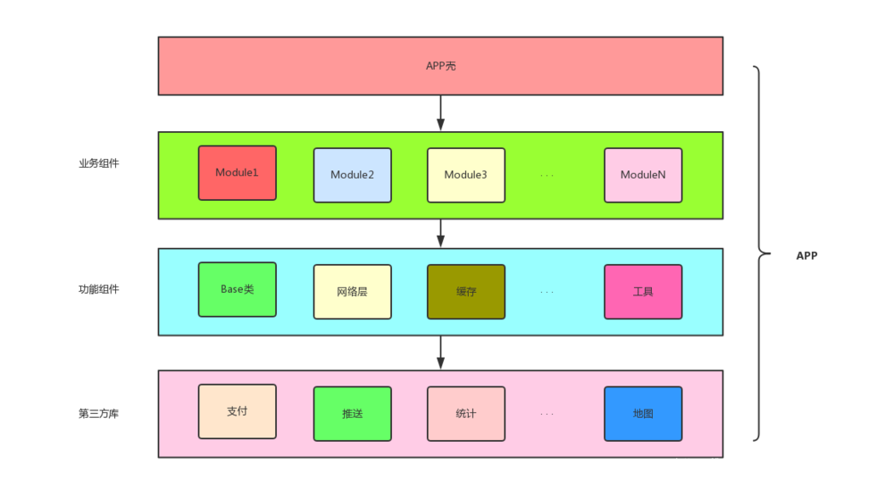
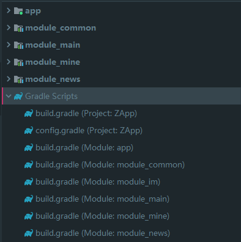

> 2025 更新：原文的 `com.android.support` / `support_v4` 已全部替换为 AndroidX；`config.gradle + ext` 的写法保留作历史对照，新项目请使用 Version Catalog + AGP 8.x。新增第 4 节「2025 年的组件化实践」和第 5 节「面试问答」。

## 1 简介

通俗来讲，将一个功能完整的 App 或模块拆分成多个子模块, 每个子模块可以独立编译和运行。也可以任意组合成另一个新的 App 或模块, 每个模块即不相互依赖但又可以相互交互, 遇到某些特殊情况甚至可以升级或者降级。

## 2 组件化架构

组件化架构通常如下图所示：



* App 壳：负责管理各个业务组件，和打包 apk，没有具体的业务功能；
* 业务组件： 根据具体业务而独立形成一个个单独工程，即可以单独打包成一个 apk，也可以变成组件的一部分；
* 功能组件（common）：支撑业务组件的基础，例如网络请求、数据管理等；
* 第三方库：包含第三方的库，微信、分享、推送、IM 等；

实际项目中应用类似如下结构：



* app：壳

* module_main：业务组件

* module_mine：业务组件，我的模块

* module_news：业务组件，新闻模块

* module_common：公共模块

* config.gradle：统一管理 SDK 和 依赖库。

  > 2025 更新：`ext + config.gradle` 是 2019 年前后的常见写法，现在仍能运行，但不再是推荐方案。原 `com.android.support` 已停止维护，下面的依赖示例已换成 AndroidX；新项目请直接看 2.1 的 Version Catalog。

  ```groovy
  //历史写法（仅对照；新项目不要再用 ext + config.gradle）
  //在 project -> build.gradle 中使用 apply from: "config.gradle"
  ext {
      /**
       * module 开关统一
       * true：module 作为 application，可单独打包为apk
       * false：module 作为 library，可作为宿主 application 的组件
       */
      isMineModule = false
      isNewsModule = false
      isMainModule = false

      //1.android开发版本配置
      build_version = [
              compileSdkVersion: 35,
              minSdkVersion    : 24,
              targetSdkVersion : 35
      ]

      //2.version配置
      versions = [
              android : '8.7.3',
              coreKtx : '1.15.0',
              appcompat: '1.7.0'
      ]

      //3.依赖库
      libs = [
              // 原 support_v4 已废弃：support 库停止维护，统一迁移到 AndroidX
              "core_ktx" : "androidx.core:core-ktx:${versions["coreKtx"]}",
              "appcompat": "androidx.appcompat:appcompat:${versions["appcompat"]}"
      ]
  }
  ```

  在业务组件的 gradle 中配置。

  > 2025 更新：`apply plugin` 的旧写法仍可用，但 AGP 8.x 更推荐 `plugins {}` + Version Catalog；下面保留原逻辑作对照，推荐写法见 2.1。

  ```groovy
  if (Boolean.valueOf(rootProject.ext.isMineModule)) {
      //作为独立App应用运行
      apply plugin: 'com.android.application'
  } else {
      //作为组件运行
      apply plugin: 'com.android.library'
  }
  apply plugin: 'kotlin-android'
  ...
  ```

  在 app 的 build.gradle 中配置。

  ```groovy
  //主模块
  implementation project(':module_main')
  //我的模块
  if (Boolean.valueOf(rootProject.ext.isMineModule)) {
       implementation project(':module_mine')
  }
   //新闻模块
  if (Boolean.valueOf(rootProject.ext.isNewsModule)) {
       implementation project(':module_news')
  }
  ```

  至此，组件化架构的搭建基本完成。

### 2.1 2025 推荐：AGP 8.x + Version Catalog

> 2025 更新：AGP 8.x 要求 Gradle 8.x、JDK 17，推荐用 `gradle/libs.versions.toml` 统一版本，用 `plugins {}` 和 `alias(...)` 代替 `apply plugin` 与 `ext`。下面是一个可直接套用的最小示例（版本号仅作示例，实际以 AGP/Kotlin 官方兼容矩阵为准）。

`gradle/libs.versions.toml`：

```toml
[versions]
agp = "8.7.3"
kotlin = "2.0.21"
ksp = "2.0.21-1.0.28"
hilt = "2.52"
compileSdk = "35"
minSdk = "24"
targetSdk = "35"
coreKtx = "1.15.0"
appcompat = "1.7.0"
material = "1.12.0"
navigation = "2.8.9"

[plugins]
android-application = { id = "com.android.application", version.ref = "agp" }
android-library = { id = "com.android.library", version.ref = "agp" }
android-dynamic-feature = { id = "com.android.dynamic-feature", version.ref = "agp" }
kotlin-android = { id = "org.jetbrains.kotlin.android", version.ref = "kotlin" }
ksp = { id = "com.google.devtools.ksp", version.ref = "ksp" }
hilt = { id = "com.google.dagger.hilt.android", version.ref = "hilt" }

[libraries]
androidx-core-ktx = { module = "androidx.core:core-ktx", version.ref = "coreKtx" }
androidx-appcompat = { module = "androidx.appcompat:appcompat", version.ref = "appcompat" }
material = { module = "com.google.android.material:material", version.ref = "material" }
androidx-navigation-fragment = { module = "androidx.navigation:navigation-fragment-ktx", version.ref = "navigation" }
hilt-android = { module = "com.google.dagger:hilt-android", version.ref = "hilt" }
hilt-compiler = { module = "com.google.dagger:hilt-compiler", version.ref = "hilt" }
```

根目录 `build.gradle.kts`：

```kotlin
plugins {
    alias(libs.plugins.android.application) apply false
    alias(libs.plugins.android.library) apply false
    alias(libs.plugins.android.dynamic.feature) apply false
    alias(libs.plugins.kotlin.android) apply false
    alias(libs.plugins.ksp) apply false
    alias(libs.plugins.hilt) apply false
}
```

`app/build.gradle.kts`：

```kotlin
plugins {
    alias(libs.plugins.android.application)
    alias(libs.plugins.kotlin.android)
    alias(libs.plugins.ksp)
    alias(libs.plugins.hilt)
}

android {
    namespace = "com.example.app"
    compileSdk = libs.versions.compileSdk.get().toInt()

    defaultConfig {
        applicationId = "com.example.app"
        minSdk = libs.versions.minSdk.get().toInt()
        targetSdk = libs.versions.targetSdk.get().toInt()
        versionCode = 1
        versionName = "1.0"
    }

    compileOptions {
        sourceCompatibility = JavaVersion.VERSION_17
        targetCompatibility = JavaVersion.VERSION_17
    }
    kotlinOptions {
        jvmTarget = "17"
    }
}

dependencies {
    implementation(project(":core:common"))
    implementation(project(":feature:mine"))
    implementation(libs.androidx.core.ktx)
    implementation(libs.androidx.appcompat)
}
```

`feature/mine/build.gradle.kts`：

```kotlin
plugins {
    alias(libs.plugins.android.library)
    alias(libs.plugins.kotlin.android)
    alias(libs.plugins.ksp)
    alias(libs.plugins.hilt)
}

android {
    namespace = "com.example.feature.mine"
    compileSdk = libs.versions.compileSdk.get().toInt()

    defaultConfig {
        minSdk = libs.versions.minSdk.get().toInt()
    }

    // 资源前缀，降低合并冲突
    resourcePrefix = "mine_"
}

dependencies {
    implementation(project(":core:common"))
    implementation(project(":core:domain"))
    implementation(libs.androidx.core.ktx)
    implementation(libs.hilt.android)
    ksp(libs.hilt.compiler)
}
```

> 2025 更新：如果还要保留「单模块可独立运行」的开关，不建议在每个模块里复制一整套 sourceSets。更干净的做法是单独建一个 `:app:mine-demo` 壳，或者只用属性控制插件：
>
> ```kotlin
> // gradle.properties: isMineModule=true
> val asApp = providers.gradleProperty("isMineModule").get().toBoolean()
> apply(plugin = if (asApp) "com.android.application" else "com.android.library")
> ```
>
> 该写法要求 Android 插件已在根项目声明但未应用，且同一模块不能同时应用 application 和 library 插件；复杂项目优先用 `build-logic` 里的 convention plugin 统一处理。

## 3 注意

### 3.1 Application

需要在 common 组件中创建 BaseAppliaction，提供全局唯一的 context，上层业务组件在组件化模式下，均需继承于 BaseAppliaction。

> 2025 更新：`BaseAppliaction` 拼写应为 `BaseApplication`。如果使用 Hilt，应用入口改为 `@HiltAndroidApp` 的 Application，不再靠手写单例持有 Context；业务模块通过依赖注入拿 `@ApplicationContext`，避免把 Application 当全局工具类。

### 3.2 applicationId管理

可为不同组件设置不同的 applicationId，也可以缺省，在 AS 中，默认的 applicationId 与包名一致。

组件的 applicationId 在其 build.gradle 文件的 defaultConfig 中进行配置。

```groovy
defaultConfig {
    if (Boolean.valueOf(rootProject.ext.isNewsModule)) {
        //组件模式下设置applicationId
        applicationId "com.miya.news"
    }
}
```

> 2025 更新：AGP 8.x 里 `namespace` 和 `applicationId` 是两件事：`namespace` 决定 R 类和 BuildConfig 的包名，`applicationId` 才是安装包的唯一标识。组件化下不要为了让模块独立运行而随意改 `namespace`，否则资源引用和路由表都会受影响。示例中的开关名也统一为前面定义的 `isNewsModule`。

### 3.3 manifest管理

组件在集成模式和组件化模式，需要配置不同的manifest文件。

```groovy
   /*
    * SourceSets 可以指定哪些源文件（或文件夹下的源文件）要被编译,哪些源文件要被排除。
    *
    */
    sourceSets {
        main {
            if (Boolean.valueOf(rootProject.ext.isNewsModule)) {//apk
                manifest.srcFile 'src/main/manifest/AndroidManifest.xml'
            } else {
                //在这个包下创建
                manifest.srcFile 'src/main/AndroidManifest.xml'
                java {
                    //library模式下，排除java/debug文件夹下的所有文件
                    exclude '*module'
                }
            }
        }
    }

```

> 2025 更新：AGP 8.x 要求模块在 `android { namespace = ... }` 中声明命名空间，不再从 manifest 的 `package` 属性推断；manifest 合并仍会保留 application/activity 的占位符能力，但 `package` 属性应移除。

### 3.4 资源名冲突问题

多人开发中，可以通过设置资源名前缀 resourcePrefix 以及约束资源名。在业务组件 build.gradle 配置。

```groovy
android {
    //统一资源前缀，规范资源引用
    resourcePrefix "mine_"
}
```

针对图片、字体、string 等资源，有一个方法是，新建一个 module_res 保存所有的资源文件。

> 2025 更新：资源前缀仍是有效手段；如果采用 Compose，字符串、颜色、尺寸建议继续放 `core:designsystem` 或各 feature 的 `res`，不要把所有资源都堆到一个巨型 `module_res`，否则该模块会成为新的编译瓶颈。

### 3.5 组件跳转

可以使用 ARouter 这种的路由第三方库。

> 2025 更新：ARouter 仍是存量项目常见方案，但新项目更推荐 Jetpack Navigation / Navigation Compose；取舍见 4.3。

### 3.6 混淆

#### 一：在 app 模块中管理所有的混淆规则

**优点**：所有混淆规则在app模块的`proguard-rule.pro`文件中统一管理

**缺点**：移除某些模块后，需手动移除 app 模块中的混淆规则。理论上混淆规则添加多了不会造成崩溃或者编译不通过，但是会影响编译效率

#### 二：组件模块管理各自的混淆规则

**优点**：将混淆文件解耦到每个模块中，并且不会影响编译效率。

> 2025 更新：AGP 8.x 默认使用 R8，library 模块应把需要保留的规则写进 `consumer-rules.pro`，由使用方自动合并；app 只保留全局规则。不要再把 `proguard-rule.pro` 当成唯一入口，文件名也建议统一为 `proguard-rules.pro`。

## 4 2025 年的组件化实践

### 4.1 模块分层：core / feature / app

> 2025 更新：今天更常见的不是「一个 common 打天下」，而是按职责分层，依赖方向严格单向。

```text
app                         // 壳：组装、导航、DI 聚合、打包
├─ core:common              // 通用工具、协程调度、Result 等，尽量无业务
├─ core:model               // 纯数据模型，无 Android 依赖
├─ core:domain              // 业务接口/UseCase，纯 Kotlin
├─ core:data                // Repository 实现、网络、数据库
├─ core:designsystem        // 主题、颜色、通用 Compose 组件
├─ core:navigation          // 路由契约/目的地定义
├─ feature:home             // 首页业务
└─ feature:mine             // 我的业务
```

规则：

- `feature:*` 只依赖 `core:*`，**feature 之间不互相依赖**；需要跳转时依赖路由契约，而不是对方的实现。
- `core:domain` 放接口和用例，`core:data` 放实现；`app` 负责把实现绑定到接口（Hilt `@Binds`）。
- `core:common` 不要变成「什么都往里塞」的垃圾桶，否则所有模块都被它拖慢、拖脏。
- 对外暴露的 API 用 `api`，纯内部实现用 `implementation`；尽量缩小模块的公开面。

接口下沉的典型写法：

```kotlin
// core:domain
interface MineRepository {
    suspend fun profile(): UserProfile
}

// core:data
class MineRepositoryImpl @Inject constructor(
    private val api: MineApi,
    private val dao: MineDao
) : MineRepository {
    override suspend fun profile(): UserProfile = api.profile().toDomain()
}
```

> 2025 更新：接口下沉不是「所有接口都放一个 common」，而是按业务边界放到 `core:domain` 或独立的 `feature-api`。接口过多、过细也会造成模块间隐形耦合，按真实调用方收敛即可。

### 4.2 接口下沉与依赖注入：Hilt

> 2025 更新：组件化后手动 new 对象会迅速失控，推荐 Hilt 统一管理依赖；它支持多模块，每个 feature 可以声明自己的绑定。

```kotlin
// app
@HiltAndroidApp
class App : Application()

// core:data 或 app 的 DI 模块
@Module
@InstallIn(SingletonComponent::class)
abstract class RepositoryModule {
    @Binds
    @Singleton
    abstract fun bindMineRepository(impl: MineRepositoryImpl): MineRepository
}

// feature
@AndroidEntryPoint
class MineFragment : Fragment() {
    private val viewModel: MineViewModel by viewModels()
}
```

要点：

- `@HiltAndroidApp` 只能有一个，放在 app 壳；`@AndroidEntryPoint` 放在 Activity/Fragment/View 等入口。
- 每个 feature 可以有 `@Module @InstallIn(...)`，最终由 Hilt 聚合；不要让 feature 自己建 Component。
- 新项目用 **KSP** 处理 Hilt/Room/Moshi，逐步替换 kapt；Hilt 对 KSP 的支持以所用版本文档为准。
- Hilt 不是「为了少写几行代码」：它把依赖方向显式化，配合接口下沉可以真正切断 feature 之间的实现依赖。

### 4.3 路由：ARouter 现状 vs Navigation / Compose Navigation

> 2025 更新：路由的选型要看「存量还是新项目」「View 还是 Compose」「是否需要跨模块强解耦」，不要默认上 ARouter。

**ARouter**

- 阿里开源的注解处理器方案，`@Route(path = "/mine/main")` + `ARouter.init()`，按 path 查找目的地，支持拦截器、降级。
- 存量项目多、Java/Kotlin 混编场景仍能用；但长期低维护，官方仍以注解处理器/kapt 为主，KSP 支持需要单独确认，AGP 8.x 升级时要重点回归。
- 路由表靠字符串维护，编译期无法校验 path 是否存在；跨模块跳转的「约定」容易腐化。

**Jetpack Navigation**

- 官方方案，管理 `NavHost`、返回栈、深链和参数；Navigation 2.8+ 支持 Kotlin Serialization 的类型安全路由。
- Navigation Compose 与 Compose 的状态模型一致；View 体系则用 `navigation-fragment-ktx`。
- 与 Hilt 集成好（`hiltViewModel()`），配合预测性返回手势更自然。
- 跨模块时把 route 契约放在 `core:navigation` 或各 feature 的 `api`，app 负责组装 `NavHost`；feature 仍不需要依赖另一个 feature。

**取舍建议**

| 场景 | 建议 |
| --- | --- |
| 新项目、Compose 为主 | Navigation Compose + 类型安全 route |
| 老项目、View 体系、模块很多 | Navigation Fragment；逐步替换 ARouter |
| 历史包袱重、ARouter 已深度使用 | 保留 ARouter，先补路由契约和回归测试，不强行迁移 |
| 需要编译期路径校验 | 类型安全 route；不要再新增字符串 path |

> 不管选哪个，**不要同时维护两套路由**；迁移时先让新页面走新路由，旧页面通过适配层过渡，最后删旧表。

### 4.4 动态特性（Dynamic Feature）

> 2025 更新：Dynamic Feature 适合「体积大、使用频率低、可延后安装」的功能，不是组件化的默认终点。

- 使用 `com.android.dynamic-feature` 插件，模块依赖 base app；必须通过 Android App Bundle + Play Feature Delivery 分发。
- 常见交付方式：`install-time`（安装时分发）、`on-demand`（按需下载）、`fast-follow`（安装后自动下载）。
- 代码侧用 Play Core 的 `SplitInstallManager` 请求安装，安装完成后再进入对应页面；要处理下载失败、存储不足、用户取消。
- 限制：主要面向 Play 分发，侧载 APK 无法验证完整动态交付；核心启动链路不要放动态模块，否则首启体验更差。

```kotlin
// feature/paid/build.gradle.kts
plugins {
    alias(libs.plugins.android.dynamic.feature)
    alias(libs.plugins.kotlin.android)
}

dependencies {
    implementation(project(":app"))
}
```

```xml
<!-- feature/paid/src/main/AndroidManifest.xml -->
<manifest xmlns:dist="http://schemas.android.com/apk/distribution">
    <dist:module dist:title="@string/feature_paid_title">
        <dist:delivery>
            <dist:on-demand />
        </dist:delivery>
    </dist:module>
</manifest>
```

### 4.5 构建速度：配置缓存、KSP、模块化并行编译

> 2025 更新：组件化做不好，模块越多越慢；构建优化要和模块边界一起设计。

- **配置缓存**：Gradle 8.x 开启 `org.gradle.configuration-cache=true`，避免每次构建重复执行配置阶段；不兼容的插件要尽快替换。
- **构建缓存 + 并行**：`org.gradle.caching=true`、`org.gradle.parallel=true`，让独立模块并行编译；`--max-workers` 按机器核数调整。
- **KSP 替代 kapt**：Room、Moshi、Hilt 等优先 KSP，kapt 的注解处理是 Kotlin 编译的额外一轮，模块多时开销明显。
- **convention plugin**：把 `compileSdk`、`compileOptions`、Compose、Hilt 等公共配置放到 `build-logic` 的 convention plugin，避免每个模块复制；`buildSrc` 改动会让整个构建失效，模块多时优先 included build。
- **控制模块数量**：模块不是越多越好，过度拆分会让配置、依赖解析和 DEX 合并变慢；按团队边界和复用价值拆分。
- **其他**：`android.nonTransitiveRClass=true` 缩小 R 类、Baseline Profile 改善启动、CI 缓存 Gradle 目录，都能叠加收益。

```properties
# gradle.properties
org.gradle.jvmargs=-Xmx4g -Dfile.encoding=UTF-8
org.gradle.parallel=true
org.gradle.caching=true
org.gradle.configuration-cache=true
android.nonTransitiveRClass=true
```

## 5 面试问答

### Q1：组件化和模块化有什么区别？

模块化是「按构建单元拆分」，关注编译隔离和依赖管理；组件化是在模块化基础上，让业务模块既能作为 library 集成，也能作为 application 独立运行/调试。组件化一定包含模块化，但模块化不一定要求每个模块都能独立跑。

### Q2：组件之间如何通信、如何解耦？

优先「接口下沉 + DI」：业务接口放 `core:domain` 或 `feature-api`，实现放 `core:data`/各 feature，app 用 Hilt 绑定；跳转走路由契约。EventBus 这类全局事件总线适合少量跨模块通知，不适合承载主业务流程，否则依赖关系会变得不可追踪。

### Q3：ARouter 的原理是什么？现在还推荐吗？

ARouter 用注解处理器扫描 `@Route`，生成路由表，运行时 `ARouter.init()` 把表加载到仓库，跳转时按 path 查找并注入参数；支持拦截器和降级。它适合存量项目，但长期低维护、path 是字符串、KSP 支持要确认。新项目优先 Jetpack Navigation，尤其是 Compose 项目。

### Q4：组件化后资源冲突和 Manifest 合并怎么处理？

资源用 `resourcePrefix` 和统一命名规范，尽量把通用资源放 `core:designsystem`；Manifest 依赖 Gradle 合并，注意 `application`/`activity` 的占位符、`tools:node` 和 exported 声明。AGP 8.x 还要把 `namespace` 从 manifest 的 `package` 迁移到 `android {}`。

### Q5：为什么 feature 之间不能互相依赖？

一旦 `feature:home` 依赖 `feature:mine`，两者就无法独立编译/调试，还会形成循环依赖，最终退化成「大单体 + 多个空模块」。正确做法是依赖 `core:domain` 的接口或 `core:navigation` 的路由契约，由 app 组装实现。

### Q6：什么时候该用 Dynamic Feature？

功能体积大、使用频率低、可以延后下载时（例如高清素材编辑、离线课程包）才值得用；它依赖 App Bundle 和 Play 分发，调试和灰度成本更高。核心页面、首启链路、频繁使用的功能不要动态化，普通模块化 + 功能开关通常更划算。
